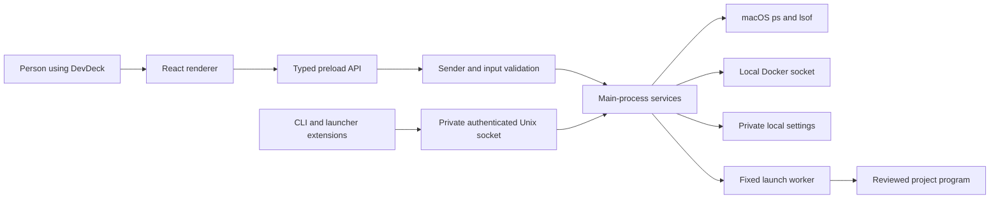

# DevDeck codebase audit and plain-language guide

Reviewed: **23 October 2026**. Product version: **1.0.0**. Implementation baseline: `6c34e69`,
plus the publication changes described below. This is a source walkthrough and local verification
record, not a certificate that the program has no bugs or a signed release has been approved.

## Contents

1. [How to read this guide](#1-how-to-read-this-guide)
2. [What the app does](#2-what-the-app-does)
3. [Architecture and folder map](#3-architecture-and-folder-map)
4. [Startup and shutdown](#4-startup-and-shutdown)
5. [Finding processes, projects and ports](#5-finding-processes-projects-and-ports)
6. [Stopping and controlling processes safely](#6-stopping-and-controlling-processes-safely)
7. [Profiles, repository approval and captured output](#7-profiles-repository-approval-and-captured-output)
8. [Docker behavior](#8-docker-behavior)
9. [Settings, files, privacy and network access](#9-settings-files-privacy-and-network-access)
10. [UI behavior and accessibility](#10-ui-behavior-and-accessibility)
11. [CLI, focus links and launcher extensions](#11-cli-focus-links-and-launcher-extensions)
12. [Function reference](#12-function-reference)
13. [Types and IPC reference](#13-types-and-ipc-reference)
14. [Tests and verified results](#14-tests-and-verified-results)
15. [Development, builds and releases](#15-development-builds-and-releases)
16. [Findings, limitations and maintenance](#16-findings-limitations-and-maintenance)
17. [GitHub consolidation and publication hygiene](#17-github-consolidation-and-publication-hygiene)
18. [Small glossary](#18-small-glossary)

## 1. How to read this guide

For a first read, follow sections 2–11. They explain what happens when someone uses the app.
For a specific change, use the folder map, then find its function in section 12. Section 13 connects
screen actions to their privileged handlers. Sections 14–17 explain what was checked and what still
needs a real release or another machine.

The function reference inventories **every named implementation function, class method, named React
callback and preload API wrapper** in the 91 JavaScript/TypeScript implementation files under `src/`,
`cli/`, `extensions/` and `packaging/`. It includes private helpers and legacy paths. Declarations in
`.d.ts` files describe types and do not execute. Test callbacks belong to the test map, not the app.
Anonymous array callbacks, event callbacks and effect cleanup functions are described with their
owning operation; the inline callback index also links each of them to its source location. These
are not separate user features. Links refer to this reviewed source and line positions can move.

A function receives inputs, does one piece of work, and may return a result. `async` means it may wait
for the operating system or Docker. `Result` means either success with data, or failure with a safe
error message. “Main” means the privileged background part of Electron. “Renderer” means the screen.

## 2. What the app does

DevDeck is a macOS menu-bar and windowed app for developers. It finds local development programs,
shows their ports and resource use, groups them by project, and provides controlled stop/restart
operations. It also works with containers through a local Docker socket.

| Area | What a person can do | Important boundary |
|---|---|---|
| Processes | Search, sort, filter, inspect trees/details, find port owners, open local URLs and project tools | Only allowed current-user processes can be controlled |
| Docker | View containers, inspect details, stream logs/stats, start/stop/restart stacks, open a shell, remove a stopped container | Uses the accessible local Docker daemon; no volume-removal request |
| Profiles | Save named process/container members and start, stop or restart a stack | Commands are explicitly reviewed; partial results are reported per member |
| Captured output | Start a process and inspect its output | Captures only launches made through DevDeck, while the app remains running |
| History | Review recent stopped processes and resource samples | Restart is best effort; logs/resource history are memory-only |
| Settings | Change theme, refresh interval, allow/ignore lists, shortcuts, notification and Docker preferences | Environment viewing and stopped-history persistence are opt-in |
| Sharing | Preview a masked snapshot or diagnostics, then copy | No automatic upload; commands are excluded from exports |
| Integrations | Use a local CLI, focus links, Raycast or Alfred | Focus links cannot execute actions; CLI stops normally ask for confirmation |

P0–P3 of [the missing-features spec](../features/missing-features.md) are implemented locally.
P4 consists of the requested [future design notes](future/), without runtime Kubernetes, remote,
mobile, devcontainer or cleanup integrations.

## 3. Architecture and folder map

The screen cannot directly run a system command. It asks through a small bridge. Main checks the
request before talking to macOS, reading files or using Docker.



| Location | Responsibility | Start here when… |
|---|---|---|
| `src/main/index.ts` | App lifecycle, single instance, window, tray, focus, cleanup | The app will not start, show, hide or quit correctly |
| `src/main/ipc.ts` | Privileged request routing and final action checks | A screen request fails or a new API is needed |
| `src/main/launch-worker.ts` | Independent program launch and initial identity proof | A launched server cannot be recognized after handoff |
| `src/main/providers/process.darwin.ts` | Current-user process and open-file scans | A process or port is missing or mislabeled |
| `src/main/security/` | Executable scope, exact-page checks and input validation | A boundary or refusal rule must change |
| `src/main/services/` | Docker, profiles, settings, notifications and other main-side work | Business behavior needs changing |
| `src/preload/` | Fixed `window.api` bridge and renderer type declarations | Connecting an approved IPC method to React |
| `src/renderer/src/main.tsx` | React root | Following browser-side startup |
| `src/renderer/src/App.tsx` | Screen selection, filters, confirmations and action results | Following a user action across components |
| `src/renderer/src/components/` | Individual screens, rows, forms and dialogs | Changing visible layout or interaction |
| `src/renderer/src/hooks/` | Reusable polling, state, focus and visibility behavior | Investigating refreshes, streams or keyboard focus |
| `src/renderer/src/styles/` and `assets/main.css` | Tokens, layout, states, theme and resets | Changing appearance or responsive behavior |
| `src/shared/` | Types and pure parsers/validators used across boundaries | A data shape or shared rule needs changing |
| `cli/devdeck.cjs` | Terminal client for the running app | A CLI command fails |
| `extensions/` | Raycast command and Alfred scripts/workflow definition | A launcher integration fails |
| `tests/unit/` | Focused parsing, safety and service checks | Adding a small regression test |
| `tests/integration/` | Real disposable process tests and opt-in Docker test | Checking OS behavior rather than just pure logic |
| `e2e/` | Isolated Electron test entry and user-flow tests | Checking the actual renderer/bridge together |
| `resources/` | App and menu-bar image assets | Replacing icons |
| `packaging/` | Release validation, entitlements and cask template | Preparing distribution |
| `.github/workflows/` | CI and draft-only signed-release workflow | Investigating GitHub checks or release automation |
| `docs/`, `features/`, root Markdown | Architecture, contracts, design and acceptance evidence | Understanding intent and current limitations |

### Important configuration files

`package.json` defines dependencies and commands; the lockfile pins exact installed versions.
`electron.vite.config.ts` builds two main entries (app and launch worker), preload and React.
`electron-builder.yml` defines app identity, files, external CLI, fuses and macOS targets.
`tsconfig*.json` separates main/shared and renderer type checking. `eslint.config.mjs` defines source
linting. `playwright.config.ts` runs Electron scenarios with one worker. `.gitignore` prevents local
outputs, certificates, editor noise and agent notes from being committed. Formatting/editor files
keep contributions consistent. `labels.json` is data for friendly process names; the JSON schema
under `docs/schemas/` documents repository config and is not an executable script.

## 4. Startup and shutdown

1. Electron loads `out/main/index.js`, built from `src/main/index.ts`.
2. A single-instance lock prevents independent copies competing for the same app state. A second
   invocation focuses the existing window and can pass a validated focus link.
3. Settings and saved window position are loaded. Corrupt data falls back to defaults; recovery
   diagnostics do not print caught parser errors or command text.
4. Main registers only known IPC handlers, starts the private CLI connection, and creates a sandboxed
   window. The window disables Node integration, isolates preload, blocks navigation/new windows and
   denies permission requests. Development loads the Vite renderer; packaged execution loads files.
5. React mounts `App`. Hooks request settings, processes and containers through `window.api`.
6. The app installs the tray, global shortcut and notification-focus callbacks. Installed packages
   also schedule an update check; downloading and restarting still require consent.
7. Focus requests are buffered in main/preload until the screen can receive them.
8. Hiding the window pauses renderer polling and closes visible-container stats. Closing it also
   closes Docker log streams. On macOS the menu-bar app can stay alive after its window closes.
9. On quit, main removes the tray/shortcut, stops CLI/socket resources, closes launch-output receivers
   and stops Docker connections. Window position is saved with debouncing.

## 5. Finding processes, projects and ports

### From macOS to a table row

The Darwin provider reads the current user's process list using `ps`. It collects process IDs,
parent/group IDs, start time, command, state, CPU, memory and elapsed time. One batched `lsof` call
collects working directories, open-file counts and sockets. It does not start one `lsof` per row.
Renderer hooks guard their own in-flight requests. `scan()` does not share a global pending promise,
so separate consumers can still start separate scans.

The allowlist excludes other users, root/system scope, ignored programs, unapproved app-bundle
executables and DevDeck's parent/descendant tree. Optional read-only rows are synthesized from
accessible socket records; they cannot authorize stop or environment inspection. Zombies are
read-only. Expanded development-tool matching distinguishes specific tunnels from generic SSH,
Kubernetes or VPN processes.

A project's working directory is walked toward a recognized project marker. Friendly labels inspect
command patterns and bounded package-script metadata. Git and declared runtime hints are additional
context, not commands executed from the project. Git status uses fixed arguments, disabled hooks and
fsmonitor, a timeout and bounded output. Context is cached for ten seconds.

`readMetadata()` opens only a bounded regular file, refuses unsafe symbolic-link resolution and uses
nonblocking/no-follow flags. A FIFO, device or unexpectedly large metadata file cannot become an
unbounded project-file read. A runtime version file is treated as text; its contents are not run.

### Ports and network visibility

A port is a numbered listening endpoint, such as 3000. The socket parser distinguishes TCP/UDP,
IPv4/IPv6, listening/bound sockets and established connections. Browser links are limited to local
HTTP URLs on localhost or 127.0.0.1 with a valid explicit port; HTTPS is not accepted by this action.
UDP ports have no HTTP action. Loopback addresses are local. Wildcard or other
non-loopback listeners receive a network-visibility explanation. This is a bind-address assessment,
not proof that a firewall permits access from another machine.

Port lookup explains whether the owner is in this project, another project, Docker, a tunnel or
read-only. A port reservation is a remembered expectation; it does not reserve an OS socket or stop
an unexpected owner. Conflict notices are deduplicated and lead back to review.

Resource totals and sorting operate on the current list. Hints about idle/leftover processes are
advisory. High-resource use means at least 50% CPU or 512 MB for the filter; notification settings
have their own validated limits. None of these hints automatically stops a program.

## 6. Stopping and controlling processes safely

A PID is only a reusable number. DevDeck therefore captures **PID + start time + full observed command**.
If any of these change, the old confirmation must not authorize a signal to the new process.

For ordinary window stops, React opens `ConfirmDialog` with Cancel initially focused and captures
the selected identities. Main validates sender/input, recomputes eligible current targets and
intersects them with the captured selection. It does not accept an arbitrary shell command.

`terminate()` revalidates before each signal, sends SIGTERM, waits three seconds, checks survivors,
and sends SIGKILL only to a survivor with the same verified identity. It reports normal stops,
forced stops, refusals and still-running programs separately. The current-user, allowlist, ignore
and self-tree rules remain in force at revalidation time.

Tray stops use a native confirmation; CLI, profile and destructive extra-signal flows also use
native review at their relevant entry point. Do not assume every route uses the same dialog class.
Tree stops work children first on captured eligible descendants. Newly appearing descendants are
excluded. Process-group operations check current membership and signal individual verified PIDs;
they never send a signal to a negative group ID. Pause/resume/reload do not silently force-stop.

Successfully stopped programs can be remembered for Undo/history. Undo uses the independent launcher,
not an exemption that allows killing DevDeck helpers. A restart is a new process; its old PID is not
reused as an authority. Normal process-table command text cannot perfectly reconstruct every program's
original argument vector or environment, so generic restart is best effort.

## 7. Profiles, repository approval and captured output

### Saved profiles

A profile has an ID, display name and named members. A member is either a process command with an
absolute project folder, or a container ID. Expected ports are optional. Validators limit the number
of profiles/members and reject extra fields, mixed member types, invalid ports and duplicate names.
The form gives specific errors and masks commands. Drafts survive tab switches; reveal state does not.

`profileAction()` collects current membership, shows exact commands/paths for review, checks imported
source approval again and performs each member independently. One failed member does not erase the
others' results. Restart does not launch a replacement after a failed/refused stop.

Successful launch identities are saved with a hash of that member's folder and configured command.
An edited profile cannot adopt a stale saved identity from a different command. Membership can also
match configured command/folder or explicitly configured expected ports. This is a local development
convenience, not a security boundary between two projects owned by the same user.

### `.devdeck.json`

The repository file describes commands; it is not trusted automatically. Its schema accepts version
1, bounded name/start/expected-port fields and relative member folders inside the real project root.
Unknown fields, traversal, oversized/nonregular files and escaping symlinks are refused.

Import presents exact commands and folders in a native Cancel-default dialog. Approval binds the
canonical root and exact file bytes with SHA-256. The file is read again after review. A later change
requires approval again before start/restart. Renderer settings cannot forge approvals or saved launch
identity records. Repository-wide expected ports are not copied onto every member, which would make
one process look like all members.

Approval covers the reviewed configuration, not the immutability of all source files the approved
program might execute. Only approve trusted repository commands. Approved programs run as your user.

### Independent launch and identity handoff

Main resolves an allowed executable, validates a real marked project directory and parses arguments.
It invokes a fixed bundled utility worker. The worker uses `spawn` with `shell:false`, a detached child
and argument array; it does not evaluate renderer-supplied script text. Shell substitution/pipeline
syntax is unsupported by the strict command parser. Known package-manager/rustup shims are treated
explicitly rather than granting arbitrary executable aliases.

Before exiting, the worker reads a snapshot of its still-live direct child, including parent ID.
Main briefly retries normal identity validation until the child is outside DevDeck's protected tree.
It adopts only the exact start-time/command snapshot. A changed/reused PID is refused. No signal is
sent during this handoff. If identity cannot be captured/saved, the launched process is reported with
a warning rather than falsely claiming a persisted restart identity.

### Captured output and history

Each launch has an opaque ID and an authenticated private output socket. Tokens, directory and socket
permissions limit the receiver to this local user/session. Output is decoded incrementally, kept in
memory, and exposed only by known launch ID. There is no arbitrary “attach to any PID's terminal”.

A ring keeps at most 5,000 completed lines / about 2 MiB per launch, clips long lines/partials, and
launch rings share a 32 MiB budget. There are at most 200 launch records per app session. Known secret
patterns are redacted when reading captured launch logs. Raw output is still present in bounded
memory before redaction; the matcher cannot recognize every possible secret. It never guarantees
that arbitrary application output is safe to share.

Keep the menu-bar app running for capture. Quitting discards buffers and closes receivers. A quiet
server can survive quitting, as tested; a program that continues writing may respond to a closed
output stream by exiting. Restart recognition and continued log capture are different capabilities.
Resource history is also memory-only: up to one hour / 1,800 samples per project and 500 projects.
Threshold notifications happen on crossings, without extra OS polling or automatic stops.

## 8. Docker behavior

Socket discovery checks a validated custom override and known local provider sockets, including
Docker Desktop, OrbStack and Colima. Missing socket, invalid override, permissions and an unavailable
daemon produce different recoverable states. No TCP/remote daemon setup is implemented.

`DockerService` owns its dockerode client, event/log streams and stats service. Socket changes close
old connections, and stale event callbacks cannot attach to a replacement client. Container summaries
are normalized into the shared `Container` type. Compose labels provide project/service/dependency
information; stack actions use deterministic dependency order and per-container results.

Container removal inspects the current state, normally stops a running target if necessary, and
then calls Docker with `force:false, v:false`. It does not request force-removal or volume removal. Docker's own daemon access is powerful: anyone able to use that
socket can manage the containers that daemon exposes; this is not per-project container ownership.

Docker log streams are batched to the renderer; the viewer retains at most 2,000 lines. Individual
line size and the main process pending batch do not have a byte cap. These show original service output;
they do not use the captured-launch log redactor. Container inspection includes potentially sensitive
environment/mount/network data only in memory, with environment reveal controls. Close the panel to
reset disclosure. Take care when copying service logs yourself.

Stats run only for visible running rows. Main caps subscriptions, handles an opening stream being
cancelled, emits at most once a second per container, and closes streams on hide, close or provider
change. CPU calculation uses deltas; memory subtracts cache; network values are cumulative RX/TX.

Interactive shell verifies the target is running, resolves fixed Docker CLI paths, probes bash and
falls back to sh. It writes a temporary private JSON argument file and a static Ruby `.command`
bridge, then opens the selected detected terminal. Variable values remain data passed to
`Process.spawn`, not interpolated shell source. Missing CLI, Ruby or terminal is a recoverable error.
The bridge cleans up on exit; a ten-minute fallback also removes its temporary directory. Actual
provider and terminal acceptance still needs the external test matrix.

## 9. Settings, files, privacy and network access

| Data | Where / lifetime | Protection and caveat |
|---|---|---|
| Preferences, profiles, approvals, launch identities, reservations, thresholds | `settings.json` under Electron userData | Atomic replacement and mode 0600; **plaintext**, including saved command text |
| Optional stopped-process history | `recently_stopped.enc` under userData | Opt-in Electron safeStorage encryption; no plaintext fallback when unavailable |
| Window position | Window-state JSON under userData | Local layout metadata, not a command store |
| CLI connection descriptor | `cli.json` under userData, current app session | Mode 0600, fresh token; removed on normal quit |
| CLI socket | Random temporary directory | Directory 0700, socket 0600, authenticated bounded requests |
| Launch output socket | Random temporary directory / open connection | Directory 0700, socket 0600, per-launch token; no log file |
| Captured logs, Docker inspection, resource samples, environment values | Memory | Bounded/ephemeral; closing/quitting has the lifetime rules described above |
| Container terminal bridge | Temporary private directory | Static bridge plus JSON arguments; cleanup on completion/fallback |
| Build outputs and QA captures | Local ignored `out/`, `release/`, test output folders | Not source or publication input |

Mode 0600 means only the owning user can read/write through normal Unix permissions. It is not
encryption and does not defend against malware already running as that user. CLI tokens share that
same trust boundary. Error diagnostics must not print parsed command text; the publication pass fixed
raw caught-error logging on settings/history recovery and added regression assertions.

Environment viewing defaults off. When enabled, main verifies identity before and after a bounded
`ps eww` read. Values are parsed best effort, shown masked, and not persisted. Spaces make this OS
text format ambiguous; it must never be used as an executable argument or restart authority.

The app has no accounts, telemetry or cloud sync. Core process/Docker work is local. Installed-package
update checks contact the configured GitHub release feed; explicit local URL actions open your browser.
Do not read “local-only” as a claim that the updater never accesses the internet. Dependency install,
GitHub CI and Git operations are development/publishing activities, not runtime telemetry.

Exports are constructed from allowed fields rather than dumping internal objects. They omit command
arguments, environment, working directories, mounts and socket paths. Project/container labels may
still identify your work, so the exact text is previewed before explicit clipboard copy.

## 10. UI behavior and accessibility

The design is a quiet instrument panel: system fonts, monospace machine values, hairline separation,
one focus/running accent and text alongside status colors. `tokens.css` defines light/dark colors;
`components.css` implements the layouts and interaction states. The root CSS supplies resets and
scrollbars. `DESIGN.md` records the implemented design rules.

- Processes keeps port lookup and resource sorting accessible; less common filters are in Filters
  with a count/reset. A filtered empty state offers Clear filters rather than saying nothing exists.
- Docker rows keep Details, Logs and lifecycle controls prominent. More collects less frequent
  actions. Project headings show running counts and stack controls.
- Profiles has no misleading Docker search/bulk action. A structured form replaces raw JSON editing.
  Busy operations prevent duplicate submissions; action failures survive background refresh.
- Settings has General, Processes, Notifications and Docker sections. Invalid thresholds return to
  their saved value with an explanation; failed saves do not claim Saved.
- Dialogs have names, initial Cancel/Close focus, Tab containment, Escape and focus restoration.
  Busy destructive work prevents dismissal. The shortcut recorder lets Tab/Escape leave the field.
- Arrow keys move among process rows, Enter opens details and Delete opens confirmation. Shortcuts
  do not hijack typing fields. Notification focus clears conflicting filters and selects an exact PID.
- Lists above 200 rows use measured windowing: only nearby rows are rendered, with spacer height
  preserving scrolling. Expanded details are measured, and project controls are retained.
- Long paths wrap inside bounded detail grids. At 200% zoom the shell/list can scroll and the tested
  target Stop button is actually in the viewport. Wide table sections can still need local scrolling.
- Loading has visible status with static indicators. Polling does not animate rows. Reduced-motion
  media disables transitions. Toast timers pause while focused/busy, and expired Undo is disabled.

Local Electron keyboard/media/zoom checks and visual theme review pass. Supporting muted text was
measured against background/surface in both themes with a minimum ratio of 4.97:1. A full VoiceOver
and real system-setting acceptance pass remains pending; source review is not a substitute for it.

## 11. CLI, focus links and launcher extensions

`devdeck ls`, `port`, `stop` and `logs` talk to the already running menu-bar app. The client reads the
private connection descriptor, authenticates on a Unix socket, and bounds the reply. Main validates
command/argument shape, uses constant-time token comparison, limits request size/connections/time,
and routes to the same process services. No TCP listener is created.

`stop 3000` chooses a matching listening port first, then a PID if no port matches. Use `pid:123` or
`port:3000` for certainty. A native Cancel-default review is shown unless the caller explicitly uses
`--yes`. That flag skips the dialog, not ownership/allowlist/identity checks. Listing hides arguments;
logs must identify exactly one known DevDeck launch. CLI output strips terminal control sequences so
project names/output cannot issue terminal escape commands through the client.

`devdeck://port/3000` and `devdeck://project/<encoded-name>` only show/focus/filter the app. The parser
rejects action hosts, credentials, queries, fragments and malformed ports. The installed app registers
the scheme. Source-mode registration and launcher-host imports are separate setup concerns.

The Raycast extension invokes the CLI with an argument array, renders its results and provides focus,
localhost and confirmed-stop actions. Alfred's list script produces Script Filter JSON; its action
script opens a validated localhost URL or asks the CLI to stop the chosen target. Their own README
files explain paths/installation. Build/plist checks have passed locally; interactive import/use in
those applications remains a manual acceptance item.

## 12. Function reference

The following catalog follows source folders. Inputs are the function's parameter names (`props`
means a React component's properties). The explanation states its role and return/effect. Nested
helpers retain the owning function/class in their name so similarly named actions are distinguishable.
Source links point to the exact reviewed declaration. The anonymous callback index follows the named
catalog; it groups small callbacks with their owner rather than pretending they are independent APIs.

### `src/main/index.ts`

Starts and shuts down the Electron application, creates its protected window, connects tray and shortcut actions, and routes focus links. It also starts the local CLI server and closes output and Docker streams on quit.

| Function / source | Inputs | Explanation |
|---|---|---|
| [focusLink](../src/main/index.ts#L29) | `input` | Accepts a DevDeck URL and parses it into a focus target. Valid links show the window and notify the renderer, or remain queued until the window loads; invalid links do nothing. |
| [handleStopAllFromTray](../src/main/index.ts#L51) | None | Lists currently manageable processes, asks for native Cancel-default confirmation, and stops only the captured targets through the normal identity checks. It records successful stops, presents the result, updates the tray count, and sends a refresh event; unexpected failures use a fixed log message. |
| [createWindow](../src/main/index.ts#L106) | None | Creates the main BrowserWindow using saved bounds, sandboxing, context isolation, and a fixed preload. It loads the development page or packaged HTML, blocks navigation and permissions, delivers pending focus requests, and attaches window and stream cleanup. |

### `src/main/ipc.ts`

Defines the renderer-to-main request boundary and connects validated requests to process, Docker, settings, profile, launch, export, and history services. Inline handlers contain much of the application routing; the named wrappers enforce shared sender and input checks.

| Function / source | Inputs | Explanation |
|---|---|---|
| [isSenderAuthorized](../src/main/ipc.ts#L38) | `event` | Checks that a request came from an existing application window, its main frame, and the exact expected development or packaged page. Returns false for other pages, lookalike URLs, or subframes. |
| [registerIpcHandlers](../src/main/ipc.ts#L49) | None | Registers the fixed IPC channel set and initializes optional stopped-history loading. Its handlers recompute privileged targets, call the appropriate services, and return structured results rather than exposing operating-system errors. |
| [registerIpcHandlers.handle](../src/main/ipc.ts#L50) | `channel`, `handler` | Registers a handler behind common sender authorization and per-channel argument validation. It rejects malformed requests before dispatch and replaces unexpected failures or INTERNAL messages with a fixed safe response. |
| [registerIpcHandlers.revalidate](../src/main/ipc.ts#L368) | `pids` | Rechecks requested PIDs through the normal process safety validator, then restricts accepted results to the previously computed project or tree scope. PIDs outside that captured scope are included in the refusal list. |
| [registerIpcHandlers.revalidate](../src/main/ipc.ts#L486) | `pids` | Rechecks requested PIDs through the normal process safety validator and retains only processes still belonging to the captured process group. Members that moved to another group are refused before a signal. |
| [registerIpcHandlers.visible](../src/main/ipc.ts#L542) | None | Looks up the request sender’s BrowserWindow and returns true only while it exists and is visible. Docker stats use this callback to stop delivering samples or opening streams for a hidden window. |

### `src/main/launch-worker.ts`

Runs as a fixed bundled utility process. It authenticates to a private output socket, spawns the approved executable with an argument array, captures proof that the process is its live direct child, reports that identity, and exits so the server can leave DevDeck’s protected process tree.

No named runtime functions are declared in this module. Its initialization, declarations or inline callbacks are covered by the module explanation and index below.

### `src/main/providers/process.darwin.ts`

Reads the current user’s process table and one batched open-file/socket listing on macOS. It applies the executable safety rules, then adds project names, labels, ports, connection counts, state, and optional read-only port owners.

| Function / source | Inputs | Explanation |
|---|---|---|
| [parseEtime](../src/main/providers/process.darwin.ts#L25) | `etime` | Converts macOS ps elapsed-time text, including day prefixes, into seconds. Empty or unparseable numeric pieces fall back to zero. |
| [DarwinProcessProvider.constructor](../src/main/providers/process.darwin.ts#L63) | `self` | Accepts the application PID and parent PID used for self-tree protection, defaulting to the current process. Each provider also remembers previous parent relationships for leftover-process hints. |
| [DarwinProcessProvider.getRawProcesses](../src/main/providers/process.darwin.ts#L68) | None | Runs a bounded, timed ps query for the current user and parses identity, parent/group IDs, status, resource use, and command text. It returns no processes for root and propagates command failures to the caller. |
| [DarwinProcessProvider.getOpenFiles](../src/main/providers/process.darwin.ts#L106) | None | Runs one timed, bounded lsof query and parses working directories, sockets, and file counts. If lsof exits unsuccessfully, it still parses any partial stdout instead of discarding accessible records. |
| [DarwinProcessProvider.listProcesses](../src/main/providers/process.darwin.ts#L121) | `options` | Accepts visibility and allowlist options and returns the enriched process rows produced by a full scan. It does not signal or change processes. |
| [DarwinProcessProvider.lookupPort](../src/main/providers/process.darwin.ts#L125) | `port`, `options` | Scans current processes and listening or bound sockets, then selects owners of the requested port. Each owner is associated with a manageable process row when available; protected owners remain read-only. |
| [DarwinProcessProvider.scan](../src/main/providers/process.darwin.ts#L134) | `options` | Collects current-user processes, computes the protected application tree, and filters executable commands against current allowlist and ignore settings. It joins one lsof snapshot to produce sorted rows with project, socket, resource, tunnel, and leftover information, optionally adding read-only owners. |

### `src/main/security/allowlist.ts`

Centralizes executable-name extraction and the rules deciding whether a process is within DevDeck’s manageable scope. It also computes the application’s protected parent and descendant PIDs.

| Function / source | Inputs | Explanation |
|---|---|---|
| [extractBinaryName](../src/main/security/allowlist.ts#L67) | `command` | Extracts the executable path and lowercase basename from a command string, including quoted paths and common unquoted application-bundle paths. Empty commands return empty values; arguments are not executed. |
| [isProcessAllowed](../src/main/security/allowlist.ts#L105) | `pid`, `command`, `options` | Checks a PID and command against protected PIDs, application identity, user ignores, application-bundle restrictions, and default or custom executable coverage. Returns an allowed flag and a refusal reason; ownership is verified separately by the process-reading callers. |
| [protectedProcessTree](../src/main/security/allowlist.ts#L166) | `processes`, `self` | Walks parent relationships downward from DevDeck to collect its complete descendant set, then adds DevDeck’s immediate parent. It returns protected PIDs without treating unrelated siblings as descendants. |

### `src/main/security/launchExecutable.ts`

Checks resolved launch executables and known package-manager shims, and validates the worker’s first process identity snapshot. These helpers prevent an approved-looking alias or reused PID from silently becoming launch authority.

| Function / source | Inputs | Explanation |
|---|---|---|
| [safeResolvedExecutable](../src/main/security/launchExecutable.ts#L11) | `candidate`, `real`, `args`, `settings` | Receives the requested executable path, its resolved real path, argument array, and settings. It allows a normal safe executable or a small known shim mapping, while retaining ignore-list and application-bundle restrictions. |
| [spawnedIdentity](../src/main/security/launchExecutable.ts#L33) | `output`, `workerPid`, `child` | Parses the worker’s ps output only while the spawned ChildProcess still has a valid PID and no recorded exit or signal. It requires the observed parent PID to be the worker and a bounded command, then returns PID/start-time/command; otherwise it returns undefined. |

### `src/main/security/validate.ts`

Contains strict per-channel renderer request validation and exact-page matching. It checks shapes, unknown fields, limits, IDs, paths, settings, and action names before any IPC handler performs privileged work.

| Function / source | Inputs | Explanation |
|---|---|---|
| [isExpectedPage](../src/main/security/validate.ts#L8) | `actual`, `expected` | Compares the actual page URL with the exact expected URL. Missing URLs and prefix or origin lookalikes are rejected. |
| [object](../src/main/security/validate.ts#L12) | `value` | Returns true only for a non-null object that is not an array. Other validators use it before examining object fields. |
| [keys](../src/main/security/validate.ts#L15) | `value`, `expected` | Checks that an object has exactly the requested set of field names, with order ignored. Extra or missing fields cause rejection. |
| [validSettings](../src/main/security/validate.ts#L18) | `value` | Checks each proposed renderer settings field against its permitted type and bounds. Unknown fields, including main-owned approval and launch-identity data, are rejected. |
| [validIpcInput](../src/main/security/validate.ts#L84) | `channel`, `value` | Validates the payload for one fixed IPC channel, including no-input channels and strict process identities, container IDs, profiles, ports, paths, and actions. Unknown channels or malformed, excessive, or extra fields return false. |

### `src/main/services/applications.ts`

Detects supported local editors and terminals, verifies project roots against active roots, and builds fixed argument arrays for opening them. It never constructs a shell command from a renderer path.

| Function / source | Inputs | Explanation |
|---|---|---|
| [detectApplications](../src/main/services/applications.ts#L23) | None | Searches fixed system and user Applications locations and selected editor CLI locations. Returns detected supported applications with IDs, paths, kinds, and CLI flags; missing candidates are simply omitted. |
| [verifyProjectPath](../src/main/services/applications.ts#L55) | `requested`, `activeRoots` | Resolves an absolute requested path and checks it against the real paths of authorized active project roots. It returns a canonical directory only when a project marker exists, and null for invalid, missing, or unverified paths. |
| [applicationInvocation](../src/main/services/applications.ts#L75) | `app`, `root` | Builds the executable and argument array for opening a verified project in the selected application. It handles CLI editors, Ghostty, and Warp specially and otherwise uses the fixed system open executable. |
| [openWithApplication](../src/main/services/applications.ts#L92) | `app`, `root` | Runs the fixed invocation for a detected application and verified root with a timeout and bounded output. Failures reject so the IPC wrapper can return a safe error. |

### `src/main/services/cliCommands.ts`

Implements authenticated CLI commands inside the running application. It exposes masked process lists and captured logs, and routes stop requests through current-target discovery, optional native confirmation, and ordinary process identity guards.

| Function / source | Inputs | Explanation |
|---|---|---|
| [cliCommand](../src/main/services/cliCommands.ts#L11) | `request` | Accepts an already validated CLI request and returns a structured list, port lookup, captured log result, or stop report. Stops resolve current manageable targets, require native confirmation unless yes was explicit, serialize concurrent CLI stops, and record successful stops without bypassing per-signal checks. |

### `src/main/services/cliServer.ts`

Hosts the local CLI transport in a private temporary Unix-socket directory. It authenticates bounded JSON requests with a random token, dispatches only valid commands, and writes private connection credentials into the application data directory.

| Function / source | Inputs | Explanation |
|---|---|---|
| [validCliRequest](../src/main/services/cliServer.ts#L10) | `value` | Checks the CLI command, argument count and content, optional yes flag, and port or stop-target syntax. Unknown commands, extra fields, invalid ports, and oversized arguments are rejected. |
| [CliServer.start](../src/main/services/cliServer.ts#L29) | `userData`, `dispatch` | Creates a private Unix socket and fresh token, writes credentials through a private temporary file, and dispatches authenticated one-line requests. It limits request and response size, connection count, and idle time; startup errors trigger cleanup and are rethrown. |
| [CliServer.start.close](../src/main/services/cliServer.ts#L105) | None | Destroys connected clients, closes the server, removes its temporary directory and credential file, and clears the stored close callback. This is shared by shutdown and failed startup cleanup. |
| [CliServer.stop](../src/main/services/cliServer.ts#L129) | None | Invokes the active server cleanup callback if the CLI server has started. Calling it without a running server has no effect. |

### `src/main/services/containerShell.ts`

Opens an interactive shell through a detected terminal and fixed Docker CLI. Variable arguments are stored as private JSON for a static Ruby bridge, rather than interpolated into shell source.

| Function / source | Inputs | Explanation |
|---|---|---|
| [containerShellArguments](../src/main/services/containerShell.ts#L23) | `socket`, `id`, `shell` | Validates an absolute local socket path and hexadecimal container ID, then returns the fixed docker exec argument array for bash or sh. Invalid socket or container input throws before invocation. |
| [openContainerShell](../src/main/services/containerShell.ts#L32) | `id`, `settings` | Resolves the local Docker socket, fixed CLI candidates, system Ruby, and a supported preferred terminal. It probes bash with a timeout, falls back to sh, and opens a private temporary bridge; missing prerequisites and launch failures return actionable structured errors, and temporary files are cleaned after use or timeout. |

### `src/main/services/context.ts`

Reads cached project Git and runtime context without running project scripts. Git status uses fixed arguments, disabled hooks and file-system monitors, a short timeout, and bounded output.

| Function / source | Inputs | Explanation |
|---|---|---|
| [parseGitHead](../src/main/services/context.ts#L10) | `head` | Recognizes a strict branch reference or full detached commit hash from HEAD contents. It rejects unsafe or malformed branch text and returns a short display label or undefined. |
| [readContext](../src/main/services/context.ts#L25) | `root` | Reads a project’s Git directory or worktree pointer and HEAD, then queries a detected Git executable for modified files. Missing Git, invalid metadata, excessive output, or timeouts produce an empty context instead of blocking the interface with an error. |
| [projectContext](../src/main/services/context.ts#L76) | `root` | Returns a cached pending context request for up to ten seconds or starts a new Git/runtime read. It combines declared runtime hints with Git data and bounds the number of cached projects. |

### `src/main/services/docker.ts`

Provides Docker socket discovery, container listing and lifecycle actions, Compose ordering, inspection, logs, events, and visible-row stats through dockerode. Connections are closed when providers change or application lifecycle requests cleanup.

| Function / source | Inputs | Explanation |
|---|---|---|
| [resolveDockerSocket](../src/main/services/docker.ts#L33) | `overridePath` | Checks a configured local socket, supported environment configuration, or known provider paths in priority order. Returns an accessible socket or a fixed missing-provider, permission, or invalid-path explanation without attempting a remote connection. |
| [parseDockerContainers](../src/main/services/docker.ts#L101) | `rawContainers` | Converts dockerode listing records into the application’s container rows, including shortened IDs, published host ports, Compose labels, state, and attached-volume information. It does not inspect or mutate containers. |
| [DockerService.constructor](../src/main/services/docker.ts#L148) | `injectedClient` | Accepts an optional injected Docker client for controlled tests. Production instances instead resolve and cache a client for the current local socket. |
| [DockerService.getClient](../src/main/services/docker.ts#L163) | `overridePath` | Resolves the requested socket and returns its cached or newly created Docker client. Invalid or changed connections close previous stats, logs, and event streams, and unavailable connections return a structured explanation. |
| [DockerService.inspectContainer](../src/main/services/docker.ts#L193) | `id`, `override` | Reads a container inspection and returns bounded environment, mount, network, health, restart, and exit information. It keeps the data in memory; unavailable clients or inspection failures return safe errors. |
| [DockerService.onDockerChanged](../src/main/services/docker.ts#L236) | `callback` | Registers a callback for container-change notifications and returns an unsubscribe function. It does not itself start polling. |
| [DockerService.notifyChanged](../src/main/services/docker.ts#L243) | None | Calls each registered container-change callback after relevant events or actions. One callback throwing does not prevent other listeners from running. |
| [DockerService.initEvents](../src/main/services/docker.ts#L253) | None | Opens a Docker event stream when a client exists and no event stream is active. Relevant container lifecycle events notify listeners; stream errors or completion clear the stored stream reference. |
| [DockerService.listContainers](../src/main/services/docker.ts#L296) | `overridePath` | Checks client availability, races Docker ping against a two-second timeout, and lists all containers into display rows. Connection failures return fixed recovery messages rather than raw daemon output. |
| [DockerService.containerAction](../src/main/services/docker.ts#L335) | `id`, `action`, `overridePath` | Validates a container ID and invokes start, normal stop, or restart through Docker’s API. Successful actions notify listeners; missing clients and Docker failures return structured errors that the IPC wrapper further sanitizes. |
| [DockerService.startStats](../src/main/services/docker.ts#L374) | `ids`, `onSample`, `visible`, `overridePath` | Requires a visible window and verifies every requested ID against currently running containers. It opens managed stats streams for accepted IDs and returns an error if the window, provider, or membership is unsuitable. |
| [DockerService.stopStats](../src/main/services/docker.ts#L413) | `ids` | Closes stats streams for the supplied container IDs through the stats manager. Unknown or already stopped IDs are harmless. |
| [DockerService.stopAllStats](../src/main/services/docker.ts#L416) | None | Closes all active or pending container stats streams. Application hide and shutdown paths use it to stop background stats work. |
| [DockerService.removeContainer](../src/main/services/docker.ts#L420) | `id`, `overridePath` | Validates the container ID, inspects current running state, stops it normally if needed, and removes it without force or volume deletion. Success closes its logs and notifies listeners; failures return a safe error. |
| [DockerService.composeAction](../src/main/services/docker.ts#L448) | `project`, `action`, `ids`, `overridePath` | Recomputes Compose membership and intersects it with the confirmed container IDs. It orders dependencies for starts and reverses them for stops, handles restart as stop then start, rejects dependency cycles before mutation, and returns an independent result for each requested ID. |
| [DockerService.stopAllContainers](../src/main/services/docker.ts#L503) | `overridePath` | Lists running containers and asks Docker to stop each normally. Per-container stop failures are caught in the current implementation, while connection or listing failures return an error; a successful aggregate response therefore does not prove every container stopped. |
| [DockerService.startContainerLogs](../src/main/services/docker.ts#L534) | `id`, `onBatch`, `overridePath` | Replaces an existing stream for the container, inspects its TTY mode, and follows a bounded initial tail plus new stdout and stderr. It demultiplexes non-TTY streams and batches output roughly every 100 ms; connection and stream-opening failures return structured errors. |
| [DockerService.startContainerLogs.flush](../src/main/services/docker.ts#L578) | None | Sends the currently buffered text to the registered log callback, clears the buffer, and releases the batch timer reference. It is also called when a stream ends or errors. |
| [DockerService.startContainerLogs.append](../src/main/services/docker.ts#L587) | `data` | Adds a data chunk to the pending text buffer and schedules a 100 ms flush if none is pending. Both stdout and stderr feed this same batching path. |
| [DockerService.startContainerLogs.write](../src/main/services/docker.ts#L598) | `chunk`, `_encoding`, `callback` | Receives a demultiplexed stdout chunk, appends it to the shared log batch, and acknowledges the Writable callback. It does not interpret output as HTML or commands. |
| [DockerService.startContainerLogs.write](../src/main/services/docker.ts#L604) | `chunk`, `_encoding`, `callback` | Receives a demultiplexed stderr chunk, appends it to the same log batch as stdout, and acknowledges completion. The viewer receives combined text batches. |
| [DockerService.stopContainerLogs](../src/main/services/docker.ts#L630) | `id` | Cancels the pending flush, emits any remaining buffered text, destroys the selected log stream, and removes it from the active map. It returns a successful null result even if no stream was active. |
| [DockerService.stopAllConnections](../src/main/services/docker.ts#L652) | None | Stops all stats and log streams and destroys the Docker event stream. Socket replacement and invalid-provider paths use it to release the previous provider connection. |
| [DockerService.stopAllLogs](../src/main/services/docker.ts#L659) | None | Stops every active container log stream and closes the Docker event stream. This does not itself close stats streams; broader cleanup calls stop those separately. |
| [orderCompose](../src/main/services/docker.ts#L678) | `containers` | Returns containers in deterministic dependency-first order, using names as the stable starting order. A circular dependency throws before the caller performs container actions. |
| [orderCompose.visit](../src/main/services/docker.ts#L682) | `container` | Recursively visits a container’s declared service dependencies, tracks in-progress nodes to detect cycles, and adds each container once. Missing dependencies outside the selected container set are not added. |
| [detectDockerApps](../src/main/services/docker.ts#L699) | None | Searches fixed system and user application directories for Docker Desktop and OrbStack. Returns detected launchable providers without opening them or installing anything. |

### `src/main/services/dockerStats.ts`

Manages bounded, cancelable Docker stats streams and converts raw counters into display samples. Delivery is batched to at most one sample per second and stops when the owning window is hidden.

| Function / source | Inputs | Explanation |
|---|---|---|
| [parseContainerStats](../src/main/services/dockerStats.ts#L4) | `raw` | Converts Docker CPU deltas, online CPU count, memory minus cache, and network totals into a timestamped sample. Missing counters and invalid CPU deltas fall back to safe zero values. |
| [DockerStatsService.start](../src/main/services/dockerStats.ts#L31) | `id`, `open`, `onSample`, `visible` | Opens at most one stats stream per container while visible and respects the overall stream limit. It parses newline-delimited bounded JSON, retains only the latest sample for each one-second delivery, and closes streams on cancellation, hidden state, overflow, errors, or completion. |
| [DockerStatsService.close](../src/main/services/dockerStats.ts#L82) | `id`, `slot` | Marks a stats slot canceled, clears its timer, destroys its stream if possible, and removes only that exact slot from the map. Pending opens consult the canceled state before beginning delivery. |
| [DockerStatsService.stop](../src/main/services/dockerStats.ts#L94) | `ids` | Closes the stats slots matching the supplied IDs. Missing IDs are ignored. |
| [DockerStatsService.stopAll](../src/main/services/dockerStats.ts#L100) | None | Closes every currently registered stats slot, including pending opens. It is the bulk cleanup operation for provider and window lifecycle changes. |

### `src/main/services/environment.ts`

Reads a process environment only through a bounded ps query and before/after identity verification. Parsing is best-effort because ps flattens whitespace; values are returned for ephemeral display and are not cached here.

| Function / source | Inputs | Explanation |
|---|---|---|
| [parseEnvironmentOutput](../src/main/services/environment.ts#L6) | `output`, `command` | Removes the expected command prefix and extracts up to 512 environment-looking key/value entries with bounded value length. It flags sensitive key names, but ambiguous whitespace is not reconstructed into authoritative execution arguments. |
| [readEnvironment](../src/main/services/environment.ts#L20) | `pid`, `startTime`, `revalidate`, `read` | Verifies the requested PID and start time, performs a timed bounded environment read, and verifies the full process identity again before returning entries. A changed or disallowed process is denied; read failures return a fixed availability error. |

### `src/main/services/hotkey.ts`

Validates and registers the single global window-toggle shortcut. Failed replacement restores the previous registration, and disposal unregisters the active shortcut.

| Function / source | Inputs | Explanation |
|---|---|---|
| [validHotkey](../src/main/services/hotkey.ts#L4) | `value` | Checks a shortcut string against supported modifiers and key syntax, or accepts null to disable it. Invalid types, excessive length, and unsupported combinations return false. |
| [HotkeyService.toggle](../src/main/services/hotkey.ts#L17) | None | Initially does nothing until the application supplies a toggle callback. The global shortcut registry invokes the currently assigned callback to show or hide the window. |
| [HotkeyService.constructor](../src/main/services/hotkey.ts#L18) | `registry` | Accepts an optional shortcut registry for tests. Production configuration uses Electron’s globalShortcut registry. |
| [HotkeyService.setToggle](../src/main/services/hotkey.ts#L19) | `toggle` | Stores the application callback invoked by the registered shortcut. It does not itself register a keyboard shortcut. |
| [HotkeyService.configure](../src/main/services/hotkey.ts#L22) | `value` | Validates a new shortcut, unregisters the old one, and attempts replacement or disabling. Returns false on failure and attempts to restore the old registration; success updates the stored shortcut. |
| [HotkeyService.dispose](../src/main/services/hotkey.ts#L37) | None | Unregisters the active shortcut and clears the stored value. Calling it again after disposal has no effect. |

### `src/main/services/kill.ts`

Defines the process identity validators and signal flows. Production dependencies re-read current ownership, executable policy, and DevDeck’s protected tree before allowing each individual signal; test dependencies can simulate those decisions.

| Function / source | Inputs | Explanation |
|---|---|---|
| [validIdentities](../src/main/services/kill.ts#L24) | `value` | Checks a nonempty list of at most 500 exact PID/start-time/command objects. It rejects duplicates, invalid PIDs, missing or oversized identity strings, and extra fields before stop requests run. |
| [waitForIdentity](../src/main/services/kill.ts#L46) | `expected`, `deps` | Retries normal process revalidation up to ten times while a launched process leaves the helper tree. It returns only an exact match to the captured start time and command, stops on a changed identity, and sends no signals. |
| [terminate](../src/main/services/kill.ts#L61) | `targets`, `deps` | Takes confirmed identities and injectable system operations, verifies each target before SIGTERM, waits three seconds, then rechecks surviving identities before SIGKILL. Returns requested, stopped, forced, refused, and still-running IDs with refusal reasons; newly discovered processes are never added. |
| [terminate.refuse](../src/main/services/kill.ts#L70) | `pid`, `reason` | Adds a PID to the refusal list once and records whether identity changed or safety policy refused it. It only updates the current termination report. |
| [terminate.verify](../src/main/services/kill.ts#L74) | `target` | Re-reads one target through the supplied safety validator and compares its start time and command with the confirmed identity. It records a refusal and returns false when the process is unavailable, disallowed, or changed. |
| [createKillDeps](../src/main/services/kill.ts#L123) | `self` | Builds the production process-reading, signal, liveness, and delay operations for a supplied application identity. All accepted targets must belong to the current user, pass current settings, and remain outside DevDeck’s protected tree. |
| [createKillDeps.signal](../src/main/services/kill.ts#L127) | `pid`, `signal` | Sends one explicitly supported signal to a positive PID and returns whether the operating system accepted it. Permission errors or missing processes return false. |
| [createKillDeps.alive](../src/main/services/kill.ts#L136) | `pid` | Uses signal zero to check whether a PID is still accessible. This is a liveness hint only; it does not establish identity or authorize a destructive signal. |
| [createKillDeps.sleep](../src/main/services/kill.ts#L145) | `ms` | Returns a promise that resolves after the supplied millisecond delay. Termination grace periods and bounded identity retries use this injected operation. |
| [createKillDeps.revalidate](../src/main/services/kill.ts#L147) | `pids` | Reads a timed, bounded current-user ps snapshot and recomputes DevDeck’s protected tree with current settings. Returns accepted PID/start-time/command/group identities and refused IDs; root execution, missing application context, query failure, or unsafe membership fails closed. |
| [sendControlSignal](../src/main/services/kill.ts#L236) | `targets`, `signal`, `deps` | Verifies each supplied identity immediately before pause, resume, reload, or normal group-stop signaling, without force escalation. It records successfully signaled and refused IDs; SIGTERM additionally waits three seconds and reports stopped or still-running members. |

### `src/main/services/labeler.ts`

Assigns familiar tool names from a fixed rule table and bounded cached package scripts. Project metadata is read as data only and never executed.

| Function / source | Inputs | Explanation |
|---|---|---|
| [projectScripts](../src/main/services/labeler.ts#L6) | `root` | Reads bounded package.json scripts for a canonical project through the safe metadata reader, caching them for ten seconds. Missing or invalid metadata returns an empty script map, and the project cache is bounded. |
| [labelCommand](../src/main/services/labeler.ts#L23) | `executable`, `command`, `scripts` | Matches the command against known tool patterns, optionally expanding a recognized package-manager script name using supplied script metadata. It returns a friendly label or the executable name when no rule matches. |
| [labelProcess](../src/main/services/labeler.ts#L38) | `executable`, `command`, `root` | Combines executable and command matching with cached scripts from the resolved project root. It returns a display label and does not change executable safety decisions. |

### `src/main/services/launchOutput.ts`

Transports launched stdout and stderr through a private authenticated local socket into in-memory buffers. The socket directory is removed after authentication; active connections can be closed together when DevDeck quits.

| Function / source | Inputs | Explanation |
|---|---|---|
| [launchOutput](../src/main/services/launchOutput.ts#L9) | `append` | Creates a private temporary Unix socket and random token, accepting output only after the first connection presents that token. UTF-8 chunks feed the supplied append callback, and the returned path/token/close handle lets the fixed worker connect and the caller clean up failures. |
| [launchOutput.cleanup](../src/main/services/launchOutput.ts#L17) | None | Asynchronously removes the temporary output directory and ignores cleanup failures. It does not write captured output to disk. |
| [launchOutput.close](../src/main/services/launchOutput.ts#L55) | None | Destroys any accepted connection, closes the listening server, removes the cleanup callback from the active set, and removes temporary socket files. Launch failures and application shutdown use it. |
| [closeLaunchOutputs](../src/main/services/launchOutput.ts#L74) | None | Invokes every registered output connection’s close callback. This releases capture sockets on quit; captured processes are not explicitly signaled by this function. |

### `src/main/services/launcher.ts`

Validates and starts approved commands through the independent utility worker, then stores bounded output and exact verified identities in memory. It resolves executables without a shell and does not allow arbitrary renderer-supplied programs outside the launch policy.

| Function / source | Inputs | Explanation |
|---|---|---|
| [launchMember](../src/main/services/launcher.ts#L26) | `member` | Accepts a process profile member, checks its command against current executable rules, verifies a real project directory, parses argv, and resolves an executable or known safe shim. It creates private output capture, starts the fixed worker, waits for exact normal identity validation, and returns a launch ID/PID or structured failure; uncertain identity remains unpersisted. |
| [launchMember.append](../src/main/services/launcher.ts#L129) | `text` | Adds decoded output to the launch’s bounded log ring and totals the retained capture memory. It clears older rings when the shared memory budget is exceeded rather than writing output to disk. |

### `src/main/services/leftovers.ts`

Produces explanatory leftover and zombie hints from process parent history and directory existence. Hints do not authorize signals or perform automatic cleanup.

| Function / source | Inputs | Explanation |
|---|---|---|
| [leftoverHint](../src/main/services/leftovers.ts#L3) | `proc`, `previous`, `directoryExists` | Returns a zombie cleanup explanation, or a possible-leftover reason for a process adopted by PID 1 whose directory disappeared or whose observed parent closed. Other processes return undefined. |

### `src/main/services/metadata.ts`

Provides bounded, regular-file project metadata reads and the shared project-marker list. It excludes symlinked metadata paths, special files, and oversized content.

| Function / source | Inputs | Explanation |
|---|---|---|
| [readMetadata](../src/main/services/metadata.ts#L4) | `root`, `relative`, `max` | Resolves a relative metadata path within a canonical root and reads at most the configured byte bound from a non-symlink regular file. Unsafe paths, oversized files, or I/O failures return an empty string, and the descriptor is always closed. |
| [hasProjectMarker](../src/main/services/metadata.ts#L33) | `root` | Checks for any recognized project marker under the supplied directory. It returns a boolean used by project resolution, opening, and launch validation without executing project contents. |

### `src/main/services/notifications.ts`

Emits silent native notices from existing process snapshots and action results. It tracks expected stops, memory crossings, network exposure, and reserved-port conflicts to avoid repeated notices for unchanged state.

| Function / source | Inputs | Explanation |
|---|---|---|
| [NotificationService.focus](../src/main/services/notifications.ts#L18) | None | Initially does nothing until the application supplies a window-focus callback. Native notification clicks later invoke the stored callback with a process, project, or port target. |
| [NotificationService.constructor](../src/main/services/notifications.ts#L19) | `send` | Accepts an optional notification-delivery function for tests. Production delivery creates silent Electron notifications. |
| [NotificationService.setFocus](../src/main/services/notifications.ts#L20) | `focus` | Stores the callback used to focus the relevant application row when a native notice is clicked. It does not create a notification itself. |
| [NotificationService.notify](../src/main/services/notifications.ts#L23) | `notice` | Sends a notice through the injected delivery callback or a silent native notification when supported. Native clicks pass the associated focus target back to the application. |
| [NotificationService.expectStops](../src/main/services/notifications.ts#L33) | `processes` | Marks supplied PIDs as expected to stop for a short suppression window. This avoids reporting a deliberate DevDeck stop as an unexpected server failure. |
| [NotificationService.observe](../src/main/services/notifications.ts#L36) | `processes`, `settings` | Compares an existing process snapshot with the previous one and current notification preferences. It reports unexpected listener exits, new memory crossings, new exposed sockets, and new reservation conflicts, updates deduplication state, and expires stop suppressions without adding polling. |
| [NotificationService.projectThreshold](../src/main/services/notifications.ts#L99) | `project`, `cpu`, `memMB` | Creates a silent project resource-limit notice with CPU and memory totals and a project focus target. ResourceHistory calls it when a configured project threshold is crossed. |
| [NotificationService.report](../src/main/services/notifications.ts#L106) | `report`, `settings` | Produces a stop-result notice summarizing stopped, forced, skipped, and still-running counts when action-result notifications are enabled. It does not expose command arguments. |

### `src/main/services/ports.ts`

Parses lsof output into socket, directory, user, connection, and file-count data, then explains ownership. Read-only synthetic rows do not grant process-management authority.

| Function / source | Inputs | Explanation |
|---|---|---|
| [parseListeners](../src/main/services/ports.ts#L4) | `output` | Legacy pure parser for PID/name/address/port listener records; its current callers are tests, not production process scans. It skips peer connections and invalid ports and deduplicates addresses per PID. |
| [explainPortOwner](../src/main/services/ports.ts#L28) | `owner`, `containers`, `project` | Classifies one owner against running Docker published ports, tunnel signatures, optional expected-project context, and manageable status. It returns plain-language explanation and suggested action metadata; classification does not authorize stopping anything. |
| [parseOpenFiles](../src/main/services/ports.ts#L80) | `output` | Parses one lsof field stream into maps of working directories, socket records, listener ports, established-connection counts, file counts, and user IDs. This is the production parser used by the macOS provider. |
| [parseOpenFiles.flush](../src/main/services/ports.ts#L96) | None | Finishes the current lsof file record, updating directory, file, and connection data and adding supported TCP or UDP sockets. Listening/bound sockets are deduplicated for port ownership while established sockets remain separate. |
| [readOnlyPortProcesses](../src/main/services/ports.ts#L175) | `snapshot`, `currentUid`, `excluded`, `ignores` | Builds minimal process-shaped rows for visible listening PIDs absent from the managed snapshot, excluding supplied IDs and ignore matches. Returned rows contain no command or start-time authority and explicitly explain why DevDeck cannot manage them. |

### `src/main/services/profiles.ts`

Stores and runs named process/container stacks with per-member reports. It identifies current members using configured command/ports and exact source-bound launch records, confirms actions natively, and retains normal stop and launch safety checks.

| Function / source | Inputs | Explanation |
|---|---|---|
| [read](../src/main/services/profiles.ts#L14) | None | Reads current manageable process rows using the latest ignore and custom executable settings. Profile status and actions share this provider snapshot source. |
| [sourceHash](../src/main/services/profiles.ts#L21) | `member` | Hashes the member’s configured working directory and command. Saved launch identities must match this source hash before they can establish membership for an edited profile. |
| [matched](../src/main/services/profiles.ts#L26) | `member`, `procs`, `profileId` | Finds currently manageable rows matching the member command/ports or an exact known launch identity. Persisted identities also require the same profile/member source hash and a fresh PID/start-time/command match. |
| [listProfiles](../src/main/services/profiles.ts#L53) | None | Reads current process and Docker snapshots, then returns saved profiles with a running flag for every member. Container IDs are matched against the shortened listing IDs; unavailable Docker data does not count containers as running. |
| [saveProfile](../src/main/services/profiles.ts#L69) | `profile` | Adds or replaces a validated saved profile and enforces the overall profile limit. It delegates persistence to settings and propagates save failures rather than pretending the configuration was saved. |
| [profileFromProject](../src/main/services/profiles.ts#L77) | `root` | Captures manageable processes belonging to the supplied project root and asks the user to review their exact commands and directories before saving. Cancel changes nothing; an empty project returns NOT_FOUND. |
| [profileAction](../src/main/services/profiles.ts#L110) | `id`, `action` | Serializes profile start/stop/restart operations, checks repository approval, captures current members, and obtains native Cancel-default confirmation. It safely stops captured processes, launches replacements or applies container actions, records source-bound identities, and returns independent member successes, failures, or persistence warnings. |

### `src/main/services/project.ts`

Resolves a process working directory into a nearby project root and display name using project markers, with an in-memory cache. Display names are directory basenames, so distinct roots can share the same name.

| Function / source | Inputs | Explanation |
|---|---|---|
| [resolveProjectFromCwd](../src/main/services/project.ts#L16) | `cwd` | Walks upward from a working directory looking for a recognized project marker, stopping at the user’s home when encountered. Returns and caches the matching root/name, falls back to the original directory, or returns Other for a missing directory. |

### `src/main/services/recentlyStopped.ts`

Keeps up to twenty recently stopped process records and optional safeStorage-encrypted persistence. Its direct-spawn restart method remains legacy/tested code; production recent:restart IPC uses the independent launcher instead.

| Function / source | Inputs | Explanation |
|---|---|---|
| [RecentlyStoppedService.constructor](../src/main/services/recentlyStopped.ts#L36) | `deps` | Selects a storage path and optional injected spawn and encryption functions. Production uses the application data directory and Electron safeStorage, with a local fallback path for unavailable app context. |
| [RecentlyStoppedService.getItems](../src/main/services/recentlyStopped.ts#L51) | None | Returns a shallow copy of the current stopped-history list. The records include commands and arguments for the renderer’s masked display, not just public summary fields. |
| [RecentlyStoppedService.getItem](../src/main/services/recentlyStopped.ts#L55) | `id` | Returns the stopped-history record with the supplied opaque ID or undefined if it has expired or been cleared. Production restart IPC uses this lookup before calling the independent launcher. |
| [RecentlyStoppedService.loadIfPersisted](../src/main/services/recentlyStopped.ts#L59) | `enabled` | Loads up to twenty decrypted records only when persistence is enabled and encryption is available. Missing or unreadable files and decrypt/parse failures leave the in-memory store usable and produce a warning. |
| [RecentlyStoppedService.saveIfPersisted](../src/main/services/recentlyStopped.ts#L77) | `enabled` | Deletes the persisted file when remembering history is disabled. When enabled and encryption is available, it encrypts current records before writing; failures are caught and warned rather than failing the stop operation. |
| [RecentlyStoppedService.recordStopped](../src/main/services/recentlyStopped.ts#L100) | `procs`, `persistEnabled` | Adds confirmed successfully stopped rows with parsed arguments, directory, project, time, and environment-key names, deduplicating command/directory pairs and keeping twenty records. It optionally saves encrypted history, notifies listeners, and returns the newly retained entries for Undo. |
| [RecentlyStoppedService.clear](../src/main/services/recentlyStopped.ts#L135) | `persistEnabled` | Empties stopped history, updates or deletes its optional persisted file, and notifies subscribers. It does not stop or restart any process. |
| [RecentlyStoppedService.restart](../src/main/services/recentlyStopped.ts#L141) | `id`, `filterOptions` | Legacy direct-spawn restart path used by older tests, not the current recent:restart IPC handler. It checks the saved executable and working directory, spawns detached with the app environment, and returns a PID or structured startup error; current production uses launchMember to avoid protecting restored servers as DevDeck children. |
| [RecentlyStoppedService.onChanged](../src/main/services/recentlyStopped.ts#L258) | `listener` | Registers a history-change callback and returns an unsubscribe function. Callbacks are notified after recording or clearing history. |
| [RecentlyStoppedService.notifyListeners](../src/main/services/recentlyStopped.ts#L265) | None | Calls all stopped-history listeners and catches individual callback errors. A failing subscriber does not prevent other listeners from receiving the change. |

### `src/main/services/repoConfig.ts`

Reads bounded repository .devdeck.json declarations and requires exact-byte, per-root approval before imported commands run. It treats config as data and re-reads it after the native review to detect changes.

| Function / source | Inputs | Explanation |
|---|---|---|
| [parseRepoConfig](../src/main/services/repoConfig.ts#L9) | `raw`, `root` | Validates bounded schema-v1 JSON, strict fields, expected ports, commands, and relative member directories inside the supplied root. Returns a derived profile, expected-port preview, and root/exact-byte hash; malformed or escaping declarations throw. |
| [readRepoProfile](../src/main/services/repoConfig.ts#L58) | `root` | Requires a canonical project root and safely reads its bounded config metadata. It resolves each member directory inside that root and returns the validated profile, rejecting missing, nonregular, symlinked, or escaping data. |
| [repoApprovalCurrent](../src/main/services/repoConfig.ts#L72) | `profile` | Returns true for ordinary manually saved profiles, or verifies an imported profile against the current config bytes, member definitions, name, and main-owned approval hash. Read errors or any mismatch return false. |
| [repoConfigRequest](../src/main/services/repoConfig.ts#L86) | `root`, `importing` | Reads a config for preview or native exact-command approval and import. It rereads before saving, checks the profile limit, persists the approval and derived profile together, treats Cancel as no change, and returns a fixed validation error on unsafe or changed input. |

### `src/main/services/resourceHistory.ts`

Maintains one hour of in-memory project CPU and memory totals from existing visible process scans. It limits samples/projects and emits a notice only when a configured project threshold newly crosses.

| Function / source | Inputs | Explanation |
|---|---|---|
| [ResourceHistory.constructor](../src/main/services/resourceHistory.ts#L6) | `now`, `notify` | Accepts an optional clock and notification callback, defaulting to current time and the native project-threshold service. These dependencies allow deterministic history and crossing tests. |
| [ResourceHistory.observe](../src/main/services/resourceHistory.ts#L11) | `procs`, `settings` | Sums manageable rows by project, prunes expired samples, adds samples at a bounded frequency, and caps each series and the project map. It detects configured CPU/memory crossings and resets crossing state after totals fall below the limit. |
| [ResourceHistory.read](../src/main/services/resourceHistory.ts#L45) | `project` | Returns copied samples for one project within the last hour. It does not trigger a process scan or write history to disk. |

### `src/main/services/runtime.ts`

Extracts declared runtime-version hints from bounded project metadata. It reads files as data and never launches Node, Python, Git hooks, or other project commands to determine a version.

| Function / source | Inputs | Explanation |
|---|---|---|
| [text](../src/main/services/runtime.ts#L3) | `root`, `file` | Reads one relative runtime metadata file through readMetadata and exposes the result as a promise. Unsafe, oversized, or missing metadata becomes an empty string. |
| [runtimeHints](../src/main/services/runtime.ts#L6) | `root` | Reads supported Node, Python, virtualenv, Go, Rust, and Java metadata and returns concise requested-version hints. Missing or malformed optional files are skipped; these are declarations, not verified versions of running interpreters. |
| [runtimeHints.short](../src/main/services/runtime.ts#L23) | `value` | Selects the first metadata line and accepts only a short allowlisted version/range form. Arbitrary prose and unsafe characters return an empty string rather than entering runtime display text. |

### `src/main/services/settings.ts`

Loads and validates local JSON settings and saves them through private atomic replacement. It retains main-owned repository approvals and source-bound launch identities, and applies login-at-startup preferences after successful persistence.

| Function / source | Inputs | Explanation |
|---|---|---|
| [SettingsService.constructor](../src/main/services/settings.ts#L38) | `customPath` | Chooses an explicit test path or the application data settings file, then loads validated state. If Electron app paths are unavailable it uses a local fallback path. |
| [SettingsService.getFilePath](../src/main/services/settings.ts#L51) | None | Returns the settings file path for diagnostics or controlled tests. It does not read or modify the file. |
| [SettingsService.load](../src/main/services/settings.ts#L55) | None | Reads and parses settings when the file exists and passes them through validation. Missing, corrupt, or unreadable data falls back to defaults with a warning on errors. |
| [SettingsService.validate](../src/main/services/settings.ts#L69) | `raw` | Builds a complete settings object from untrusted or stored data, retaining valid fields and replacing invalid values with defaults. It bounds profiles, reservations, thresholds, approvals, and source-bound launch records, retaining launch records only for existing saved profiles. |
| [SettingsService.getSettings](../src/main/services/settings.ts#L167) | None | Returns a shallow copy of the current cached settings. Nested structures are not deep-cloned by this method. |
| [SettingsService.updateSettings](../src/main/services/settings.ts#L171) | `partial` | Merges a partial update, validates it, writes a mode-0600 temporary JSON file, and atomically renames it before updating the cache. Failed writes remove the temporary file and throw; successful updates also attempt to apply the login-item preference. |

### `src/main/services/tray.ts`

Builds the macOS menu-bar tray, window toggle, process-count display, update action, and quit action. Stop-all delegates to a confirmation-gated application callback rather than sending signals directly.

| Function / source | Inputs | Explanation |
|---|---|---|
| [TrayService.init](../src/main/services/tray.ts#L13) | `mainWindow`, `onStopAll` | Stores the current window and stop-all callback, loads a template tray image, and creates the click/menu behavior. Missing assets or initialization failures return null instead of preventing the main window from running. |
| [TrayService.getTrayIconPath](../src/main/services/tray.ts#L51) | None | Searches fixed development and bundled-relative locations for the tray image. Returns the first existing path or null. |
| [TrayService.updateProcessCount](../src/main/services/tray.ts#L66) | `count` | Stores a process count, updates the tray tooltip, and rebuilds the menu when a tray exists. It uses supplied snapshots and does not scan processes itself. |
| [TrayService.renderMenu](../src/main/services/tray.ts#L78) | None | Builds a status row plus Open, Stop All, Check for updates, and Quit actions. Stop All is enabled only for a nonzero stored count and invokes the application’s confirmation flow. |
| [TrayService.renderMenu.click](../src/main/services/tray.ts#L95) | None | Shows and focuses the tracked application window if it still exists. It does not create another window or alter processes. |
| [TrayService.renderMenu.click](../src/main/services/tray.ts#L105) | None | Invokes the registered stop-all flow and catches a rejected callback. The registered application flow is responsible for confirmation and safe target handling. |
| [TrayService.renderMenu.click](../src/main/services/tray.ts#L111) | None | Starts the interactive update-check flow from the tray menu. Downloading and restarting remain separate consent steps inside the updater service. |
| [TrayService.renderMenu.click](../src/main/services/tray.ts#L119) | None | Requests Electron application quit from the menu. Application shutdown handlers release shortcuts and streams. |
| [TrayService.destroy](../src/main/services/tray.ts#L128) | None | Destroys an existing tray instance and clears its reference. It is safe to call when no tray was created. |
| [confirmTrayStopAll](../src/main/services/tray.ts#L139) | `targets`, `confirm`, `stop` | Accepts a captured process list and injected confirmation/stop callbacks. Empty targets or Cancel return null; only explicit confirmation passes the original captured targets to the stop operation. |

### `src/main/services/tunnels.ts`

Recognizes supported local forwarding commands and extracts limited display targets. Conditional tunnel recognition also informs default executable coverage, so generic SSH, Kubernetes, and VPN commands are not automatically manageable.

| Function / source | Inputs | Explanation |
|---|---|---|
| [safeTarget](../src/main/services/tunnels.ts#L5) | `value` | Returns a bounded safe host/port-style target or a permitted URL reduced to scheme and host. It removes URL credentials, paths, queries, and fragments and rejects unsupported or malformed values. |
| [detectTunnel](../src/main/services/tunnels.ts#L19) | `command` | Parses command arguments and recognizes SSH forwarding, kubectl port-forward, ngrok, cloudflared tunnel, and Tailscale funnel forms. It returns kind and optional sanitized target, or undefined when the command is not a supported tunnel. |

### `src/main/services/updater.ts`

Configures electron-updater for explicit download and restart consent, without logging command data or auto-installing on quit. Only packaged releases check the feed; signed-release acceptance remains separate external QA.

| Function / source | Inputs | Explanation |
|---|---|---|
| [getUpdater](../src/main/services/updater.ts#L8) | None | Lazily loads and configures the updater with automatic download/install, downgrade, prerelease, and logging disabled. It attaches a safe installation-error notice and returns the shared updater instance. |
| [checkForUpdates](../src/main/services/updater.ts#L35) | `interactive` | Serializes update checks and skips feed access for source builds. For a packaged release it checks availability, asks before download and restart, and handles failures with fixed user-facing text; noninteractive checks suppress routine status and failure dialogs. |

### `src/main/services/windowState.ts`

Persists window bounds and maximized state separately from application preferences. It attempts to keep restored windows on an available display and debounces move/resize writes.

| Function / source | Inputs | Explanation |
|---|---|---|
| [WindowStateManager.constructor](../src/main/services/windowState.ts#L22) | `customPath` | Selects an explicit state file or the application data window-state file and loads it. It falls back to a local path when application paths are unavailable. |
| [WindowStateManager.load](../src/main/services/windowState.ts#L35) | None | Reads saved dimensions, position, and maximized state with basic size/type checks. Missing or corrupt files return default window dimensions. |
| [WindowStateManager.getState](../src/main/services/windowState.ts#L61) | None | Returns current window state while checking that saved bounds overlap an available display. Off-screen positions are omitted so Electron can choose a visible location; unavailable screen information is treated as nonfatal. |
| [WindowStateManager.track](../src/main/services/windowState.ts#L90) | `win` | Attaches move, resize, and close listeners to one BrowserWindow. Movement and resizing schedule delayed saves, while close requests an immediate save of current state. |
| [WindowStateManager.track.saveState](../src/main/services/windowState.ts#L93) | None | Captures normal bounds or maximized state and writes window-state JSON if the window still exists. I/O failures are caught because window-position persistence must not stop application work. |
| [WindowStateManager.track.debouncedSave](../src/main/services/windowState.ts#L116) | None | Cancels the previous pending position save and schedules a replacement after 500 ms. This avoids writing on every intermediate move or resize event. |

### `src/main/utils/command.ts`

Compatibility re-export of the shared argument tokenizer. Production and test imports through this older main-process path use the same parsing implementation; this module defines no separate functions.

No named runtime functions are declared in this module. Its initialization, declarations or inline callbacks are covered by the module explanation and index below.

### `src/preload/index.ts`

Exposes a fixed typed window.api bridge to the isolated renderer, forwarding named requests to specific IPC channels and wrapping selected incoming events with unsubscribe functions. It buffers early focus requests and does not expose raw ipcRenderer, Node execution or a generic command channel; the main process owns authorization and input validation.

| Function / source | Inputs | Explanation |
|---|---|---|
| [exportPreview](../src/preload/index.ts#L18) | `kind`, `format` | Forwards kind and format to the fixed export:preview IPC channel and returns a Result containing reviewable snapshot or diagnostic text. It does not copy the text to the clipboard. |
| [projectHistory](../src/preload/index.ts#L19) | `project` | Forwards a project key to the fixed project:history IPC channel and returns a Result containing the in-memory resource samples. The call does not enable background sampling. |
| [startLaunch](../src/preload/index.ts#L20) | `member` | Forwards a profile-style process member to the fixed launch:start IPC channel and returns a Result containing a launch ID and PID. The main process validates the command and folder and presents the launch confirmation. |
| [listLaunches](../src/preload/index.ts#L21) | None | Forwards no input to the fixed launch:list IPC channel and returns a Result containing captured launch IDs, names and PIDs. Commands and environment values are not part of this listing. |
| [launchLogs](../src/preload/index.ts#L22) | `id` | Forwards a launch ID to the fixed launch:logs IPC channel and returns a Result containing that launch ring’s redacted text lines. This only reads output captured by DevDeck; it cannot attach to an arbitrary PID. |
| [clearLaunchLogs](../src/preload/index.ts#L23) | `id` | Forwards a launch ID to the fixed launch:clear IPC channel and returns a Result confirming the memory ring was cleared. It does not delete a file or stop the launched process. |
| [reservePort](../src/preload/index.ts#L24) | `port`, `project` | Forwards a port and project label to the fixed ports:reserve IPC channel and returns a Result confirming the saved reservation. This records an expectation and does not bind the port or stop its current owner. |
| [unreservePort](../src/preload/index.ts#L25) | `port` | Forwards a port to the fixed ports:unreserve IPC channel and returns a Result confirming removal of its saved reservation. It does not change a running process or operating-system socket. |
| [reservedPortStatus](../src/preload/index.ts#L26) | None | Forwards no input to the fixed ports:reserved IPC channel and returns a Result containing current reservation status. Main uses its latest process snapshot rather than this wrapper running a scan. |
| [readRepoConfig](../src/preload/index.ts#L27) | `path` | Forwards a project path to the fixed repoConfig:read IPC channel and returns a Result containing repository-config preview information. Reading does not approve or execute repository commands. |
| [importRepoConfig](../src/preload/index.ts#L28) | `path` | Forwards a project path to the fixed repoConfig:import IPC channel and returns a Result reporting the import request outcome. Main verifies the file and requires approval of exact commands before importing an unapproved configuration. |
| [listProfiles](../src/preload/index.ts#L29) | None | Forwards no input to the fixed profiles:list IPC channel and returns a Result containing saved profiles and member-running status. Saved profile commands are sensitive data even when the UI keeps them concealed. |
| [saveProfile](../src/preload/index.ts#L30) | `profile` | Forwards a profile object to the fixed profiles:save IPC channel and returns a Result confirming the profile was saved. Saving configuration does not launch its members; main enforces the accepted profile shape. |
| [deleteProfile](../src/preload/index.ts#L31) | `id` | Forwards a profile ID to the fixed profiles:delete IPC channel and returns a Result confirming removal of the saved profile. This removes configuration and does not stop running members. |
| [profileFromProject](../src/preload/index.ts#L32) | `path` | Forwards a project path to the fixed profiles:fromProject IPC channel and returns a Result reporting the capture request outcome. Main gathers manageable processes and asks for review before saving their commands. |
| [profileAction](../src/preload/index.ts#L33) | `id`, `action` | Forwards a profile ID and start, stop or restart action to the fixed profiles:action IPC channel and returns a Result containing per-member outcomes. Main handles native review, repository approval and safe target checks; the wrapper itself performs no validation. |
| [inspectContainer](../src/preload/index.ts#L34) | `id` | Forwards a container ID to the fixed docker:inspect IPC channel and returns a Result containing bounded inspection details. Returned environment values remain sensitive and must be concealed by the UI until explicitly revealed. |
| [openContainerShell](../src/preload/index.ts#L35) | `id` | Forwards a container ID to the fixed docker:exec IPC channel and returns a Result reporting whether shell opening succeeded. Main verifies a running container and constructs the fixed local Docker/terminal invocation; renderer shell text is not accepted. |
| [startContainerStats](../src/preload/index.ts#L36) | `ids` | Forwards container IDs to the fixed docker:stats:start IPC channel and returns a Result reporting the stream-start request. Main checks current running membership and window visibility before opening streams. |
| [stopContainerStats](../src/preload/index.ts#L37) | `ids` | Forwards container IDs to the fixed docker:stats:stop IPC channel and returns a Result confirming the stream-stop request. It closes monitoring streams and does not stop containers. |
| [onContainerStats](../src/preload/index.ts#L38) | `callback` | Registers a callback for fixed docker:stats events and returns an unsubscribe function that removes its listener. The wrapper forwards event data to the callback without exposing the underlying IPC object. |
| [onContainerStats.handler](../src/preload/index.ts#L39) | `_event`, `value` | Receives one container-stat event and passes its payload to the registered callback. It discards the Electron event object and performs no additional payload validation. |
| [getProjectContext](../src/preload/index.ts#L45) | `path` | Forwards a project path to the fixed project:context IPC channel and returns a Result containing available Git and declared-runtime hints. Main verifies the project root; the renderer does not execute project commands. |
| [signalProcess](../src/preload/index.ts#L46) | `action`, `target` | Forwards an action and captured process identity to the fixed proc:signal IPC channel and returns a Result containing the signal outcome report. Main applies native confirmation where required and rechecks identity and safety before signaling. |
| [getProcessEnvironment](../src/preload/index.ts#L47) | `pid`, `startTime` | Forwards a PID and start time to the fixed proc:environment IPC channel and returns a Result containing environment entries. Main refuses when the viewer is disabled and revalidates the process; values must remain concealed until revealed. |
| [getProcessDetails](../src/preload/index.ts#L49) | `pid`, `startTime` | Forwards a PID and start time to the fixed proc:details IPC channel and returns a Result containing verified process details. Main rechecks process safety and identity before returning sensitive command information. |
| [getProcessTree](../src/preload/index.ts#L50) | None | Forwards no input to the fixed proc:tree IPC channel and returns a Result containing process-tree nodes. The returned tree does not itself authorize a stop. |
| [stopProcessTree](../src/preload/index.ts#L51) | `root`, `targets` | Forwards a captured root identity and confirmed target identities to the fixed proc:treeStop IPC channel and returns a Result containing a stop report. Main intersects the confirmed identities with current managed descendants and retains per-signal checks. |
| [getDockerApps](../src/preload/index.ts#L52) | None | Forwards no input to the fixed docker:apps IPC channel and returns a Result containing detected supported Docker desktop providers. Detection does not launch a provider or grant socket access. |
| [launchDockerApp](../src/preload/index.ts#L53) | `app` | Forwards a supported provider ID to the fixed docker:launch IPC channel and returns a Result reporting the provider-launch request. Main chooses a detected fixed application path; no arbitrary executable is accepted. |
| [removeContainer](../src/preload/index.ts#L54) | `id` | Forwards a container ID to the fixed docker:remove IPC channel and returns a Result reporting removal. Main performs normal stop/removal without deleting volumes or forcing removal; the caller supplies the confirmation flow. |
| [composeAction](../src/preload/index.ts#L55) | `project`, `action`, `ids` | Forwards a project, action and confirmed container IDs to the fixed docker:composeAction IPC channel and returns a Result containing per-container outcomes. Main recomputes project membership and acts only on the confirmed IDs in dependency order. |
| [onFocusTarget](../src/preload/index.ts#L57) | `callback` | Adds a callback for app focus requests, delivering the latest buffered target in a microtask if one arrived before subscription. It returns an unsubscribe function and checks the callback is still registered before delivering that buffered target. |
| [getInstalledApps](../src/preload/index.ts#L70) | None | Forwards no input to the fixed project:apps IPC channel and returns a Result containing detected editors and terminals. Application candidates are chosen by main rather than supplied as renderer executable paths. |
| [openProjectInEditor](../src/preload/index.ts#L71) | `path` | Forwards a project path to the fixed project:openEditor IPC channel and returns a Result reporting the editor-open request. Main verifies the project root and uses a detected application with fixed argument arrays. |
| [showProjectInFinder](../src/preload/index.ts#L72) | `path` | Forwards a project path to the fixed project:openFinder IPC channel and returns a Result reporting the Finder request. Main checks that it is a verified project root before revealing it. |
| [openProjectInTerminal](../src/preload/index.ts#L73) | `path` | Forwards a project path to the fixed project:openTerminal IPC channel and returns a Result reporting the terminal-open request. Main verifies the root and constructs arguments for a detected terminal; the wrapper accepts no shell program. |
| [openLocalUrl](../src/preload/index.ts#L74) | `url` | Forwards a URL to the fixed url:open IPC channel and returns a Result reporting the browser-open request. Main accepts only the documented HTTP loopback URL forms with valid ports. |
| [lookupPort](../src/preload/index.ts#L75) | `port`, `project` | Forwards a port and optional project display context to the fixed ports:lookup IPC channel and returns a Result containing visible port owners and explanations. The project context is sent only when truthy and does not expand permission to stop an owner. |
| [getProcesses](../src/preload/index.ts#L77) | None | Forwards no input to the fixed procs:list IPC channel and returns a Result containing the current process snapshot. Main applies process visibility and safety settings; this wrapper does not query the operating system directly. |
| [getSettings](../src/preload/index.ts#L78) | None | Forwards no input to the fixed settings:get IPC channel and returns a Result containing current settings. Some settings contain saved commands and should be treated as private local data. |
| [updateSettings](../src/preload/index.ts#L79) | `partial` | Forwards a partial settings object to the fixed settings:set IPC channel and returns a Result containing accepted updated settings. Main validates edits and rejects protected main-owned settings keys. |
| [stopProcess](../src/preload/index.ts#L81) | `target` | Forwards one captured process identity to the fixed procs:stop IPC channel and returns a Result containing a stop report. It packages that identity as a one-element target array; main still rechecks ownership, allowlist and identity before signals. |
| [stopProject](../src/preload/index.ts#L82) | `project`, `targets` | Forwards a project label and confirmed process identities to the fixed procs:stopProject IPC channel and returns a Result containing a stop report. Main recomputes project membership and never adds unconfirmed processes. |
| [stopAll](../src/preload/index.ts#L83) | `targets` | Forwards confirmed process identities to the fixed procs:stopAll IPC channel and returns a Result containing a stop report. The name does not authorize newly discovered processes; main checks each confirmed identity. |
| [getRecentlyStopped](../src/preload/index.ts#L84) | None | Forwards no input to the fixed recent:list IPC channel and returns a Result containing recent stopped-process records. These records can contain original command arguments and must remain concealed by default. |
| [restartStopped](../src/preload/index.ts#L86) | `id` | Forwards a recent-history item ID to the fixed recent:restart IPC channel and returns a Result containing an optional restarted PID. Main looks up the saved item and revalidates executable and working-directory safety; the renderer does not supply a new command here. |
| [clearRecentlyStopped](../src/preload/index.ts#L88) | None | Forwards no input to the fixed recent:clear IPC channel and returns a Result confirming history clearing. It clears the recent records and their optional persistence without stopping processes. |
| [onRecentlyStoppedChanged](../src/preload/index.ts#L89) | `callback` | Subscribes a callback to recent:changed notifications and returns an unsubscribe function. The event tells the UI to refresh its view and does not itself contain or restart a command. |
| [onRecentlyStoppedChanged.handler](../src/preload/index.ts#L90) | None | Invokes the registered callback when recent history changes. It passes no Electron event object or process data to the renderer callback. |
| [listContainers](../src/preload/index.ts#L96) | None | Forwards no input to the fixed docker:list IPC channel and returns a Result containing local Docker containers. Main resolves and accesses the configured local Docker socket. |
| [containerAction](../src/preload/index.ts#L97) | `id`, `action` | Forwards a container ID and start, stop or restart action to the fixed docker:action IPC channel and returns a Result reporting the action. The fixed IPC handler validates the ID and action; this wrapper accepts no Docker command text. |
| [stopAllContainers](../src/preload/index.ts#L99) | None | Forwards no input to the fixed docker:stopAll IPC channel and returns a Result reporting the bulk-stop request. The caller supplies the confirmation flow; the request itself carries no captured container-ID list. |
| [startContainerLogs](../src/preload/index.ts#L100) | `id` | Forwards a container ID to the fixed docker:logs:start IPC channel and returns a Result reporting whether log streaming started. Subsequent output arrives through the fixed docker:log event and can contain service secrets. |
| [stopContainerLogs](../src/preload/index.ts#L101) | `id` | Forwards a container ID to the fixed docker:logs:stop IPC channel and returns a Result confirming the log-stream stop request. It closes monitoring for that ID and does not stop the container. |
| [onDockerLog](../src/preload/index.ts#L102) | `callback` | Subscribes to the fixed docker:log event and returns an unsubscribe function that removes that listener. Payloads include a container ID and output text; this subscription does not start the stream or redact service logs. |
| [onDockerLog.handler](../src/preload/index.ts#L103) | `_event`, `msg` | Forwards the Docker log message payload to the registered callback while discarding the Electron event object. Callers should filter messages by container ID and treat service output as sensitive. |
| [onDockerChanged](../src/preload/index.ts#L109) | `callback` | Subscribes a callback to Docker change notifications and returns a function to remove the listener. The notification prompts a refresh rather than carrying executable Docker instructions. |
| [onDockerChanged.handler](../src/preload/index.ts#L110) | None | Invokes its registered callback when Docker announces a change. It does not pass Electron internals or alter containers. |

### `src/renderer/src/App.tsx`

Composes the Processes, Docker and Profiles screens, filters and grouped lists. Connects preload-backed data hooks to captured-identity confirmations, result toasts, Undo, settings, history, onboarding and notification focus.

| Function / source | Inputs | Explanation |
|---|---|---|
| [identity](../src/renderer/src/App.tsx#L47) | `props` | Takes a process snapshot and returns only its PID, start time and full command for a stop request. The renderer passes this captured identity to main so later validation can refuse a replacement process. |
| [App](../src/renderer/src/App.tsx#L53) | None | Builds the application shell from process, container, settings and recently stopped data. Owns tab and filter state, switches to measured lists above 200 rows, routes confirmation and result feedback, and handles notification focus and theme changes; privileged work stays behind window.api. |
| [App.action](../src/renderer/src/App.tsx#L103) | None | Provides the initial confirmation-dialog state with an empty asynchronous action. It resolves without sending IPC or changing any process before an actual action replaces it. |
| [App.handleRestartStopped](../src/renderer/src/App.tsx#L109) | `id` | Takes a recently stopped item ID and asks the history hook to restart it. Shows a success or failure toast and refreshes processes after success. |
| [App.handleClearRecent](../src/renderer/src/App.tsx#L129) | None | Asks the history hook to clear its records. Shows a confirmation toast only when clearing succeeds. |
| [App.resetFilters](../src/renderer/src/App.tsx#L181) | None | Clears search, heavy-only and leftover-only filters and resets socket protocol and state to all values. It changes renderer state without stopping or querying any process itself. |
| [App.showReportToast](../src/renderer/src/App.tsx#L273) | `report` | Takes a KillReport and summarizes stopped, forced and refused counts in a toast. When the report contains restartable history IDs, attaches an Undo action with a ten-second expiry and selects success or warning styling from the outcome. |
| [App.showReportToast.run](../src/renderer/src/App.tsx#L289) | None | Attempts to restart each history ID captured in the stop report, counting successful results. Replaces the Undo toast with the restored count and refreshes the process list. |
| [App.handleStopProcess](../src/renderer/src/App.tsx#L311) | `proc` | Takes the clicked process snapshot and opens a confirmation describing its name, PID, ports and possible force escalation. Captures that snapshot for the deferred action; opening the dialog sends no stop request. |
| [App.handleStopProcess.action](../src/renderer/src/App.tsx#L317) | None | Runs after confirmation, marks the dialog busy and submits the captured process identity through the process hook. Shows the returned stop report or error and clears busy state and closes the dialog in finally. |
| [App.handleStopProject](../src/renderer/src/App.tsx#L337) | `project` | Takes a project name, captures its currently listed manageable processes and opens a dialog listing them and their count. The deferred action retains these identities rather than adding processes discovered later. |
| [App.handleStopProject.action](../src/renderer/src/App.tsx#L346) | None | Submits the project name and identities captured when the dialog opened. Presents a stop report or error, then clears busy state and closes the confirmation regardless of the result. |
| [App.handleStopAllProcesses](../src/renderer/src/App.tsx#L365) | None | Captures all currently listed manageable processes and opens a bulk confirmation naming each process and project. The action waits for explicit confirmation before requesting any stops. |
| [App.handleStopAllProcesses.action](../src/renderer/src/App.tsx#L372) | None | Sends the captured identities to the stop-all hook while the dialog is busy. Shows the report or IPC error, then releases busy state and closes the dialog. |
| [App.handleStopLeftovers](../src/renderer/src/App.tsx#L389) | None | Selects manageable processes already marked possibly leftover and opens a dialog naming the captured targets. Detection remains a hint; this handler does not stop anything without confirmation. |
| [App.handleStopLeftovers.action](../src/renderer/src/App.tsx#L395) | None | Submits the captured leftover identities through the normal stop-all API. Displays the report or error and always clears the busy confirmation state. |
| [App.handleStopTree](../src/renderer/src/App.tsx#L410) | `root`, `targets` | Takes a root process and an ordered target list supplied by the tree view and opens a confirmation naming that tree. Retains the root and target snapshots for main-process identity and descendant checks. |
| [App.handleStopTree.action](../src/renderer/src/App.tsx#L415) | None | Calls stopProcessTree with the captured root identity and target identities while busy. Shows the report or error, refreshes processes, and closes the dialog in finally. |
| [App.handleDockerAction](../src/renderer/src/App.tsx#L434) | `id`, `action` | Takes a container ID and start, stop or restart action, resolving the display name from the current list. Starts run directly; stops and restarts open a confirmation describing the graceful timeout before invoking the container hook. |
| [App.handleDockerAction.action](../src/renderer/src/App.tsx#L445) | None | Executes the confirmed container stop or restart while the dialog is busy. On success creates the implemented success toast, then always releases busy state and closes the dialog; hook errors remain in Docker state. |
| [App.handleDockerProject](../src/renderer/src/App.tsx#L479) | `project`, `members`, `action` | Takes a Compose project, the displayed member containers and an action, capturing their IDs for a shared runner. Starts run immediately; stops and restarts first show the member count and names in a confirmation. |
| [App.handleDockerProject.run](../src/renderer/src/App.tsx#L480) | None | Calls composeAction with the captured project, action and container IDs. Displays every member result or the overall error, refreshes Docker, and releases busy and dialog state in finally. |
| [App.handleDockerRemove](../src/renderer/src/App.tsx#L519) | `container` | Takes a container snapshot and opens a removal confirmation explaining whether it will stop first, that volumes are retained and that removal has no Undo. Actual removal stays deferred until confirmation. |
| [App.handleDockerRemove.action](../src/renderer/src/App.tsx#L526) | None | Calls removeContainer for the confirmed ID while busy and shows success or the returned error. Refreshes the Docker list and always closes the confirmation and releases busy state. |
| [App.handleStopAllContainers](../src/renderer/src/App.tsx#L546) | None | Captures the currently running containers for a confirmation showing their count, names and images. The deferred action uses the existing stop-all-container hook after confirmation. |
| [App.handleStopAllContainers.action](../src/renderer/src/App.tsx#L553) | None | Runs the container stop-all hook while the dialog is busy and shows a success toast only when it succeeds. Clears busy state and closes the confirmation in finally. |
| [App.handleUpdateSettings](../src/renderer/src/App.tsx#L573) | `partial` | Takes a partial settings edit and saves it through the process hook, throwing the returned message so the settings dialog can show a save failure. A successful Docker socket change also refreshes containers. |

### `src/renderer/src/components/ConfirmDialog.tsx`

Reusable destructive-action confirmation with target summaries, initial Cancel focus and dialog keyboard containment. Busy state prevents dismissal and repeated submission.

| Function / source | Inputs | Explanation |
|---|---|---|
| [ConfirmDialog](../src/renderer/src/components/ConfirmDialog.tsx#L15) | `props` | Renders nothing while closed; otherwise shows the supplied title, description, target list and Cancel/Confirm controls. Uses shared focus containment, starts on Cancel, and blocks backdrop, Escape and button cancellation or duplicate confirmation while busy. |
| [ConfirmDialog.formattedTargets](../src/renderer/src/components/ConfirmDialog.tsx#L36) | None | Formats the captured target labels for display. Returns null for an empty list, joins up to eight targets and appends the remaining count when there are more. |

### `src/renderer/src/components/ContainerInspector.tsx`

Fetches and displays one container inspection, including health, restarts, mounts, networks and individually concealed environment values.

| Function / source | Inputs | Explanation |
|---|---|---|
| [ContainerInspector](../src/renderer/src/components/ContainerInspector.tsx#L3) | `props` | Takes a container ID and requests its inspection through preload, showing loading or returned-error feedback. Displays health, restart and exit information plus mounts and networks, with environment values masked until their individual Reveal buttons are used; ignores a late response after unmount. |

### `src/renderer/src/components/DockerContainerRow.tsx`

Presents container identity, lifecycle controls, logs, inspection and optional shell/removal actions alongside visible-row resource statistics.

| Function / source | Inputs | Explanation |
|---|---|---|
| [DockerContainerRow](../src/renderer/src/components/DockerContainerRow.tsx#L15) | `props` | Takes a container snapshot, lifecycle/log/removal callbacks and loading state and renders its status, identity, ports and controls. Subscribes to stats only for a visible running row, expands inspection on request, and reports shell or clipboard errors beside the row. |

### `src/renderer/src/components/DockerErrorState.tsx`

Turns Docker connection failures into an actionable state with provider-launch and retry controls.

| Function / source | Inputs | Explanation |
|---|---|---|
| [DockerErrorState](../src/renderer/src/components/DockerErrorState.tsx#L4) | `props` | Takes a connection message, error code and retry callback and chooses an appropriate error heading. Detects installed providers through preload, offers to launch them, and displays launch failures without attempting arbitrary applications. |

### `src/renderer/src/components/DockerLogViewer.tsx`

Modal Docker output viewer with a bounded local line list, filter, wrapping, pause-scroll, clipboard and clear controls, and stream cleanup on close.

| Function / source | Inputs | Explanation |
|---|---|---|
| [stripAnsi](../src/renderer/src/components/DockerLogViewer.tsx#L13) | `str` | Takes a string and removes the supported ANSI CSI escape patterns. Returns plain text used when searching or copying Docker output. |
| [DockerLogViewer](../src/renderer/src/components/DockerLogViewer.tsx#L18) | `props` | Takes a container and close callback, opens a focus-contained log dialog and starts its stream through preload. Keeps at most 2,000 received lines, filters output and controls wrapping and autoscroll, shows stream/copy errors, and unsubscribes and stops the stream when unmounted. |
| [DockerLogViewer.handleCopy](../src/renderer/src/components/DockerLogViewer.tsx#L75) | None | Joins the currently filtered lines after stripping ANSI formatting and writes them to the clipboard. Shows a temporary copied indicator on success or a manual-copy suggestion on failure. |
| [DockerLogViewer.handleClear](../src/renderer/src/components/DockerLogViewer.tsx#L86) | None | Clears the viewer's local line state. It does not remove container logs or stop their stream. |

### `src/renderer/src/components/DockerProjectGroup.tsx`

Groups Docker rows under a collapsible project heading with running counts and state-aware Compose stack controls.

| Function / source | Inputs | Explanation |
|---|---|---|
| [DockerProjectGroup](../src/renderer/src/components/DockerProjectGroup.tsx#L17) | `props` | Takes a project name, container snapshots and action callbacks and renders a collapsible container group. Shows running/total counts, enables relevant stack start/stop/restart controls when available, and passes row loading, logs and removal actions to each container row. |

### `src/renderer/src/components/EmptyState.tsx`

Provides distinct empty-list and search-miss explanations for process and Docker views.

| Function / source | Inputs | Explanation |
|---|---|---|
| [EmptyState](../src/renderer/src/components/EmptyState.tsx#L9) | `props` | Takes an optional search query, clear callback and view kind and returns the matching empty-state content. Search misses include the query and a clear action, while empty process or Docker lists explain how to populate the view. |

### `src/renderer/src/components/EnvironmentViewer.tsx`

Requests the opt-in environment view for a verified process identity and keeps per-key reveal/copy state only in the mounted panel.

| Function / source | Inputs | Explanation |
|---|---|---|
| [EnvironmentViewer](../src/renderer/src/components/EnvironmentViewer.tsx#L4) | `props` | Takes a PID and start time and requests environment entries through preload only while mounted. Shows loading, empty or error feedback and initially masks every value, including clipboard copies; a per-key reveal changes that key's displayed and copied value, and closing the panel discards its state. |

### `src/renderer/src/components/ErrorState.tsx`

Displays the process-list failure message and a direct retry action.

| Function / source | Inputs | Explanation |
|---|---|---|
| [ErrorState](../src/renderer/src/components/ErrorState.tsx#L8) | `props` | Takes a message and retry callback and returns an alert explaining that processes could not be listed. Its Retry button delegates another attempt to the caller. |

### `src/renderer/src/components/ExportPanel.tsx`

Offers snapshot and diagnostic export as a reviewable native dialog before any clipboard write.

| Function / source | Inputs | Explanation |
|---|---|---|
| [ExportPanel](../src/renderer/src/components/ExportPanel.tsx#L2) | None | Lets the user request a JSON or text snapshot/diagnostic preview from main and opens a native modal with initial Cancel focus. Shows loading or error feedback and enables copying only once exact preview text is available; changing format requests a new preview, and clipboard failures remain visible. |

### `src/renderer/src/components/Header.tsx`

Renders scoped navigation, counts, search, refresh and bulk controls plus history and settings access, with search keyboard shortcuts.

| Function / source | Inputs | Explanation |
|---|---|---|
| [Header](../src/renderer/src/components/Header.tsx#L24) | `props` | Takes active-tab state, counts, settings and navigation/action callbacks and renders the application toolbar appropriate to that tab. Installs and removes the global search shortcut and routes refresh, interval, history, settings and available bulk actions to the parent. |
| [Header.handleKeyDown](../src/renderer/src/components/Header.tsx#L46) | `e` | Handles slash by focusing search unless the event comes from an editable field. Escape clears and blurs the search only when that field currently has focus. |

### `src/renderer/src/components/LaunchPanel.tsx`

Provides a masked command form for reviewed independent launches and an in-memory captured-output browser with search, copy and clear actions.

| Function / source | Inputs | Explanation |
|---|---|---|
| [LaunchPanel](../src/renderer/src/components/LaunchPanel.tsx#L4) | `props` | Takes an active-tab flag and retains a launch draft while remasking its command when the tab becomes inactive. Submits a name, absolute folder and command to main's review flow with duplicate submission blocked, polls available launches and selected output while active, and displays launch/log/clipboard failures with filtered output. |
| [LaunchPanel.read](../src/renderer/src/components/LaunchPanel.tsx#L26) | None | Reads the captured launch list and, when selected, that launch's log lines through preload. Skips hidden windows and overlapping reads, ignores responses after cleanup, reports read failures and always releases its in-flight guard. |

### `src/renderer/src/components/LoadingState.tsx`

Supplies static process-list skeleton rows with accessible loading text.

| Function / source | Inputs | Explanation |
|---|---|---|
| [LoadingState](../src/renderer/src/components/LoadingState.tsx#L3) | `props` | Takes an optional loading label and returns a status region with that text and four decorative skeleton rows. Skeleton shapes are hidden from assistive technology. |

### `src/renderer/src/components/LocalPortLink.tsx`

Shows controlled localhost open and copy actions for a single port with adjacent status feedback.

| Function / source | Inputs | Explanation |
|---|---|---|
| [LocalPortLink](../src/renderer/src/components/LocalPortLink.tsx#L3) | `props` | Takes a port and constructs its HTTP localhost URL. Opens it only through the validated preload API or copies it on request, reports failures, and prevents these controls from toggling the enclosing process row. |

### `src/renderer/src/components/LogLines.tsx`

Renders only the visible slice of captured log lines while preserving a full scroll range and supported ANSI text colors.

| Function / source | Inputs | Explanation |
|---|---|---|
| [LogLines](../src/renderer/src/components/LogLines.tsx#L3) | `props` | Takes an array of captured log lines and computes a visible slice with overscan from scroll position, viewport height and measured line height. Returns a keyboard-focusable output region whose rendered spans use supported ANSI color segments rather than executing markup. |
| [LogLines.update](../src/renderer/src/components/LogLines.tsx#L9) | None | Measures the log element's current client height and computed line height. Saves those metrics so virtualization adjusts when the element is resized or zoomed. |

### `src/renderer/src/components/Onboarding.tsx`

Presents the three-step introductory guide and delegates completion persistence to the app.

| Function / source | Inputs | Explanation |
|---|---|---|
| [Onboarding](../src/renderer/src/components/Onboarding.tsx#L17) | `props` | Takes an asynchronous completion callback and presents project visibility, stopping safety and settings guidance. Next and Back change the local step; Skip or the final action invoke completion and disable repeated submissions while it is pending. |

### `src/renderer/src/components/PortLookup.tsx`

Provides debounced local-port ownership lookup, conflict explanations, project reservations and delegation to existing stop confirmations.

| Function / source | Inputs | Explanation |
|---|---|---|
| [PortLookup](../src/renderer/src/components/PortLookup.tsx#L5) | `props` | Takes a refresh interval, known project names and process/container stop callbacks and renders the port lookup field with expected-project context. Parses allowed port formats, debounces and refreshes owner lookup, displays read-only owners without a direct process-stop option, and can reserve a port and announce reservation changes. |
| [PortLookup.key](../src/renderer/src/components/PortLookup.tsx#L23) | `event` | Handles Command-or-Control plus Shift+P by preventing the default action and focusing the port field. It does not look up or stop a process itself. |
| [PortLookup.lookup](../src/renderer/src/components/PortLookup.tsx#L35) | None | Looks up the currently parsed port and optional expected project through preload when visible and no lookup is already running. Replaces owner results and free/error status only while the effect remains active, then releases the request guard. |

### `src/renderer/src/components/ProcessDetailsPanel.tsx`

Displays freshly verified process details, concealed commands, optional environment viewing and guarded additional-signal actions.

| Function / source | Inputs | Explanation |
|---|---|---|
| [CopyField](../src/renderer/src/components/ProcessDetailsPanel.tsx#L6) | `props` | Takes a field name and the value already selected for display and renders it with a copy button. Copies that exact value, so a concealed command stays concealed in the clipboard, and shows success or failure feedback. |
| [ProcessDetailsPanel](../src/renderer/src/components/ProcessDetailsPanel.tsx#L28) | `props` | Takes a process snapshot and requests verified details by PID/start time, or shows only a read-only reason for unmanageable processes. Presents runtime, socket and parent information, masks the command until revealed, conditionally mounts environment viewing, and serializes signal actions with returned cancellation/error feedback and local Pause/Resume status updates. |

### `src/renderer/src/components/ProcessRow.tsx`

Presents one process with resources, ports, readable state and hints, and keyboard-accessible details and stop delegation.

| Function / source | Inputs | Explanation |
|---|---|---|
| [ProcessRow](../src/renderer/src/components/ProcessRow.tsx#L13) | `props` | Takes a process snapshot and optional stop callback and renders state, name, socket-aware ports, CPU, memory and uptime with expandable details. Up/Down move focus among mounted rows, Enter or Space toggles details, and Delete delegates a stop confirmation only for manageable processes; UDP-only ports do not get browser actions. |

### `src/renderer/src/components/ProcessTreeView.tsx`

Builds the smaller-list process hierarchy and delegates tree stops with captured descendant snapshots.

| Function / source | Inputs | Explanation |
|---|---|---|
| [Branch](../src/renderer/src/components/ProcessTreeView.tsx#L11) | `props` | Takes a tree node, complete process snapshot and stop callbacks and recursively renders an open, collapsible branch. Shows its process row and, when manageable, a Stop tree action supplying descendants in child-first order to the caller. |
| [ProcessTreeView](../src/renderer/src/components/ProcessTreeView.tsx#L47) | `props` | Takes the filtered process list and tree-action props, builds the display tree and renders one recursive Branch per root. The complete process snapshot remains available for capturing tree-stop targets beyond the displayed filter. |

### `src/renderer/src/components/ProfileEditor.tsx`

Structured profile/member form with field validation, concealed commands, source-managed profile restrictions and persistent drafts across tab switches.

| Function / source | Inputs | Explanation |
|---|---|---|
| [emptyMember](../src/renderer/src/components/ProfileEditor.tsx#L12) | None | Returns a fresh blank process-member draft with empty command, folder, container ID and port text. Each call supplies independent form state for a newly added member. |
| [ProfileEditor](../src/renderer/src/components/ProfileEditor.tsx#L20) | `props` | Takes an initial profile, active flag and save/cancel callbacks and builds an editable draft of named process or container members. Masks commands and remasks them on tab changes, preserves unfinished fields, blocks repeated saves while busy, and shows imported profiles as instructions to edit and reapprove their source instead of editing locally. |
| [ProfileEditor.update](../src/renderer/src/components/ProfileEditor.tsx#L53) | `index`, `patch` | Takes a member index and partial draft edit and merges that edit into only the matching member. Clears the previous validation error so the form can be corrected. |
| [ProfileEditor.save](../src/renderer/src/components/ProfileEditor.tsx#L57) | `event` | Handles form submission by parsing port text, checking unique names, absolute folders, command and container-ID limits, then applying shared profile validation. Focuses field-error feedback on invalid input or saves through preload, calls onSaved only on success, and always releases busy state after an attempted save. |

### `src/renderer/src/components/ProfilesPanel.tsx`

Lists stack profiles with per-member running state/results, structured editing, reviewed deletion and an optional launch-capture disclosure.

| Function / source | Inputs | Explanation |
|---|---|---|
| [ProfilesPanel](../src/renderer/src/components/ProfilesPanel.tsx#L6) | `props` | Takes active-tab state and suggested project folders/container IDs and renders saved profiles, member status, editor and optional capture UI. Refreshes profiles only while active, retains action failures separately from polling errors, blocks conflicting actions while busy, and confirms deletion without stopping running members. |
| [ProfilesPanel.read](../src/renderer/src/components/ProfilesPanel.tsx#L24) | None | Requests all saved profile statuses through preload and updates the list on success. Clears only load errors after success and reports lookup failures without erasing action errors. |
| [ProfilesPanel.act](../src/renderer/src/components/ProfilesPanel.tsx#L58) | `id`, `action` | Takes a profile ID and start, stop or restart action, marks that profile/action busy and clears its previous member report. Calls main's reviewed action flow, stores its individual member results or error, refreshes status and always releases busy state. |

### `src/renderer/src/components/ProjectActions.tsx`

Offers installed editor, Finder and terminal actions for a supplied project folder through validated preload methods.

| Function / source | Inputs | Explanation |
|---|---|---|
| [ProjectActions](../src/renderer/src/components/ProjectActions.tsx#L4) | `props` | Takes a project folder, requests available applications and renders editor, Finder and terminal buttons. Disables unavailable application kinds and displays any opening failure beside the controls. |
| [ProjectActions.open](../src/renderer/src/components/ProjectActions.tsx#L19) | `action` | Takes editor, finder or terminal and calls the corresponding preload operation with the supplied project path. Clears status on success or shows the returned or caught error; main performs the path and application checks. |

### `src/renderer/src/components/ProjectGroup.tsx`

Shares project context, totals, secondary actions and resource history between normal and virtual process lists, and composes ordinary grouped rows.

| Function / source | Inputs | Explanation |
|---|---|---|
| [ProjectHeading](../src/renderer/src/components/ProjectGroup.tsx#L16) | `props` | Takes a project name/path, process snapshots and action callbacks and displays cached Git context, resource totals and process count. Groups editor/Finder/terminal, save-as-profile and repository import actions behind disclosure, reports their results, and includes resource history plus the available project-stop action. |
| [ProjectHeading.read](../src/renderer/src/components/ProjectGroup.tsx#L26) | None | Requests project context only when a project path exists and the window is visible. Applies successful context responses while mounted and quietly leaves the heading unchanged on failures. |
| [ProjectGroup](../src/renderer/src/components/ProjectGroup.tsx#L153) | `props` | Takes grouped-project props and returns a named project section containing the shared heading and one ProcessRow per snapshot. Keys each row by PID and start time so a replacement process receives fresh details state. |

### `src/renderer/src/components/ProjectHistory.tsx`

Shows an on-demand project resource sparkline and editable per-project CPU/memory notification thresholds.

| Function / source | Inputs | Explanation |
|---|---|---|
| [ProjectHistory](../src/renderer/src/components/ProjectHistory.tsx#L3) | `props` | Takes a project name and expands an in-memory history view only on demand, loading saved thresholds and refreshing samples while visible. Displays a downsampled memory graph and summary and saves threshold edits through settings with adjacent status feedback. |
| [ProjectHistory.read](../src/renderer/src/components/ProjectHistory.tsx#L19) | None | Requests resource-history samples for the current project when the window is visible. Updates samples or returned-error feedback only while the disclosure effect is still active. |

### `src/renderer/src/components/RecentlyStoppedDrawer.tsx`

Displays stopped-process history with concealed command details, one-click restart callbacks, clear controls and modal focus handling.

| Function / source | Inputs | Explanation |
|---|---|---|
| [formatRelativeTime](../src/renderer/src/components/RecentlyStoppedDrawer.tsx#L16) | `timestamp` | Takes a stop timestamp and returns a nonnegative relative label using just now, seconds, minutes or hours. It computes the difference from the current time without changing stored history. |
| [RecentlyStoppedDrawer](../src/renderer/src/components/RecentlyStoppedDrawer.tsx#L26) | `props` | Takes open/loading/error state, history records and restart/clear/close callbacks and renders a focus-contained history dialog. Shows relative stop times and initially concealed command arguments, tracks per-record reveal state and reflects which record is restarting. |
| [RecentlyStoppedDrawer.toggleReveal](../src/renderer/src/components/RecentlyStoppedDrawer.tsx#L41) | `id` | Takes a history-record ID and toggles its membership in a copied reveal set. This changes that record's local command disclosure without modifying saved history. |

### `src/renderer/src/components/ReservedPorts.tsx`

Displays watched port reservations, free/conflicting ownership and explicit unreserve actions, refreshed by polling and reservation events.

| Function / source | Inputs | Explanation |
|---|---|---|
| [ReservedPorts](../src/renderer/src/components/ReservedPorts.tsx#L3) | None | Loads reserved-port statuses and renders each port, expected project and current owner or free/conflict text. Polls while visible, listens for reservation changes, supports unreserving and shows lookup errors; renders nothing when there are no reservations or errors. |
| [ReservedPorts.read](../src/renderer/src/components/ReservedPorts.tsx#L6) | None | Requests reserved-port statuses through preload. Replaces the displayed reservations on success or stores the returned failure message. |

### `src/renderer/src/components/SettingsModal.tsx`

Organizes General, Processes, Notifications and Docker settings, installed-application choices, shortcut editing and adjacent save feedback in a keyboard-contained modal.

| Function / source | Inputs | Explanation |
|---|---|---|
| [SettingsModal](../src/renderer/src/components/SettingsModal.tsx#L13) | `props` | Takes the open flag, current settings and update/close/guide callbacks and renders the selected settings category. Loads installed application choices when opened, routes edits through shared save feedback and uses dialog focus containment and restoration. |
| [SettingsModal.triggerSave](../src/renderer/src/components/SettingsModal.tsx#L40) | `partial` | Takes a partial settings edit and awaits the parent update callback. Returns true and briefly shows Saved on success; otherwise keeps the error beside the controls and returns false. |
| [SettingsModal.handleAddIgnore](../src/renderer/src/components/SettingsModal.tsx#L55) | `e` | Handles the ignore-list form submission by trimming and lowercasing the draft and rejecting empty or duplicate entries. Saves an appended list and clears the draft only when the save succeeds. |
| [SettingsModal.handleRemoveIgnore](../src/renderer/src/components/SettingsModal.tsx#L62) | `item` | Takes an ignore-list entry and saves a copy of the current list with that entry removed. Save feedback and errors are handled by triggerSave. |
| [SettingsModal.handleAddAllow](../src/renderer/src/components/SettingsModal.tsx#L66) | `e` | Handles the custom-allowlist form submission by trimming and lowercasing the draft and rejecting empty or duplicate names. Appends the executable name through triggerSave and clears the draft only after success. |
| [SettingsModal.handleRemoveAllow](../src/renderer/src/components/SettingsModal.tsx#L74) | `item` | Takes a custom executable name and saves the current allowlist without that entry. It delegates persistence and failure feedback to triggerSave. |
| [SettingsModal.handleDockerSocketBlur](../src/renderer/src/components/SettingsModal.tsx#L78) | `rawVal` | Takes the edited socket-path text, trims it and treats an empty value as automatic discovery. Saves only when the resulting value differs from the current setting. |

### `src/renderer/src/components/Toast.tsx`

Shows transient result feedback and optional expiring Undo actions while respecting focused or busy interaction and restoring focus when dismissed.

| Function / source | Inputs | Explanation |
|---|---|---|
| [Toast](../src/renderer/src/components/Toast.tsx#L16) | `props` | Takes an optional toast and dismissal callback and renders an accessible status notification with optional asynchronous action. Tracks focus, busy state and expiry to avoid dismissing an active interaction or running expired Undo, and restores prior focus or main focus when the close button is used. |

### `src/renderer/src/components/VirtualContainers.tsx`

Flattens large Docker groups into virtual heading/container rows while retaining lifecycle, stack, logs and removal callbacks.

| Function / source | Inputs | Explanation |
|---|---|---|
| [VirtualContainers](../src/renderer/src/components/VirtualContainers.tsx#L6) | `props` | Takes grouped containers, row/stack callbacks and a loading ID and flattens them into keyed heading and container entries for VirtualList. Renders DockerContainerRow for member entries and stack action controls for Compose headings. |

### `src/renderer/src/components/VirtualList.tsx`

Measured variable-height windowing for large lists using the shared application scroll viewport, overscan and accessible item positions.

| Function / source | Inputs | Explanation |
|---|---|---|
| [VirtualList](../src/renderer/src/components/VirtualList.tsx#L3) | `props` | Takes items, a stable-key function and a render function and computes cumulative measured row offsets. Observes scrolling and viewport size, locates the visible range with overscan and renders only that slice while preserving total height and list positions. |
| [VirtualList.update](../src/renderer/src/components/VirtualList.tsx#L22) | None | Schedules a single animation-frame viewport measurement after cancelling an older pending frame. Saves the list's scroll-relative top and the app-content viewport height for visible-range calculation. |
| [VirtualList.measure](../src/renderer/src/components/VirtualList.tsx#L44) | `key`, `height` | Takes a row key and measured height and updates the height map only for positive changes larger than one pixel. Reuses unchanged state to avoid redundant renders and resets the map after its stored-size bound is exceeded. |
| [MeasuredRow](../src/renderer/src/components/VirtualList.tsx#L89) | `props` | Takes a row key, vertical offset, accessible position/count and rendered children and returns an absolutely positioned list item. A ResizeObserver reports its actual height to the parent and is disconnected on cleanup. |

### `src/renderer/src/components/VirtualProcesses.tsx`

Turns large project groups or collapsible process trees into keyed virtual rows, reusing the project heading and normal process actions.

| Function / source | Inputs | Explanation |
|---|---|---|
| [VirtualProcesses](../src/renderer/src/components/VirtualProcesses.tsx#L14) | `props` | Takes grouped and complete process snapshots, tree mode and stop callbacks and builds the rows consumed by VirtualList. Reuses ProjectHeading for group controls or shows indented tree rows with collapse state and captured descendant-stop actions. |
| [VirtualProcesses.visit](../src/renderer/src/components/VirtualProcesses.tsx#L34) | `node`, `depth` | Takes a process-tree node and depth and appends its keyed process row with child count. Recursively appends children only when that PID is not locally collapsed, increasing their displayed depth. |

### `src/renderer/src/hooks/useContainerStats.ts`

Manages per-row Docker stats subscriptions only while a running container is in the viewport and the document is visible.

| Function / source | Inputs | Explanation |
|---|---|---|
| [useContainerStats](../src/renderer/src/hooks/useContainerStats.ts#L4) | `id`, `running` | Takes a container ID and running flag and returns an element ref plus up to 60 accepted samples. Uses viewport and document visibility to control stream requests, filters events to that visible container, and removes observers/listeners and stops stats during cleanup. |
| [useContainerStats.update](../src/renderer/src/hooks/useContainerStats.ts#L13) | None | Checks the row's current intersection state and document visibility. Requests stats for the one container only when both are visible; otherwise requests that its stream stop, absorbing transport rejections. |

### `src/renderer/src/hooks/useDialogFocus.ts`

Shares initial focus, Escape handling, Tab wrapping, containment and restoration among custom application dialogs.

| Function / source | Inputs | Explanation |
|---|---|---|
| [useDialogFocus](../src/renderer/src/hooks/useDialogFocus.ts#L3) | `root`, `open`, `onClose` | Takes a dialog root ref, open flag and close callback and installs keyboard/focus containment only while open. Keeps the latest close callback, focuses an initial control, removes listeners on cleanup and restores the previous focus if it still exists. |
| [useDialogFocus.controls](../src/renderer/src/hooks/useDialogFocus.ts#L16) | None | Collects the open dialog's enabled buttons, inputs, selects, textareas, links and zero-tabindex elements. Filters out elements without a visible client rectangle and returns them in document order. |
| [useDialogFocus.focus](../src/renderer/src/hooks/useDialogFocus.ts#L22) | None | Focuses the dialog's explicitly marked initial control, otherwise its first visible control, otherwise the dialog itself. It is reused for opening focus and containment recovery. |
| [useDialogFocus.key](../src/renderer/src/hooks/useDialogFocus.ts#L29) | `event` | Handles Escape by invoking the latest close callback and preventing propagation. For Tab and Shift+Tab, wraps between the first and last visible dialog controls or focuses the dialog when there are none. |
| [useDialogFocus.contain](../src/renderer/src/hooks/useDialogFocus.ts#L59) | `event` | Takes a document focus event and checks whether its target is within the open dialog. If focus escaped, calls the initial-focus helper to bring it back inside. |

### `src/renderer/src/hooks/useDocker.ts`

Provides container snapshots, connection/action errors, guarded visible-window polling and container lifecycle operations to the renderer.

| Function / source | Inputs | Explanation |
|---|---|---|
| [useDocker](../src/renderer/src/hooks/useDocker.ts#L15) | `pollIntervalSec` | Takes an optional polling interval and returns container data, loading/error state, the active action ID and refresh/lifecycle methods. Subscribes to Docker change and document visibility events, avoids overlapping list requests and removes timers and subscriptions on cleanup. |
| [useDocker.fetchContainers](../src/renderer/src/hooks/useDocker.ts#L25) | `isInitial` | Optionally marks an initial load, then lists containers only when the API exists, the document is visible and no read is in flight. Updates snapshots or connection errors while mounted, clears stale rows for unavailable/denied Docker and always releases loading and in-flight state. |
| [useDocker.visible](../src/renderer/src/hooks/useDocker.ts#L75) | None | Responds to visibility changes by requesting a container refresh when the document is visible. It leaves hidden-window polling paused through the shared fetch guard. |
| [useDocker.containerAction](../src/renderer/src/hooks/useDocker.ts#L93) | `id`, `action` | Takes a container ID and lifecycle action, marks that row loading and calls preload. Refreshes on success and returns true, or stores the returned/caught error and returns false; always clears the active action ID. |
| [useDocker.stopAllContainers](../src/renderer/src/hooks/useDocker.ts#L116) | None | Requests the existing bulk container-stop operation and tracks loading while it runs. Returns true after a successful refresh or false with error feedback, and always releases loading state. |
| [useDocker.refresh](../src/renderer/src/hooks/useDocker.ts#L143) | None | Calls the guarded container fetch with its initial-load flag disabled. Returns its promise so callers can wait for the refresh to settle. |

### `src/renderer/src/hooks/useProcesses.ts`

Owns process snapshots and settings, visible-window polling and captured-identity stop requests through the typed preload API.

| Function / source | Inputs | Explanation |
|---|---|---|
| [useProcesses](../src/renderer/src/hooks/useProcesses.ts#L26) | None | Returns process/settings state, last successful update time, refresh controls and identity-based stop methods. Loads settings once, manages a visibility-aware refresh timer and keeps a single list request in flight. |
| [useProcesses.fetchProcesses](../src/renderer/src/hooks/useProcesses.ts#L50) | None | Skips an overlapping process read, requests the current snapshot and updates rows, error state and the last-updated timestamp on success. Records IPC failures and always releases the in-flight flag and initial loading state. |
| [useProcesses.setupTimer](../src/renderer/src/hooks/useProcesses.ts#L78) | None | Clears an existing process timer and creates one using the saved refresh interval. Each tick requests processes only when the document is visible. |
| [useProcesses.handleVisibilityChange](../src/renderer/src/hooks/useProcesses.ts#L92) | None | Refreshes processes and resets the timer when the document becomes visible. On hiding, clears the timer and its stored handle. |
| [useProcesses.changeInterval](../src/renderer/src/hooks/useProcesses.ts#L113) | `interval` | Takes one of the supported refresh intervals and saves it through preload. Replaces local settings only on success and silently ignores transport failures. |
| [useProcesses.updateSettings](../src/renderer/src/hooks/useProcesses.ts#L125) | `partial` | Takes a partial settings edit and returns main's Result after saving. Successful edits replace local settings and refresh processes; thrown transport errors become an INTERNAL Result for the caller. |
| [useProcesses.stopProcess](../src/renderer/src/hooks/useProcesses.ts#L142) | `target` | Takes a captured process identity and submits it to the validated stop API. Refreshes processes after the request resolves and returns its KillReport Result. |
| [useProcesses.stopProject](../src/renderer/src/hooks/useProcesses.ts#L151) | `project`, `targets` | Takes a project name and captured target identities and submits both to the project-stop API. Refreshes the process snapshot and returns the result without expanding the renderer's target set. |
| [useProcesses.stopAll](../src/renderer/src/hooks/useProcesses.ts#L160) | `targets` | Takes the identities captured for a bulk confirmation and submits them to main's stop-all API. Refreshes processes afterward and returns the KillReport Result. |

### `src/renderer/src/hooks/useRecentlyStopped.ts`

Keeps recently stopped records synchronized with main-process events and exposes restart and clear operations with loading/error state.

| Function / source | Inputs | Explanation |
|---|---|---|
| [useRecentlyStopped](../src/renderer/src/hooks/useRecentlyStopped.ts#L14) | None | Returns history records, initial-load/error state, the restarting record ID and refresh/restart/clear methods. Schedules the initial read, subscribes to history-change events and removes the timer and subscription on cleanup. |
| [useRecentlyStopped.refresh](../src/renderer/src/hooks/useRecentlyStopped.ts#L20) | None | Requests stopped-process history, replacing records and clearing errors on success or storing returned/caught failures. Always finishes initial loading state. |
| [useRecentlyStopped.restartItem](../src/renderer/src/hooks/useRecentlyStopped.ts#L50) | `id` | Takes a history ID, marks that record restarting and calls the validated restart API. Refreshes history only on success, returns the API Result and always clears restarting state. |
| [useRecentlyStopped.clearAll](../src/renderer/src/hooks/useRecentlyStopped.ts#L65) | None | Requests that main clear stopped-process history. Clears local records and returns true only on success; returned failures or thrown errors produce false. |

### `src/renderer/src/main.tsx`

Renderer entry point: loads the app stylesheet and mounts App into the root element under React StrictMode.

No named runtime functions are declared in this module. Its initialization, declarations or inline callbacks are covered by the module explanation and index below.

### `src/renderer/src/utils/format.ts`

Contains the compact human-readable process uptime formatter.

| Function / source | Inputs | Explanation |
|---|---|---|
| [formatUptime](../src/renderer/src/utils/format.ts#L1) | `seconds` | Takes elapsed seconds and returns a compact seconds, minutes, hours/minutes or days/hours string. Uses whole larger units for the row's uptime display. |

### `src/renderer/src/utils/processes.ts`

Pure resource-total and stable-sort helpers used by process headings, filters and list ordering.

| Function / source | Inputs | Explanation |
|---|---|---|
| [processTotals](../src/renderer/src/utils/processes.ts#L4) | `processes` | Takes process snapshots and returns their summed memory in MB and CPU percentage. An empty array returns zero totals without mutating the inputs. |
| [sortProcesses](../src/renderer/src/utils/processes.ts#L10) | `processes`, `sort` | Takes snapshots and a sort choice and returns a new ordered array. Sorts memory, CPU and uptime descending, ports ascending with portless rows last, or names alphabetically, and preserves original order for ties. |

### `src/shared/command.ts`

Tokenizes configured command text into an executable and argument array without shell evaluation. Strict parsing rejects incomplete quoting; path resolution, executable safety and spawning belong to the main process.

| Function / source | Inputs | Explanation |
|---|---|---|
| [parseCommandLine](../src/shared/command.ts#L2) | `command`, `strict` | Splits a command string into an executable and argument array while honoring quotes, escapes and empty quoted arguments. Strict mode rejects unfinished quotes or escapes; the parser does not expand variables, substitutions, pipes or redirects and does not execute anything. |

### `src/shared/deepLinks.ts`

Parses only bounded devdeck port and project focus links. It rejects credentials and extra URL components and returns display-focus data rather than any destructive or executable action.

| Function / source | Inputs | Explanation |
|---|---|---|
| [parseDeepLink](../src/shared/deepLinks.ts#L2) | `input` | Parses a bounded devdeck URL into a port or project focus target, returning null for invalid input. Only the two focus forms are accepted, with no credentials, query, fragment or command action, so parsing cannot authorize a stop or launch. |

### `src/shared/export.ts`

Builds reviewable JSON/text snapshots from selected process and container fields or supplied diagnostic metadata. It hides command arguments, excludes environment and folder data, clips labels and bounds row counts; clipboard access remains a separate UI action.

| Function / source | Inputs | Explanation |
|---|---|---|
| [clean](../src/shared/export.ts#L2) | `text` | Removes ASCII control characters from a display label and limits its length before export. It cleans names for readable output and does not attempt to detect secrets in arbitrary labels. |
| [exportPreview](../src/shared/export.ts#L16) | `kind`, `format`, `processes`, `containers`, `diagnostics` | Builds a JSON or plain-text snapshot from explicitly selected process/container fields, or formats the supplied diagnostics object. Snapshot commands are replaced with a hidden marker and environment values and folder paths are omitted, with limits on exported rows; the function only returns text and does not copy, save or upload it. |

### `src/shared/logs.ts`

Provides best-effort secret redaction, supported ANSI parsing and a bounded in-memory output ring. Raw text remains in the ring until cleared or discarded, and redaction occurs on reads; these helpers do not write logs to disk and do not guarantee discovery of every possible secret.

| Function / source | Inputs | Explanation |
|---|---|---|
| [redactLog](../src/shared/logs.ts#L1) | `text` | Masks recognized secret assignments, authorization values and URI credentials after normalizing supported ANSI sequences. It returns redacted plain text when a match changes the line and otherwise preserves the original input, so it is a pattern-based privacy filter rather than a guarantee that all secrets are detected. |
| [stripAnsi](../src/shared/logs.ts#L13) | `text` | Removes supported ANSI formatting and operating-system-command escape sequences from a string for display, search and copying. It is not the CLI terminal sanitizer and should not be described as removing every possible terminal control character. |
| [ansiSegments](../src/shared/logs.ts#L17) | `text` | Converts a line into text segments with a small fixed set of color tokens, tracking supported foreground and reset codes. Other supported escape sequences are stripped from segment text; callers can render the returned strings as text without interpreting log content as HTML. |
| [LogRing.append](../src/shared/logs.ts#L49) | `text` | Appends an output chunk to an in-memory log ring, joins fragmented lines and clips oversized text. It keeps at most 5,000 completed lines and approximately 2 MiB of completed-line text, with a separately capped unfinished line; raw stored text is redacted when read, not when appended. |
| [LogRing.clear](../src/shared/logs.ts#L61) | None | Discards completed lines, the unfinished line and the ring size counter. Clearing also prevents fragments from before the clear from appearing in later output. |
| [LogRing.size](../src/shared/logs.ts#L66) | None | Returns the estimated memory size of completed and unfinished text using two bytes per JavaScript string unit. The launcher uses this estimate when enforcing its aggregate output budget. |
| [LogRing.read](../src/shared/logs.ts#L69) | None | Returns a new array containing completed lines and any unfinished line after applying secret redaction to each entry. Reading does not write logs to disk or change the stored raw ring contents. |

### `src/shared/ports.ts`

Contains pure validators and classifiers for user-entered ports, restricted local URLs, loopback addresses and saved reservations. These helpers return parsed values or decisions; they do not open browsers, bind sockets or signal owners.

| Function / source | Inputs | Explanation |
|---|---|---|
| [parsePortInput](../src/shared/ports.ts#L1) | `input` | Accepts a port number written alone, with a leading colon or after localhost:, returning an integer from 1 to 65535 or null. It rejects arbitrary hostnames and command-like input. |
| [isLocalUrl](../src/shared/ports.ts#L7) | `value` | Returns whether a value is an explicit HTTP localhost or 127.0.0.1 URL with a valid port and an optional trailing slash. Credentials, other hosts, other schemes, paths, queries and fragments do not pass this check. |
| [isNetworkExposed](../src/shared/ports.ts#L13) | `address` | Classifies a listening address as local or potentially reachable beyond this Mac, recognizing localhost, IPv4 loopback, IPv6 loopback and IPv4-mapped loopback forms. This is an address-based hint and does not probe the network or account for firewall rules. |
| [validReservations](../src/shared/ports.ts#L23) | `value` | Checks a reservation array for its size limit, unique valid ports, exact field names and bounded nonempty project labels. It validates saved data shape only and does not reserve an operating-system port or grant permission to stop its owner. |

### `src/shared/processTree.ts`

Builds nested process trees and child-before-parent traversal order from an existing snapshot, guarding traversal against cycles. The structures support display and target ordering while main retains ownership, allowlist and identity decisions.

| Function / source | Inputs | Explanation |
|---|---|---|
| [descendantsChildrenFirst](../src/shared/processTree.ts#L3) | `processes`, `pid` | Returns the supplied process matching a root PID and its reachable descendants in child-before-parent order. A visited set prevents cycles; this ordering helper neither expands beyond its input snapshot nor decides whether a process may be signaled. |
| [descendantsChildrenFirst.visit](../src/shared/processTree.ts#L6) | `id` | Visits one PID in the supplied process snapshot, recursively visits its children in PID order and then appends that process. It skips previously visited PIDs to avoid repeated work and loops in malformed parent relationships. |
| [buildProcessTree](../src/shared/processTree.ts#L17) | `processes` | Builds nested process-tree nodes from PID and parent-PID relationships in a supplied snapshot. Missing-parent roots and otherwise unvisited cyclic fragments remain representable; the result is a display structure, not signal authorization. |
| [buildProcessTree.node](../src/shared/processTree.ts#L20) | `proc` | Wraps one process in a tree node and recursively adds its not-yet-visited children. The shared visited set keeps repeated or cyclic relationships from recursing indefinitely. |

### `src/shared/profiles.ts`

Validates profile members, profiles, thresholds and saved launch-record shapes, and matches configured commands to observed processes including common package-manager shims. These are parsing and candidate-selection helpers; repository approval, real filesystem checks, source-hash comparison and signal authorization remain separate main-process work.

| Function / source | Inputs | Explanation |
|---|---|---|
| [text](../src/shared/profiles.ts#L3) | `value`, `max` | Checks that a value is nonempty text within a requested length limit and contains no NUL character. Other profile validators reuse it for names, paths and captured identity text. |
| [validMember](../src/shared/profiles.ts#L8) | `value` | Checks the allowed fields and bounds for a profile member, its name and expected ports, and its process-command/folder or container-ID form. This is a data-shape check; executable permission, real folder boundaries and actual container membership are checked elsewhere. |
| [validProfile](../src/shared/profiles.ts#L23) | `value` | Checks the exact profile fields, bounded ID and name, unique member names and member count, plus optional repository path/hash metadata. A valid shape does not mean repository commands have been approved or that their targets are safe to operate on. |
| [equivalentCommand](../src/shared/profiles.ts#L43) | `configured`, `actual` | Compares configured and observed command arguments after tokenizing them, allowing a bare executable to match an absolute executable path and recognizing common Node package-manager shims. It returns false on parsing failure and does not independently verify executable contents, process ownership or captured identity. |
| [equivalentCommand.basename](../src/shared/profiles.ts#L47) | `value` | Extracts the last component of an executable or shim path using either slash style. The command-equivalence helper uses this to compare a bare configured name with an observed full path. |
| [profileProcesses](../src/shared/profiles.ts#L73) | `member`, `processes` | Selects manageable processes in the member working directory whose command matches or whose listening ports overlap its expected ports. These are candidate profile members from an existing snapshot; this helper does not perform ownership, approval or per-signal identity checks. |
| [validThresholds](../src/shared/profiles.ts#L83) | `value` | Checks a bounded map of project CPU and memory thresholds, allowing only known fields with finite positive values within their limits. It returns a boolean and does not collect samples or emit notifications. |
| [savedIdentity](../src/shared/profiles.ts#L110) | `value` | Checks the exact fields and bounds of a persisted PID/start-time/command record together with its source hash. It checks record shape, not whether the process still exists or the hash matches the current profile source. |
| [validProfileLaunches](../src/shared/profiles.ts#L122) | `value` | Checks the nested saved-profile launch map, including limits on profiles and members, allowed profile IDs and valid saved identity records. The main process must still compare the source hash and revalidate the current process before using a record. |

### `src/shared/types.ts`

Defines the shared data contracts for results, settings, processes, containers, profiles, logs, resource history and the renderer API, plus default notification preferences. Types document the interface at compile time and do not replace runtime IPC validation; some fields intentionally carry sensitive commands or environment values.

No named runtime functions are declared in this module. Its initialization, declarations or inline callbacks are covered by the module explanation and index below.

### `cli/devdeck.cjs`

Provides the Node-based devdeck command line for process lists, port lookup, confirmed stops and captured output. It reads a private credentials file, talks to the running app over an authenticated local Unix socket, bounds responses and strips terminal controls before printing; main remains responsible for process safety.

| Function / source | Inputs | Explanation |
|---|---|---|
| [cleanTerminal](../cli/devdeck.cjs#L7) | `value` | Converts an output value to text and removes terminal escape sequences and control characters while preserving tabs and line breaks. This prevents captured logs or names from issuing clipboard or cursor commands when the CLI prints them. |
| [print](../cli/devdeck.cjs#L13) | `value` | Prints one value after passing it through cleanTerminal. It centralizes sanitized standard output for help, command results and JSON output. |
| [main](../cli/devdeck.cjs#L14) | None | Reads CLI arguments for listing processes, finding a port owner, requesting a stop or reading captured logs, then sends one authenticated request to the running app through its local socket. It verifies the credentials file belongs to the current user and has private permissions, bounds the reply, and prints the result; the app performs all process safety checks, and stops normally require its confirmation unless --yes was supplied. |

### `extensions/alfred/action.cjs`

Handles a selected Alfred result by requesting an explicit-PID stop through the CLI or opening a restricted project-focus/localhost URL. It uses argument arrays, omits --yes for stops and reports a fixed failure message instead of exposing command output.

No named runtime functions are declared in this module. Its initialization, declarations or inline callbacks are covered by the module explanation and index below.

### `extensions/alfred/list.cjs`

Loads sanitized process rows through the CLI and turns them into Alfred search results with focus, localhost and confirmed-stop actions. Search text only filters data and is not used as executable shell source.

No named runtime functions are declared in this module. Its initialization, declarations or inline callbacks are covered by the module explanation and index below.

### `extensions/raycast/src/processes.tsx`

Implements the Raycast process search screen using the user-configured local CLI. It offers focus and localhost links and routes stops through native DevDeck confirmation rather than sending --yes or a shell command.

| Function / source | Inputs | Explanation |
|---|---|---|
| [cli](../extensions/raycast/src/processes.tsx#L20) | `args` | Runs the absolute CLI executable path chosen in Raycast preferences with a supplied argument array, returning its standard output. It sets a timeout and output limit and never joins arguments into a shell command; the configured executable path must therefore be trusted. |
| [Command](../extensions/raycast/src/processes.tsx#L26) | None | Renders the Raycast process search screen, loading rows through the local CLI and offering project focus links, localhost links, refresh and Stop actions. Stop requests omit --yes so the running DevDeck app must confirm the current target before signaling. |
| [Command.refresh](../extensions/raycast/src/processes.tsx#L30) | None | Loads the latest process list with the CLI ls --json command and updates loading, row and error state. Failures show a fixed instruction to check DevDeck and the configured CLI path. |
| [Command.stop](../extensions/raycast/src/processes.tsx#L44) | `item` | Requests a stop for the selected row using an explicit pid: argument, shows progress and outcome in a Raycast toast, then refreshes the list. It does not send --yes, so DevDeck resolves and confirms the current process rather than treating a stale Raycast row as authorization. |

### `packaging/verify-release.cjs`

Checks a built application’s Developer ID signature, strict signature validity, universal architecture, Electron fuses and expected update feed. Failure produces a fixed diagnostic; this script does not itself establish notarization, clean-machine acceptance or a working signed update chain.

| Function / source | Inputs | Explanation |
|---|---|---|
| [verifyRelease](../packaging/verify-release.cjs#L7) | `appPath` | Checks a supplied .app directory for a Developer ID Application signature, strict code-signature validity, both macOS processor architectures, the expected Electron fuses and the configured GitHub update feed. It throws when a check fails and prints a success message only after all checks pass; notarization, Gatekeeper behavior and a real signed update still need separate verification. |

### Inline callback index

The 810 inline callbacks below are real function bodies in the reviewed implementation. Their containing functions and module descriptions explain the larger behavior; this index makes small event, list, rendering and cleanup functions traceable too. A callback is called by the enclosing operation rather than directly by the user.

<details>
<summary>Expand the 810 source-linked inline callbacks</summary>

#### `src/main/index.ts`

| Source | Owner | Callback role |
|---|---|---|
| [Line 42](../src/main/index.ts#L42) | `module startup` | Handles a registered event; enclosing operation: `app.on`. |
| [Line 60](../src/main/index.ts#L60) | `handleStopAllFromTray` | Supplies the callback used by confirmTrayStopAll; enclosing operation: `confirmTrayStopAll`. |
| [Line 73](../src/main/index.ts#L73) | `handleStopAllFromTray` | Supplies the callback used by confirmTrayStopAll; enclosing operation: `confirmTrayStopAll`. |
| [Line 79](../src/main/index.ts#L79) | `handleStopAllFromTray` | Selects entries matching a condition; enclosing operation: `targets.filter`. |
| [Line 137](../src/main/index.ts#L137) | `createWindow` | Handles a registered event; enclosing operation: `mainWindow.webContents.on`. |
| [Line 144](../src/main/index.ts#L144) | `createWindow` | Handles a registered event; enclosing operation: `mainWindow.on`. |
| [Line 148](../src/main/index.ts#L148) | `createWindow` | Handles a registered event; enclosing operation: `mainWindow.webContents.on`. |
| [Line 149](../src/main/index.ts#L149) | `createWindow` | Decides whether a requested window may open; enclosing operation: `mainWindow.webContents.setWindowOpenHandler`. |
| [Line 150](../src/main/index.ts#L150) | `createWindow` | Answers a renderer permission request; enclosing operation: `mainWindow.webContents.session.setPermissionRequestHandler`. |
| [Line 153](../src/main/index.ts#L153) | `createWindow` | Checks whether permission is granted; enclosing operation: `mainWindow.webContents.session.setPermissionCheckHandler`. |
| [Line 162](../src/main/index.ts#L162) | `createWindow` | Handles a registered event; enclosing operation: `mainWindow.on`. |
| [Line 163](../src/main/index.ts#L163) | `createWindow` | Handles a registered event; enclosing operation: `mainWindow.on`. |
| [Line 173](../src/main/index.ts#L173) | `module startup` | Handles a registered event; enclosing operation: `app.on`. |
| [Line 182](../src/main/index.ts#L182) | `module startup` | Handles a completed asynchronous result; enclosing operation: `app.whenReady().then`. |
| [Line 186](../src/main/index.ts#L186) | `module startup` | Handles a registered event; enclosing operation: `app.on`. |
| [Line 192](../src/main/index.ts#L192) | `module startup` | Handles an asynchronous failure; enclosing operation: `cliServer .start(app.getPath('userData'), cliCommand) .catch`. |
| [Line 196](../src/main/index.ts#L196) | `module startup` | Handles a requested focus target; enclosing operation: `notificationService.setFocus`. |
| [Line 202](../src/main/index.ts#L202) | `module startup` | Handles the configured window-toggle shortcut; enclosing operation: `hotkeyService.setToggle`. |
| [Line 213](../src/main/index.ts#L213) | `module startup` | Runs deferred or timeout work; enclosing operation: `setTimeout`. |
| [Line 217](../src/main/index.ts#L217) | `module startup` | Handles a one-time event; enclosing operation: `app.once`. |
| [Line 226](../src/main/index.ts#L226) | `module startup` | Handles a completed asynchronous result; enclosing operation: `processProvider .listProcesses() .then`. |
| [Line 227](../src/main/index.ts#L227) | `module startup` | Handles an asynchronous failure; enclosing operation: `processProvider .listProcesses() .then((procs) => trayService.updateProcessCount(procs.length)) .catch`. |
| [Line 229](../src/main/index.ts#L229) | `module startup` | Handles a registered event; enclosing operation: `app.on`. |
| [Line 240](../src/main/index.ts#L240) | `module startup` | Handles a registered event; enclosing operation: `app.on`. |
| [Line 246](../src/main/index.ts#L246) | `module startup` | Handles a registered event; enclosing operation: `process.on`. |
| [Line 251](../src/main/index.ts#L251) | `module startup` | Handles a registered event; enclosing operation: `process.on`. |
| [Line 254](../src/main/index.ts#L254) | `module startup` | Handles a registered event; enclosing operation: `app.on`. |
| [Line 256](../src/main/index.ts#L256) | `module startup` | Handles a registered event; enclosing operation: `app.on`. |
| [Line 258](../src/main/index.ts#L258) | `module startup` | Handles a registered event; enclosing operation: `app.on`. |

#### `src/main/ipc.ts`

| Source | Owner | Callback role |
|---|---|---|
| [Line 51](../src/main/ipc.ts#L51) | `registerIpcHandlers.handle` | Handles a registered validated IPC request; enclosing operation: `ipcMain.handle`. |
| [Line 84](../src/main/ipc.ts#L84) | `registerIpcHandlers` | Handles a registered validated IPC request; enclosing operation: `handle`. |
| [Line 101](../src/main/ipc.ts#L101) | `registerIpcHandlers` | Selects entries matching a condition; enclosing operation: `procs.filter`. |
| [Line 112](../src/main/ipc.ts#L112) | `registerIpcHandlers` | Handles a registered validated IPC request; enclosing operation: `handle`. |
| [Line 114](../src/main/ipc.ts#L114) | `registerIpcHandlers` | Handles a registered validated IPC request; enclosing operation: `handle`. |
| [Line 123](../src/main/ipc.ts#L123) | `registerIpcHandlers` | Builds and flattens derived items; enclosing operation: `procs.flatMap`. |
| [Line 138](../src/main/ipc.ts#L138) | `registerIpcHandlers` | Finds a matching entry; enclosing operation: `detectApplications().find`. |
| [Line 156](../src/main/ipc.ts#L156) | `registerIpcHandlers` | Handles a registered validated IPC request; enclosing operation: `handle`. |
| [Line 161](../src/main/ipc.ts#L161) | `registerIpcHandlers` | Handles a registered validated IPC request; enclosing operation: `handle`. |
| [Line 173](../src/main/ipc.ts#L173) | `registerIpcHandlers` | Builds an output item from each input item; enclosing operation: `owners.map`. |
| [Line 180](../src/main/ipc.ts#L180) | `registerIpcHandlers` | Handles a registered validated IPC request; enclosing operation: `handle`. |
| [Line 196](../src/main/ipc.ts#L196) | `registerIpcHandlers` | Handles a registered validated IPC request; enclosing operation: `handle`. |
| [Line 235](../src/main/ipc.ts#L235) | `registerIpcHandlers` | Handles a registered validated IPC request; enclosing operation: `handle`. |
| [Line 244](../src/main/ipc.ts#L244) | `registerIpcHandlers` | Handles a registered validated IPC request; enclosing operation: `handle`. |
| [Line 251](../src/main/ipc.ts#L251) | `registerIpcHandlers` | Finds a matching entry; enclosing operation: `processes.find`. |
| [Line 262](../src/main/ipc.ts#L262) | `registerIpcHandlers` | Finds a matching entry; enclosing operation: `(await defaultKillDeps.revalidate([pid])).ok.find`. |
| [Line 284](../src/main/ipc.ts#L284) | `registerIpcHandlers` | Handles a registered validated IPC request; enclosing operation: `handle`. |
| [Line 299](../src/main/ipc.ts#L299) | `registerIpcHandlers` | Handles a registered validated IPC request; enclosing operation: `handle`. |
| [Line 334](../src/main/ipc.ts#L334) | `registerIpcHandlers` | Finds a matching entry; enclosing operation: `procs.find`. |
| [Line 339](../src/main/ipc.ts#L339) | `registerIpcHandlers` | Builds an output item from each input item; enclosing operation: `targets.map`. |
| [Line 343](../src/main/ipc.ts#L343) | `registerIpcHandlers` | Builds an output item from each input item; enclosing operation: `targets.map`. |
| [Line 345](../src/main/ipc.ts#L345) | `registerIpcHandlers` | Builds an output item from each input item; enclosing operation: `targets.map`. |
| [Line 350](../src/main/ipc.ts#L350) | `registerIpcHandlers` | Builds an output item from each input item; enclosing operation: `ordered.map`. |
| [Line 351](../src/main/ipc.ts#L351) | `registerIpcHandlers` | Builds an output item from each input item; enclosing operation: `targets.map`. |
| [Line 353](../src/main/ipc.ts#L353) | `registerIpcHandlers` | Builds and flattens derived items; enclosing operation: `ordered.flatMap`. |
| [Line 354](../src/main/ipc.ts#L354) | `registerIpcHandlers` | Selects entries matching a condition; enclosing operation: `targets.filter`. |
| [Line 360](../src/main/ipc.ts#L360) | `registerIpcHandlers` | Selects entries matching a condition; enclosing operation: `procs .filter`. |
| [Line 364](../src/main/ipc.ts#L364) | `registerIpcHandlers` | Builds an output item from each input item; enclosing operation: `procs .filter( (proc) => (!treeMembers \|\| treeMembers.has(proc.pid)) && (channel !== 'procs:stopProject' \|\| proc.project === value.project) ) .map`. |
| [Line 371](../src/main/ipc.ts#L371) | `registerIpcHandlers.revalidate` | Selects entries matching a condition; enclosing operation: `result.ok.filter`. |
| [Line 372](../src/main/ipc.ts#L372) | `registerIpcHandlers.revalidate` | Selects entries matching a condition; enclosing operation: `pids.filter`. |
| [Line 380](../src/main/ipc.ts#L380) | `registerIpcHandlers` | Selects entries matching a condition; enclosing operation: `procs.filter`. |
| [Line 383](../src/main/ipc.ts#L383) | `registerIpcHandlers` | Checks whether a matching entry exists; enclosing operation: `targets.some`. |
| [Line 391](../src/main/ipc.ts#L391) | `registerIpcHandlers` | Builds an output item from each input item; enclosing operation: `recentlyStoppedService .recordStopped(actual, !!settings.persistRecentlyStopped) .map`. |
| [Line 405](../src/main/ipc.ts#L405) | `registerIpcHandlers` | Handles a registered validated IPC request; enclosing operation: `handle`. |
| [Line 416](../src/main/ipc.ts#L416) | `registerIpcHandlers` | Finds a matching entry; enclosing operation: `processes.find`. |
| [Line 429](../src/main/ipc.ts#L429) | `registerIpcHandlers` | Selects entries matching a condition; enclosing operation: `processes .filter`. |
| [Line 430](../src/main/ipc.ts#L430) | `registerIpcHandlers` | Builds an output item from each input item; enclosing operation: `processes .filter((proc) => proc.pgid === root.pgid) .map`. |
| [Line 447](../src/main/ipc.ts#L447) | `registerIpcHandlers` | Selects entries matching a condition; enclosing operation: `processes .filter`. |
| [Line 447](../src/main/ipc.ts#L447) | `registerIpcHandlers` | Checks whether a matching entry exists; enclosing operation: `targets.some`. |
| [Line 448](../src/main/ipc.ts#L448) | `registerIpcHandlers` | Builds an output item from each input item; enclosing operation: `processes .filter((proc) => targets.some((item) => item.pid === proc.pid)) .map`. |
| [Line 459](../src/main/ipc.ts#L459) | `registerIpcHandlers` | Builds an output item from each input item; enclosing operation: `targets.map`. |
| [Line 469](../src/main/ipc.ts#L469) | `registerIpcHandlers` | Finds a matching entry; enclosing operation: `(await defaultKillDeps.revalidate([target.pid])).ok.find`. |
| [Line 489](../src/main/ipc.ts#L489) | `registerIpcHandlers.revalidate` | Selects entries matching a condition; enclosing operation: `current.ok.filter`. |
| [Line 492](../src/main/ipc.ts#L492) | `registerIpcHandlers.revalidate` | Selects entries matching a condition; enclosing operation: `current.ok.filter`. |
| [Line 492](../src/main/ipc.ts#L492) | `registerIpcHandlers.revalidate` | Builds an output item from each input item; enclosing operation: `current.ok.filter((proc) => proc.pgid !== root.pgid).map`. |
| [Line 517](../src/main/ipc.ts#L517) | `registerIpcHandlers` | Selects entries matching a condition; enclosing operation: `processes.filter`. |
| [Line 520](../src/main/ipc.ts#L520) | `registerIpcHandlers` | Builds an output item from each input item; enclosing operation: `recentlyStoppedService .recordStopped( processes.filter((proc) => stopped.has(proc.pid)), !!settings.persistRecentlyStopped ) .map`. |
| [Line 527](../src/main/ipc.ts#L527) | `registerIpcHandlers` | Handles a registered validated IPC request; enclosing operation: `handle`. |
| [Line 536](../src/main/ipc.ts#L536) | `registerIpcHandlers` | Builds and flattens derived items; enclosing operation: `procs.flatMap`. |
| [Line 541](../src/main/ipc.ts#L541) | `registerIpcHandlers` | Handles a registered validated IPC request; enclosing operation: `handle`. |
| [Line 548](../src/main/ipc.ts#L548) | `registerIpcHandlers` | Supplies the callback used by dockerService.startStats; enclosing operation: `dockerService.startStats`. |
| [Line 556](../src/main/ipc.ts#L556) | `registerIpcHandlers` | Handles a registered validated IPC request; enclosing operation: `handle`. |
| [Line 561](../src/main/ipc.ts#L561) | `registerIpcHandlers` | Handles a registered validated IPC request; enclosing operation: `handle`. |
| [Line 564](../src/main/ipc.ts#L564) | `registerIpcHandlers` | Handles a registered validated IPC request; enclosing operation: `handle`. |
| [Line 567](../src/main/ipc.ts#L567) | `registerIpcHandlers` | Checks whether a matching entry exists; enclosing operation: `current.data.some`. |
| [Line 575](../src/main/ipc.ts#L575) | `registerIpcHandlers` | Handles a registered validated IPC request; enclosing operation: `handle`. |
| [Line 576](../src/main/ipc.ts#L576) | `registerIpcHandlers` | Handles a registered validated IPC request; enclosing operation: `handle`. |
| [Line 580](../src/main/ipc.ts#L580) | `registerIpcHandlers` | Handles a registered validated IPC request; enclosing operation: `handle`. |
| [Line 582](../src/main/ipc.ts#L582) | `registerIpcHandlers` | Selects entries matching a condition; enclosing operation: `(settingsService.getSettings().profiles \|\| []).filter`. |
| [Line 586](../src/main/ipc.ts#L586) | `registerIpcHandlers` | Handles a registered validated IPC request; enclosing operation: `handle`. |
| [Line 587](../src/main/ipc.ts#L587) | `registerIpcHandlers` | Handles a registered validated IPC request; enclosing operation: `handle`. |
| [Line 589](../src/main/ipc.ts#L589) | `registerIpcHandlers` | Handles a registered validated IPC request; enclosing operation: `handle`. |
| [Line 597](../src/main/ipc.ts#L597) | `registerIpcHandlers` | Builds and flattens derived items; enclosing operation: `procs.flatMap`. |
| [Line 598](../src/main/ipc.ts#L598) | `registerIpcHandlers` | Builds and flattens derived items; enclosing operation: `(settings.profiles \|\| []).flatMap`. |
| [Line 599](../src/main/ipc.ts#L599) | `registerIpcHandlers` | Builds and flattens derived items; enclosing operation: `p.members.flatMap`. |
| [Line 610](../src/main/ipc.ts#L610) | `registerIpcHandlers` | Handles a registered validated IPC request; enclosing operation: `handle`. |
| [Line 612](../src/main/ipc.ts#L612) | `registerIpcHandlers` | Builds an output item from each input item; enclosing operation: `(settingsService.getSettings().reservedPorts \|\| []).map`. |
| [Line 615](../src/main/ipc.ts#L615) | `registerIpcHandlers` | Selects entries matching a condition; enclosing operation: `latestPortProcesses .filter`. |
| [Line 616](../src/main/ipc.ts#L616) | `registerIpcHandlers` | Builds an output item from each input item; enclosing operation: `latestPortProcesses .filter((p) => p.ports.includes(r.port)) .map`. |
| [Line 617](../src/main/ipc.ts#L617) | `registerIpcHandlers` | Checks whether a matching entry exists; enclosing operation: `latestPortProcesses.some`. |
| [Line 620](../src/main/ipc.ts#L620) | `registerIpcHandlers` | Handles a registered validated IPC request; enclosing operation: `handle`. |
| [Line 622](../src/main/ipc.ts#L622) | `registerIpcHandlers` | Checks whether a matching entry exists; enclosing operation: `current.some`. |
| [Line 625](../src/main/ipc.ts#L625) | `registerIpcHandlers` | Selects entries matching a condition; enclosing operation: `current.filter`. |
| [Line 629](../src/main/ipc.ts#L629) | `registerIpcHandlers` | Handles a registered validated IPC request; enclosing operation: `handle`. |
| [Line 632](../src/main/ipc.ts#L632) | `registerIpcHandlers` | Selects entries matching a condition; enclosing operation: `(settingsService.getSettings().reservedPorts \|\| []).filter`. |
| [Line 637](../src/main/ipc.ts#L637) | `registerIpcHandlers` | Handles a registered validated IPC request; enclosing operation: `handle`. |
| [Line 651](../src/main/ipc.ts#L651) | `registerIpcHandlers` | Handles a registered validated IPC request; enclosing operation: `handle`. |
| [Line 653](../src/main/ipc.ts#L653) | `registerIpcHandlers` | Builds an output item from each input item; enclosing operation: `[...launches.values()].map`. |
| [Line 655](../src/main/ipc.ts#L655) | `registerIpcHandlers` | Handles a registered validated IPC request; enclosing operation: `handle`. |
| [Line 664](../src/main/ipc.ts#L664) | `registerIpcHandlers` | Handles a registered validated IPC request; enclosing operation: `handle`. |
| [Line 668](../src/main/ipc.ts#L668) | `registerIpcHandlers` | Handles a registered validated IPC request; enclosing operation: `handle`. |
| [Line 672](../src/main/ipc.ts#L672) | `registerIpcHandlers` | Handles a registered validated IPC request; enclosing operation: `handle`. |
| [Line 710](../src/main/ipc.ts#L710) | `registerIpcHandlers` | Handles a registered validated IPC request; enclosing operation: `handle`. |
| [Line 720](../src/main/ipc.ts#L720) | `registerIpcHandlers` | Handles a registered validated IPC request; enclosing operation: `handle`. |
| [Line 743](../src/main/ipc.ts#L743) | `registerIpcHandlers` | Handles a registered validated IPC request; enclosing operation: `handle`. |
| [Line 752](../src/main/ipc.ts#L752) | `registerIpcHandlers` | Handles a registered validated IPC request; enclosing operation: `handle`. |
| [Line 753](../src/main/ipc.ts#L753) | `registerIpcHandlers` | Handles a registered validated IPC request; enclosing operation: `handle`. |
| [Line 754](../src/main/ipc.ts#L754) | `registerIpcHandlers` | Finds a matching entry; enclosing operation: `detectDockerApps().find`. |
| [Line 765](../src/main/ipc.ts#L765) | `registerIpcHandlers` | Handles a registered validated IPC request; enclosing operation: `handle`. |
| [Line 770](../src/main/ipc.ts#L770) | `registerIpcHandlers` | Handles a registered validated IPC request; enclosing operation: `handle`. |
| [Line 783](../src/main/ipc.ts#L783) | `registerIpcHandlers` | Handles a registered validated IPC request; enclosing operation: `handle`. |
| [Line 794](../src/main/ipc.ts#L794) | `registerIpcHandlers` | Handles a registered validated IPC request; enclosing operation: `handle`. |
| [Line 816](../src/main/ipc.ts#L816) | `registerIpcHandlers` | Handles a registered validated IPC request; enclosing operation: `handle`. |
| [Line 825](../src/main/ipc.ts#L825) | `registerIpcHandlers` | Handles a registered validated IPC request; enclosing operation: `handle`. |
| [Line 839](../src/main/ipc.ts#L839) | `registerIpcHandlers` | Handles a one-time event; enclosing operation: `sender.once`. |
| [Line 845](../src/main/ipc.ts#L845) | `registerIpcHandlers` | Supplies the callback used by dockerService.startContainerLogs; enclosing operation: `dockerService.startContainerLogs`. |
| [Line 855](../src/main/ipc.ts#L855) | `registerIpcHandlers` | Handles a registered validated IPC request; enclosing operation: `handle`. |
| [Line 869](../src/main/ipc.ts#L869) | `registerIpcHandlers` | Handles docker changed notification; enclosing operation: `dockerService.onDockerChanged`. |
| [Line 870](../src/main/ipc.ts#L870) | `registerIpcHandlers` | Applies work to each entry; enclosing operation: `BrowserWindow.getAllWindows().forEach`. |
| [Line 878](../src/main/ipc.ts#L878) | `registerIpcHandlers` | Handles changed notification; enclosing operation: `recentlyStoppedService.onChanged`. |
| [Line 879](../src/main/ipc.ts#L879) | `registerIpcHandlers` | Applies work to each entry; enclosing operation: `BrowserWindow.getAllWindows().forEach`. |

#### `src/main/launch-worker.ts`

| Source | Owner | Callback role |
|---|---|---|
| [Line 5](../src/main/launch-worker.ts#L5) | `module startup` | Handles a one-time event; enclosing operation: `process.parentPort.once`. |
| [Line 7](../src/main/launch-worker.ts#L7) | `module startup` | Handles a one-time event; enclosing operation: `output.once`. |
| [Line 8](../src/main/launch-worker.ts#L8) | `module startup` | Handles a one-time event; enclosing operation: `output.once`. |
| [Line 9](../src/main/launch-worker.ts#L9) | `module startup` | Handles a stream-write completion; enclosing operation: `output.write`. |
| [Line 18](../src/main/launch-worker.ts#L18) | `module startup` | Handles a one-time event; enclosing operation: `child.once`. |
| [Line 22](../src/main/launch-worker.ts#L22) | `module startup` | Handles a one-time event; enclosing operation: `child.once`. |
| [Line 32](../src/main/launch-worker.ts#L32) | `module startup` | Handles completion of fixed executable arguments; enclosing operation: `execFile`. |
| [Line 35](../src/main/launch-worker.ts#L35) | `module startup` | Runs deferred or timeout work; enclosing operation: `setTimeout`. |

#### `src/main/providers/process.darwin.ts`

| Source | Owner | Callback role |
|---|---|---|
| [Line 38](../src/main/providers/process.darwin.ts#L38) | `parseEtime` | Builds an output item from each input item; enclosing operation: `timeStr.split(':').map`. |
| [Line 127](../src/main/providers/process.darwin.ts#L127) | `DarwinProcessProvider.lookupPort` | Builds an output item from each input item; enclosing operation: `snapshot.processes.map`. |
| [Line 130](../src/main/providers/process.darwin.ts#L130) | `DarwinProcessProvider.lookupPort` | Selects entries matching a condition; enclosing operation: `[...snapshot.listeners.values()] .flat() .filter`. |
| [Line 131](../src/main/providers/process.darwin.ts#L131) | `DarwinProcessProvider.lookupPort` | Builds an output item from each input item; enclosing operation: `[...snapshot.listeners.values()] .flat() .filter((socket) => socket.port === port) .map`. |
| [Line 142](../src/main/providers/process.darwin.ts#L142) | `DarwinProcessProvider.scan` | Selects entries matching a condition; enclosing operation: `rawProcesses.filter`. |
| [Line 162](../src/main/providers/process.darwin.ts#L162) | `DarwinProcessProvider.scan` | Builds an output item from each input item; enclosing operation: `filtered.map`. |
| [Line 167](../src/main/providers/process.darwin.ts#L167) | `DarwinProcessProvider.scan` | Builds an output item from each input item; enclosing operation: `(portsMap.get(proc.pid) \|\| []).map`. |
| [Line 185](../src/main/providers/process.darwin.ts#L185) | `DarwinProcessProvider.scan` | Finds a matching entry; enclosing operation: `rawProcesses.find`. |
| [Line 212](../src/main/providers/process.darwin.ts#L212) | `DarwinProcessProvider.scan` | Compares entries for ordering; enclosing operation: `ports.sort`. |
| [Line 228](../src/main/providers/process.darwin.ts#L228) | `DarwinProcessProvider.scan` | Selects entries matching a condition; enclosing operation: `rawProcesses .filter`. |
| [Line 230](../src/main/providers/process.darwin.ts#L230) | `DarwinProcessProvider.scan` | Checks whether a matching entry exists; enclosing operation: `(options.userIgnoreList \|\| []).some`. |
| [Line 233](../src/main/providers/process.darwin.ts#L233) | `DarwinProcessProvider.scan` | Builds an output item from each input item; enclosing operation: `rawProcesses .filter((proc) => (options.userIgnoreList \|\| []).some( (ignore) => ignore && proc.command.toLowerCase().includes(ignore.toLowerCase()) ) ) .map`. |
| [Line 238](../src/main/providers/process.darwin.ts#L238) | `DarwinProcessProvider.scan` | Builds an output item from each input item; enclosing operation: `result.map`. |
| [Line 244](../src/main/providers/process.darwin.ts#L244) | `DarwinProcessProvider.scan` | Builds an output item from each input item; enclosing operation: `rawProcesses.map`. |
| [Line 248](../src/main/providers/process.darwin.ts#L248) | `DarwinProcessProvider.scan` | Compares entries for ordering; enclosing operation: `result.sort`. |

#### `src/main/security/allowlist.ts`

| Source | Owner | Callback role |
|---|---|---|
| [Line 129](../src/main/security/allowlist.ts#L129) | `isProcessAllowed` | Builds an output item from each input item; enclosing operation: `userIgnoreList.map`. |
| [Line 132](../src/main/security/allowlist.ts#L132) | `isProcessAllowed` | Checks whether a matching entry exists; enclosing operation: `normalizedIgnore.some`. |
| [Line 139](../src/main/security/allowlist.ts#L139) | `isProcessAllowed` | Builds an output item from each input item; enclosing operation: `customAllowlist.map`. |
| [Line 151](../src/main/security/allowlist.ts#L151) | `isProcessAllowed` | Builds an output item from each input item; enclosing operation: `customAllowlist.map`. |

#### `src/main/security/launchExecutable.ts`

| Source | Owner | Callback role |
|---|---|---|
| [Line 24](../src/main/security/launchExecutable.ts#L24) | `safeResolvedExecutable` | Checks whether a matching entry exists; enclosing operation: `settings.customAllowlist.some`. |
| [Line 28](../src/main/security/launchExecutable.ts#L28) | `safeResolvedExecutable` | Checks whether a matching entry exists; enclosing operation: `settings.ignoreList.some`. |

#### `src/main/security/validate.ts`

| Source | Owner | Callback role |
|---|---|---|
| [Line 19](../src/main/security/validate.ts#L19) | `validSettings` | Checks that all entries satisfy a rule; enclosing operation: `Object.entries(value).every`. |
| [Line 30](../src/main/security/validate.ts#L30) | `validSettings` | Builds an output item from each input item; enclosing operation: `field.map`. |
| [Line 38](../src/main/security/validate.ts#L38) | `validSettings` | Checks that all entries satisfy a rule; enclosing operation: `Object.values(field).every`. |
| [Line 63](../src/main/security/validate.ts#L63) | `validSettings` | Checks that all entries satisfy a rule; enclosing operation: `field.every`. |
| [Line 186](../src/main/security/validate.ts#L186) | `validIpcInput` | Checks that all entries satisfy a rule; enclosing operation: `value.ids.every`. |
| [Line 203](../src/main/security/validate.ts#L203) | `validIpcInput` | Checks that all entries satisfy a rule; enclosing operation: `value.ids.every`. |
| [Line 225](../src/main/security/validate.ts#L225) | `validIpcInput` | Checks whether a matching entry exists; enclosing operation: `value.targets.some`. |

#### `src/main/services/applications.ts`

| Source | Owner | Callback role |
|---|---|---|
| [Line 28](../src/main/services/applications.ts#L28) | `detectApplications` | Checks whether a matching entry exists; enclosing operation: `apps.some`. |
| [Line 49](../src/main/services/applications.ts#L49) | `detectApplications` | Checks whether a matching entry exists; enclosing operation: `apps.some`. |
| [Line 61](../src/main/services/applications.ts#L61) | `verifyProjectPath` | Checks whether a matching entry exists; enclosing operation: `activeRoots.some`. |

#### `src/main/services/cliCommands.ts`

| Source | Owner | Callback role |
|---|---|---|
| [Line 14](../src/main/services/cliCommands.ts#L14) | `cliCommand` | Selects entries matching a condition; enclosing operation: `[...launches.values()].filter`. |
| [Line 38](../src/main/services/cliCommands.ts#L38) | `cliCommand` | Builds an output item from each input item; enclosing operation: `(await provider.lookupPort(Number(request.args[0]), options)).map`. |
| [Line 51](../src/main/services/cliCommands.ts#L51) | `cliCommand` | Builds an output item from each input item; enclosing operation: `procs.map`. |
| [Line 69](../src/main/services/cliCommands.ts#L69) | `cliCommand` | Selects entries matching a condition; enclosing operation: `procs.filter`. |
| [Line 72](../src/main/services/cliCommands.ts#L72) | `cliCommand` | Selects entries matching a condition; enclosing operation: `procs.filter`. |
| [Line 77](../src/main/services/cliCommands.ts#L77) | `cliCommand` | Selects entries matching a condition; enclosing operation: `procs.filter`. |
| [Line 78](../src/main/services/cliCommands.ts#L78) | `cliCommand` | Selects entries matching a condition; enclosing operation: `( prefix === 'pid' ? procs.filter((p) => p.pid === number) : prefix === 'port' ? onPort : onPort.length ? onPort : procs.filter((p) => p.pid === number) ).filter`. |
| [Line 88](../src/main/services/cliCommands.ts#L88) | `cliCommand` | Builds an output item from each input item; enclosing operation: `targets.map`. |
| [Line 105](../src/main/services/cliCommands.ts#L105) | `cliCommand` | Selects entries matching a condition; enclosing operation: `targets.filter`. |

#### `src/main/services/cliServer.ts`

| Source | Owner | Callback role |
|---|---|---|
| [Line 14](../src/main/services/cliServer.ts#L14) | `validCliRequest` | Checks that all entries satisfy a rule; enclosing operation: `Object.keys(r).every`. |
| [Line 19](../src/main/services/cliServer.ts#L19) | `validCliRequest` | Checks that all entries satisfy a rule; enclosing operation: `r.args.every`. |
| [Line 40](../src/main/services/cliServer.ts#L40) | `CliServer.start` | Handles an incoming local connection; enclosing operation: `net.createServer`. |
| [Line 42](../src/main/services/cliServer.ts#L42) | `CliServer.start` | Runs deferred or timeout work; enclosing operation: `socket.setTimeout`. |
| [Line 43](../src/main/services/cliServer.ts#L43) | `CliServer.start` | Handles a registered event; enclosing operation: `socket.on`. |
| [Line 44](../src/main/services/cliServer.ts#L44) | `CliServer.start` | Handles a registered event; enclosing operation: `socket.on`. |
| [Line 47](../src/main/services/cliServer.ts#L47) | `CliServer.start` | Handles a registered event; enclosing operation: `socket.on`. |
| [Line 57](../src/main/services/cliServer.ts#L57) | `CliServer.start` | Runs an inline function in its surrounding expression; enclosing operation: `ParenthesizedExpression`. |
| [Line 113](../src/main/services/cliServer.ts#L113) | `CliServer.start` | Supplies the callback used by NewExpression; enclosing operation: `NewExpression`. |
| [Line 115](../src/main/services/cliServer.ts#L115) | `CliServer.start` | Handles local server readiness; enclosing operation: `server.listen`. |

#### `src/main/services/containerShell.ts`

| Source | Owner | Callback role |
|---|---|---|
| [Line 55](../src/main/services/containerShell.ts#L55) | `openContainerShell` | Selects entries matching a condition; enclosing operation: `detectApplications().filter`. |
| [Line 57](../src/main/services/containerShell.ts#L57) | `openContainerShell` | Finds a matching entry; enclosing operation: `terminals.find`. |
| [Line 58](../src/main/services/containerShell.ts#L58) | `openContainerShell` | Finds a matching entry; enclosing operation: `terminals.find`. |
| [Line 107](../src/main/services/containerShell.ts#L107) | `openContainerShell` | Runs deferred or timeout work; enclosing operation: `setTimeout`. |
| [Line 108](../src/main/services/containerShell.ts#L108) | `openContainerShell` | Handles an asynchronous failure; enclosing operation: `fs.rm(directory, { recursive: true, force: true }).catch`. |

#### `src/main/services/context.ts`

| Source | Owner | Callback role |
|---|---|---|
| [Line 16](../src/main/services/context.ts#L16) | `parseGitHead` | Checks whether a matching entry exists; enclosing operation: `[...branch[1]].some`. |
| [Line 80](../src/main/services/context.ts#L80) | `projectContext` | Handles a completed asynchronous result; enclosing operation: `Promise.all([readContext(root), runtimeHints(root)]).then`. |

#### `src/main/services/docker.ts`

| Source | Owner | Callback role |
|---|---|---|
| [Line 102](../src/main/services/docker.ts#L102) | `parseDockerContainers` | Builds an output item from each input item; enclosing operation: `rawContainers.map`. |
| [Line 140](../src/main/services/docker.ts#L140) | `parseDockerContainers` | Builds an output item from each input item; enclosing operation: `(raw.Labels?.['com.docker.compose.depends_on'] \|\| '') .split(',') .map`. |
| [Line 208](../src/main/services/docker.ts#L208) | `DockerService.inspectContainer` | Builds an output item from each input item; enclosing operation: `(data.Config?.Env \|\| []).slice(0, 1000).map`. |
| [Line 217](../src/main/services/docker.ts#L217) | `DockerService.inspectContainer` | Builds an output item from each input item; enclosing operation: `(data.Mounts \|\| []) .slice(0, 200) .map`. |
| [Line 238](../src/main/services/docker.ts#L238) | `DockerService.onDockerChanged` | Provides the returned cleanup or unsubscribe callback; enclosing operation: `ReturnStatement`. |
| [Line 239](../src/main/services/docker.ts#L239) | `DockerService.onDockerChanged` | Selects entries matching a condition; enclosing operation: `this.listeners.filter`. |
| [Line 257](../src/main/services/docker.ts#L257) | `DockerService.initEvents` | Supplies the callback used by requestedClient.getEvents; enclosing operation: `requestedClient.getEvents`. |
| [Line 265](../src/main/services/docker.ts#L265) | `DockerService.initEvents` | Handles a registered event; enclosing operation: `stream.on`. |
| [Line 271](../src/main/services/docker.ts#L271) | `DockerService.initEvents` | Checks whether a matching entry exists; enclosing operation: `['start', 'stop', 'die', 'destroy', 'pause', 'unpause', 'restart'].some`. |
| [Line 283](../src/main/services/docker.ts#L283) | `DockerService.initEvents` | Handles a registered event; enclosing operation: `stream.on`. |
| [Line 287](../src/main/services/docker.ts#L287) | `DockerService.initEvents` | Handles a registered event; enclosing operation: `stream.on`. |
| [Line 314](../src/main/services/docker.ts#L314) | `DockerService.listContainers` | Supplies the callback used by NewExpression; enclosing operation: `NewExpression`. |
| [Line 314](../src/main/services/docker.ts#L314) | `DockerService.listContainers` | Runs deferred or timeout work; enclosing operation: `setTimeout`. |
| [Line 393](../src/main/services/docker.ts#L393) | `DockerService.startStats` | Checks whether a matching entry exists; enclosing operation: `ids.some`. |
| [Line 394](../src/main/services/docker.ts#L394) | `DockerService.startStats` | Checks whether a matching entry exists; enclosing operation: `listed.data.some`. |
| [Line 402](../src/main/services/docker.ts#L402) | `DockerService.startStats` | Builds an output item from each input item; enclosing operation: `ids.map`. |
| [Line 405](../src/main/services/docker.ts#L405) | `DockerService.startStats` | Supplies the callback used by this.statsService.start; enclosing operation: `this.statsService.start`. |
| [Line 406](../src/main/services/docker.ts#L406) | `DockerService.startStats` | Supplies the callback used by this.statsService.start; enclosing operation: `this.statsService.start`. |
| [Line 456](../src/main/services/docker.ts#L456) | `DockerService.composeAction` | Selects entries matching a condition; enclosing operation: `listed.data.filter`. |
| [Line 470](../src/main/services/docker.ts#L470) | `DockerService.composeAction` | Builds an output item from each input item; enclosing operation: `ids.map`. |
| [Line 474](../src/main/services/docker.ts#L474) | `DockerService.composeAction` | Finds a matching entry; enclosing operation: `members.find`. |
| [Line 475](../src/main/services/docker.ts#L475) | `DockerService.composeAction` | Checks whether a matching entry exists; enclosing operation: `members.some`. |
| [Line 476](../src/main/services/docker.ts#L476) | `DockerService.composeAction` | Checks whether a matching entry exists; enclosing operation: `members.some`. |
| [Line 519](../src/main/services/docker.ts#L519) | `DockerService.stopAllContainers` | Builds an output item from each input item; enclosing operation: `raw.map`. |
| [Line 523](../src/main/services/docker.ts#L523) | `DockerService.stopAllContainers` | Handles an asynchronous failure; enclosing operation: `client .getContainer(c.Id) .stop({ t: 10 }) .catch`. |
| [Line 612](../src/main/services/docker.ts#L612) | `DockerService.startContainerLogs` | Handles a registered event; enclosing operation: `stream.on`. |
| [Line 617](../src/main/services/docker.ts#L617) | `DockerService.startContainerLogs` | Handles a registered event; enclosing operation: `stream.on`. |
| [Line 687](../src/main/services/docker.ts#L687) | `orderCompose.visit` | Finds a matching entry; enclosing operation: `containers.find`. |
| [Line 694](../src/main/services/docker.ts#L694) | `orderCompose` | Compares entries for ordering; enclosing operation: `[...containers].sort`. |
| [Line 700](../src/main/services/docker.ts#L700) | `detectDockerApps` | Builds and flattens derived items; enclosing operation: `(['desktop', 'orbstack'] as const).flatMap`. |
| [Line 703](../src/main/services/docker.ts#L703) | `detectDockerApps` | Builds an output item from each input item; enclosing operation: `['/Applications', path.join(os.homedir(), 'Applications')] .map`. |
| [Line 704](../src/main/services/docker.ts#L704) | `detectDockerApps` | Finds a matching entry; enclosing operation: `['/Applications', path.join(os.homedir(), 'Applications')] .map((directory) => path.join(directory, `${name}.app`)) .find`. |

#### `src/main/services/dockerStats.ts`

| Source | Owner | Callback role |
|---|---|---|
| [Line 18](../src/main/services/dockerStats.ts#L18) | `parseContainerStats` | Combines entries into one result; enclosing operation: `networks.reduce`. |
| [Line 19](../src/main/services/dockerStats.ts#L19) | `parseContainerStats` | Combines entries into one result; enclosing operation: `networks.reduce`. |
| [Line 47](../src/main/services/dockerStats.ts#L47) | `DockerStatsService.start` | Runs a bounded-lifetime periodic task; enclosing operation: `setInterval`. |
| [Line 57](../src/main/services/dockerStats.ts#L57) | `DockerStatsService.start` | Handles a registered event; enclosing operation: `stream.on`. |
| [Line 75](../src/main/services/dockerStats.ts#L75) | `DockerStatsService.start` | Handles a one-time event; enclosing operation: `stream.once`. |
| [Line 76](../src/main/services/dockerStats.ts#L76) | `DockerStatsService.start` | Handles a one-time event; enclosing operation: `stream.once`. |
| [Line 77](../src/main/services/dockerStats.ts#L77) | `DockerStatsService.start` | Handles a one-time event; enclosing operation: `stream.once`. |

#### `src/main/services/environment.ts`

| Source | Owner | Callback role |
|---|---|---|
| [Line 11](../src/main/services/environment.ts#L11) | `parseEnvironmentOutput` | Builds an output item from each input item; enclosing operation: `matches.slice(0, 512).map`. |
| [Line 24](../src/main/services/environment.ts#L24) | `readEnvironment` | Provides a default injected dependency; enclosing operation: `Parameter`. |
| [Line 41](../src/main/services/environment.ts#L41) | `readEnvironment` | Finds a matching entry; enclosing operation: `(await revalidate([pid])).ok.find`. |
| [Line 46](../src/main/services/environment.ts#L46) | `readEnvironment` | Finds a matching entry; enclosing operation: `(await revalidate([pid])).ok.find`. |

#### `src/main/services/kill.ts`

| Source | Owner | Callback role |
|---|---|---|
| [Line 27](../src/main/services/kill.ts#L27) | `validIdentities` | Checks that all entries satisfy a rule; enclosing operation: `value.every`. |
| [Line 51](../src/main/services/kill.ts#L51) | `waitForIdentity` | Finds a matching entry; enclosing operation: `(await deps.revalidate([expected.pid])).ok.find`. |
| [Line 63](../src/main/services/kill.ts#L63) | `terminate` | Builds an output item from each input item; enclosing operation: `targets.map`. |
| [Line 76](../src/main/services/kill.ts#L76) | `terminate.verify` | Finds a matching entry; enclosing operation: `current.ok.find`. |
| [Line 145](../src/main/services/kill.ts#L145) | `createKillDeps.sleep` | Supplies the callback used by NewExpression; enclosing operation: `NewExpression`. |
| [Line 170](../src/main/services/kill.ts#L170) | `createKillDeps.revalidate` | Builds and flattens derived items; enclosing operation: `lines.flatMap`. |
| [Line 174](../src/main/services/kill.ts#L174) | `createKillDeps.revalidate` | Checks whether a matching entry exists; enclosing operation: `treeRows.some`. |
| [Line 242](../src/main/services/kill.ts#L242) | `sendControlSignal` | Builds an output item from each input item; enclosing operation: `targets.map`. |
| [Line 251](../src/main/services/kill.ts#L251) | `sendControlSignal` | Finds a matching entry; enclosing operation: `(await deps.revalidate([target.pid])).ok.find`. |

#### `src/main/services/labeler.ts`

| Source | Owner | Callback role |
|---|---|---|
| [Line 4](../src/main/services/labeler.ts#L4) | `module startup` | Builds an output item from each input item; enclosing operation: `rules.map`. |
| [Line 28](../src/main/services/labeler.ts#L28) | `labelCommand` | Finds a matching entry; enclosing operation: `compiled.find`. |
| [Line 34](../src/main/services/labeler.ts#L34) | `labelCommand` | Finds a matching entry; enclosing operation: `compiled.find`. |

#### `src/main/services/launchOutput.ts`

| Source | Owner | Callback role |
|---|---|---|
| [Line 18](../src/main/services/launchOutput.ts#L18) | `launchOutput.cleanup` | Handles an asynchronous failure; enclosing operation: `fs.rm(directory, { recursive: true, force: true }).catch`. |
| [Line 20](../src/main/services/launchOutput.ts#L20) | `launchOutput` | Handles an incoming local connection; enclosing operation: `net.createServer`. |
| [Line 29](../src/main/services/launchOutput.ts#L29) | `launchOutput` | Handles a registered event; enclosing operation: `socket.on`. |
| [Line 48](../src/main/services/launchOutput.ts#L48) | `launchOutput` | Handles a registered event; enclosing operation: `socket.on`. |
| [Line 49](../src/main/services/launchOutput.ts#L49) | `launchOutput` | Handles a registered event; enclosing operation: `socket.on`. |
| [Line 62](../src/main/services/launchOutput.ts#L62) | `launchOutput` | Supplies the callback used by NewExpression; enclosing operation: `NewExpression`. |
| [Line 64](../src/main/services/launchOutput.ts#L64) | `launchOutput` | Handles local server readiness; enclosing operation: `server.listen`. |

#### `src/main/services/launcher.ts`

| Source | Owner | Callback role |
|---|---|---|
| [Line 51](../src/main/services/launcher.ts#L51) | `launchMember` | Checks whether a matching entry exists; enclosing operation: `['/System', '/usr', '/bin', '/sbin', '/Library'].some`. |
| [Line 77](../src/main/services/launcher.ts#L77) | `launchMember` | Selects entries matching a condition; enclosing operation: `(process.env.PATH \|\| '/opt/homebrew/bin:/usr/local/bin:/usr/bin:/bin') .split(path.delimiter) .filter`. |
| [Line 78](../src/main/services/launcher.ts#L78) | `launchMember` | Builds an output item from each input item; enclosing operation: `(process.env.PATH \|\| '/opt/homebrew/bin:/usr/local/bin:/usr/bin:/bin') .split(path.delimiter) .filter((p) => path.isAbsolute(p)) .map`. |
| [Line 132](../src/main/services/launcher.ts#L132) | `launchMember.append` | Combines entries into one result; enclosing operation: `[...launches.values()].reduce`. |
| [Line 142](../src/main/services/launcher.ts#L142) | `launchMember` | Supplies the callback used by NewExpression; enclosing operation: `NewExpression`. |
| [Line 150](../src/main/services/launcher.ts#L150) | `launchMember` | Handles a registered event; enclosing operation: `worker.on`. |
| [Line 164](../src/main/services/launcher.ts#L164) | `launchMember` | Runs deferred or timeout work; enclosing operation: `setTimeout`. |
| [Line 175](../src/main/services/launcher.ts#L175) | `launchMember` | Handles a one-time event; enclosing operation: `worker.once`. |

#### `src/main/services/metadata.ts`

| Source | Owner | Callback role |
|---|---|---|
| [Line 34](../src/main/services/metadata.ts#L34) | `hasProjectMarker` | Checks whether a matching entry exists; enclosing operation: `PROJECT_MARKERS.some`. |

#### `src/main/services/notifications.ts`

| Source | Owner | Callback role |
|---|---|---|
| [Line 30](../src/main/services/notifications.ts#L30) | `NotificationService.notify` | Handles a registered event; enclosing operation: `notification.on`. |
| [Line 38](../src/main/services/notifications.ts#L38) | `NotificationService.observe` | Builds an output item from each input item; enclosing operation: `processes.map`. |
| [Line 80](../src/main/services/notifications.ts#L80) | `NotificationService.observe` | Selects entries matching a condition; enclosing operation: `processes.filter`. |

#### `src/main/services/ports.ts`

| Source | Owner | Callback role |
|---|---|---|
| [Line 21](../src/main/services/ports.ts#L21) | `parseListeners` | Checks whether a matching entry exists; enclosing operation: `entries.some`. |
| [Line 34](../src/main/services/ports.ts#L34) | `explainPortOwner` | Finds a matching entry; enclosing operation: `containers.find`. |
| [Line 124](../src/main/services/ports.ts#L124) | `parseOpenFiles.flush` | Checks whether a matching entry exists; enclosing operation: `listeners.some`. |
| [Line 181](../src/main/services/ports.ts#L181) | `readOnlyPortProcesses` | Builds and flattens derived items; enclosing operation: `[...snapshot.listeners].flatMap`. |
| [Line 185](../src/main/services/ports.ts#L185) | `readOnlyPortProcesses` | Checks whether a matching entry exists; enclosing operation: `ignores.some`. |
| [Line 201](../src/main/services/ports.ts#L201) | `readOnlyPortProcesses` | Builds an output item from each input item; enclosing operation: `sockets.map`. |

#### `src/main/services/profiles.ts`

| Source | Owner | Callback role |
|---|---|---|
| [Line 32](../src/main/services/profiles.ts#L32) | `matched` | Selects entries matching a condition; enclosing operation: `[...launches.values()].filter`. |
| [Line 37](../src/main/services/profiles.ts#L37) | `matched` | Builds an output item from each input item; enclosing operation: `profileProcesses(member, procs).map`. |
| [Line 39](../src/main/services/profiles.ts#L39) | `matched` | Selects entries matching a condition; enclosing operation: `procs.filter`. |
| [Line 46](../src/main/services/profiles.ts#L46) | `matched` | Checks whether a matching entry exists; enclosing operation: `known.some`. |
| [Line 58](../src/main/services/profiles.ts#L58) | `listProfiles` | Builds an output item from each input item; enclosing operation: `(settingsService.getSettings().profiles \|\| []).map`. |
| [Line 60](../src/main/services/profiles.ts#L60) | `listProfiles` | Builds an output item from each input item; enclosing operation: `profile.members.map`. |
| [Line 64](../src/main/services/profiles.ts#L64) | `listProfiles` | Checks whether a matching entry exists; enclosing operation: `containers.data.some`. |
| [Line 71](../src/main/services/profiles.ts#L71) | `saveProfile` | Checks whether a matching entry exists; enclosing operation: `current.some`. |
| [Line 74](../src/main/services/profiles.ts#L74) | `saveProfile` | Selects entries matching a condition; enclosing operation: `current.filter`. |
| [Line 79](../src/main/services/profiles.ts#L79) | `profileFromProject` | Selects entries matching a condition; enclosing operation: `(await read()).filter`. |
| [Line 91](../src/main/services/profiles.ts#L91) | `profileFromProject` | Builds an output item from each input item; enclosing operation: `procs.map`. |
| [Line 101](../src/main/services/profiles.ts#L101) | `profileFromProject` | Builds an output item from each input item; enclosing operation: `procs.slice(0, 50).map`. |
| [Line 119](../src/main/services/profiles.ts#L119) | `profileAction` | Finds a matching entry; enclosing operation: `settingsService.getSettings().profiles?.find`. |
| [Line 134](../src/main/services/profiles.ts#L134) | `profileAction` | Builds an output item from each input item; enclosing operation: `profile.members.map`. |
| [Line 142](../src/main/services/profiles.ts#L142) | `profileAction` | Builds an output item from each input item; enclosing operation: `captured .map`. |
| [Line 145](../src/main/services/profiles.ts#L145) | `profileAction` | Builds an output item from each input item; enclosing operation: `procs.map`. |

#### `src/main/services/recentlyStopped.ts`

| Source | Owner | Callback role |
|---|---|---|
| [Line 56](../src/main/services/recentlyStopped.ts#L56) | `RecentlyStoppedService.getItem` | Finds a matching entry; enclosing operation: `this.items.find`. |
| [Line 125](../src/main/services/recentlyStopped.ts#L125) | `RecentlyStoppedService.recordStopped` | Selects entries matching a condition; enclosing operation: `this.items.filter`. |
| [Line 132](../src/main/services/recentlyStopped.ts#L132) | `RecentlyStoppedService.recordStopped` | Selects entries matching a condition; enclosing operation: `this.items.filter`. |
| [Line 199](../src/main/services/recentlyStopped.ts#L199) | `RecentlyStoppedService.restart` | Checks whether a matching entry exists; enclosing operation: `['/System', '/usr', '/bin', '/sbin'].some`. |
| [Line 211](../src/main/services/recentlyStopped.ts#L211) | `RecentlyStoppedService.restart` | Supplies the callback used by NewExpression; enclosing operation: `NewExpression`. |
| [Line 222](../src/main/services/recentlyStopped.ts#L222) | `RecentlyStoppedService.restart` | Handles a registered event; enclosing operation: `child.on`. |
| [Line 232](../src/main/services/recentlyStopped.ts#L232) | `RecentlyStoppedService.restart` | Handles a registered event; enclosing operation: `child.on`. |
| [Line 242](../src/main/services/recentlyStopped.ts#L242) | `RecentlyStoppedService.restart` | Runs deferred or timeout work; enclosing operation: `setTimeout`. |
| [Line 260](../src/main/services/recentlyStopped.ts#L260) | `RecentlyStoppedService.onChanged` | Provides the returned cleanup or unsubscribe callback; enclosing operation: `ReturnStatement`. |
| [Line 261](../src/main/services/recentlyStopped.ts#L261) | `RecentlyStoppedService.onChanged` | Selects entries matching a condition; enclosing operation: `this.listeners.filter`. |

#### `src/main/services/repoConfig.ts`

| Source | Owner | Callback role |
|---|---|---|
| [Line 19](../src/main/services/repoConfig.ts#L19) | `parseRepoConfig` | Checks whether a matching entry exists; enclosing operation: `Object.keys(value).some`. |
| [Line 27](../src/main/services/repoConfig.ts#L27) | `parseRepoConfig` | Checks that all entries satisfy a rule; enclosing operation: `value.expectedPorts.every`. |
| [Line 37](../src/main/services/repoConfig.ts#L37) | `parseRepoConfig` | Builds an output item from each input item; enclosing operation: `value.start.map`. |
| [Line 40](../src/main/services/repoConfig.ts#L40) | `parseRepoConfig` | Checks whether a matching entry exists; enclosing operation: `Object.keys(m).some`. |
| [Line 109](../src/main/services/repoConfig.ts#L109) | `repoConfigRequest` | Builds an output item from each input item; enclosing operation: `profile.members.map`. |
| [Line 122](../src/main/services/repoConfig.ts#L122) | `repoConfigRequest` | Selects entries matching a condition; enclosing operation: `(settings.profiles \|\| []).filter`. |
| [Line 126](../src/main/services/repoConfig.ts#L126) | `repoConfigRequest` | Selects entries matching a condition; enclosing operation: `(settings.profiles \|\| []).filter`. |

#### `src/main/services/resourceHistory.ts`

| Source | Owner | Callback role |
|---|---|---|
| [Line 8](../src/main/services/resourceHistory.ts#L8) | `ResourceHistory.constructor` | Provides a default injected dependency; enclosing operation: `Parameter`. |
| [Line 22](../src/main/services/resourceHistory.ts#L22) | `ResourceHistory.observe` | Selects entries matching a condition; enclosing operation: `series.filter`. |
| [Line 47](../src/main/services/resourceHistory.ts#L47) | `ResourceHistory.read` | Selects entries matching a condition; enclosing operation: `(this.samples.get(project) \|\| []).filter`. |
| [Line 47](../src/main/services/resourceHistory.ts#L47) | `ResourceHistory.read` | Builds an output item from each input item; enclosing operation: `(this.samples.get(project) \|\| []).filter((p) => p.at > cutoff).map`. |

#### `src/main/services/runtime.ts`

| Source | Owner | Callback role |
|---|---|---|
| [Line 20](../src/main/services/runtime.ts#L20) | `runtimeHints` | Builds an output item from each input item; enclosing operation: `[ '.nvmrc', '.node-version', 'package.json', '.python-version', '.venv/pyvenv.cfg', 'go.mod', 'rust-toolchain.toml', 'rust-toolchain', '.java-version', '.sdkmanrc' ].map`. |

#### `src/main/services/settings.ts`

| Source | Owner | Callback role |
|---|---|---|
| [Line 82](../src/main/services/settings.ts#L82) | `SettingsService.validate` | Selects entries matching a condition; enclosing operation: `r.ignoreList.filter`. |
| [Line 86](../src/main/services/settings.ts#L86) | `SettingsService.validate` | Selects entries matching a condition; enclosing operation: `r.customAllowlist.filter`. |
| [Line 110](../src/main/services/settings.ts#L110) | `SettingsService.validate` | Selects entries matching a condition; enclosing operation: `Object.entries(r.profileLaunches).filter`. |
| [Line 110](../src/main/services/settings.ts#L110) | `SettingsService.validate` | Checks whether a matching entry exists; enclosing operation: `profiles.some`. |
| [Line 119](../src/main/services/settings.ts#L119) | `SettingsService.validate` | Selects entries matching a condition; enclosing operation: `Object.entries(r.approvedRepoConfigs) .filter`. |
| [Line 137](../src/main/services/settings.ts#L137) | `SettingsService.validate` | Builds an output item from each input item; enclosing operation: `Object.entries(DEFAULT_NOTIFICATIONS).map`. |

#### `src/main/services/tray.ts`

| Source | Owner | Callback role |
|---|---|---|
| [Line 29](../src/main/services/tray.ts#L29) | `TrayService.init` | Handles a registered event; enclosing operation: `this.tray.on`. |
| [Line 106](../src/main/services/tray.ts#L106) | `TrayService.renderMenu.click` | Handles an asynchronous failure; enclosing operation: `this.onStopAll?.().catch`. |
| [Line 145](../src/main/services/tray.ts#L145) | `confirmTrayStopAll` | Builds an output item from each input item; enclosing operation: `targets.map`. |

#### `src/main/services/tunnels.ts`

| Source | Owner | Callback role |
|---|---|---|
| [Line 66](../src/main/services/tunnels.ts#L66) | `detectTunnel` | Checks whether a matching entry exists; enclosing operation: `args.slice(index + 2).some`. |
| [Line 71](../src/main/services/tunnels.ts#L71) | `detectTunnel` | Supplies the callback used by args.findIndex; enclosing operation: `args.findIndex`. |
| [Line 76](../src/main/services/tunnels.ts#L76) | `detectTunnel` | Finds a matching entry; enclosing operation: `args.find`. |

#### `src/main/services/updater.ts`

| Source | Owner | Callback role |
|---|---|---|
| [Line 17](../src/main/services/updater.ts#L17) | `getUpdater` | Handles a registered event; enclosing operation: `updater.on`. |
| [Line 29](../src/main/services/updater.ts#L29) | `getUpdater` | Handles an asynchronous failure; enclosing operation: `dialog .showMessageBox({ type: 'warning', title: 'DevDeck', message: 'Could not install the update.', detail: 'The update could not be verified or installed. Your current copy has not been replaced.' }) .catch`. |

#### `src/main/services/windowState.ts`

| Source | Owner | Callback role |
|---|---|---|
| [Line 71](../src/main/services/windowState.ts#L71) | `WindowStateManager.getState` | Checks whether a matching entry exists; enclosing operation: `screen.getAllDisplays().some`. |

#### `src/preload/index.ts`

| Source | Owner | Callback role |
|---|---|---|
| [Line 13](../src/preload/index.ts#L13) | `module startup` | Handles a registered event; enclosing operation: `ipcRenderer.on`. |
| [Line 41](../src/preload/index.ts#L41) | `onContainerStats` | Provides the returned cleanup or unsubscribe callback; enclosing operation: `ReturnStatement`. |
| [Line 62](../src/preload/index.ts#L62) | `onFocusTarget` | Runs queued focus or notification work; enclosing operation: `queueMicrotask`. |
| [Line 66](../src/preload/index.ts#L66) | `onFocusTarget` | Provides the returned cleanup or unsubscribe callback; enclosing operation: `ReturnStatement`. |
| [Line 92](../src/preload/index.ts#L92) | `onRecentlyStoppedChanged` | Provides the returned cleanup or unsubscribe callback; enclosing operation: `ReturnStatement`. |
| [Line 105](../src/preload/index.ts#L105) | `onDockerLog` | Provides the returned cleanup or unsubscribe callback; enclosing operation: `ReturnStatement`. |
| [Line 112](../src/preload/index.ts#L112) | `onDockerChanged` | Provides the returned cleanup or unsubscribe callback; enclosing operation: `ReturnStatement`. |

#### `src/renderer/src/App.tsx`

| Source | Owner | Callback role |
|---|---|---|
| [Line 141](../src/renderer/src/App.tsx#L141) | `App` | Sets up state synchronization, timers or subscriptions; enclosing operation: `useEffect`. |
| [Line 142](../src/renderer/src/App.tsx#L142) | `App` | Handles focus target notification; enclosing operation: `window.api.onFocusTarget`. |
| [Line 155](../src/renderer/src/App.tsx#L155) | `App` | Updates layout or viewport work on a browser frame; enclosing operation: `requestAnimationFrame`. |
| [Line 165](../src/renderer/src/App.tsx#L165) | `App` | Sets up state synchronization, timers or subscriptions; enclosing operation: `useEffect`. |
| [Line 190](../src/renderer/src/App.tsx#L190) | `App` | Calculates a derived value for the current inputs; enclosing operation: `useMemo`. |
| [Line 194](../src/renderer/src/App.tsx#L194) | `App` | Selects entries matching a condition; enclosing operation: `procs.filter`. |
| [Line 199](../src/renderer/src/App.tsx#L199) | `App` | Checks whether a matching entry exists; enclosing operation: `(proc.sockets \|\| []).some`. |
| [Line 208](../src/renderer/src/App.tsx#L208) | `App` | Checks whether a matching entry exists; enclosing operation: `proc.ports.some`. |
| [Line 214](../src/renderer/src/App.tsx#L214) | `App` | Calculates a derived value for the current inputs; enclosing operation: `useMemo`. |
| [Line 232](../src/renderer/src/App.tsx#L232) | `App` | Calculates a derived value for the current inputs; enclosing operation: `useMemo`. |
| [Line 233](../src/renderer/src/App.tsx#L233) | `App` | Builds an output item from each input item; enclosing operation: `procs.map`. |
| [Line 238](../src/renderer/src/App.tsx#L238) | `App` | Calculates a derived value for the current inputs; enclosing operation: `useMemo`. |
| [Line 242](../src/renderer/src/App.tsx#L242) | `App` | Selects entries matching a condition; enclosing operation: `containers.filter`. |
| [Line 246](../src/renderer/src/App.tsx#L246) | `App` | Checks whether a matching entry exists; enclosing operation: `c.ports.some`. |
| [Line 251](../src/renderer/src/App.tsx#L251) | `App` | Calculates a derived value for the current inputs; enclosing operation: `useMemo`. |
| [Line 268](../src/renderer/src/App.tsx#L268) | `App` | Calculates a derived value for the current inputs; enclosing operation: `useMemo`. |
| [Line 269](../src/renderer/src/App.tsx#L269) | `App` | Selects entries matching a condition; enclosing operation: `containers.filter`. |
| [Line 328](../src/renderer/src/App.tsx#L328) | `App.handleStopProcess.action` | Updates dialog state state; enclosing operation: `setDialogState`. |
| [Line 339](../src/renderer/src/App.tsx#L339) | `App.handleStopProject` | Selects entries matching a condition; enclosing operation: `procs.filter`. |
| [Line 345](../src/renderer/src/App.tsx#L345) | `App.handleStopProject` | Builds an output item from each input item; enclosing operation: `projectProcs.map`. |
| [Line 357](../src/renderer/src/App.tsx#L357) | `App.handleStopProject.action` | Updates dialog state state; enclosing operation: `setDialogState`. |
| [Line 366](../src/renderer/src/App.tsx#L366) | `App.handleStopAllProcesses` | Selects entries matching a condition; enclosing operation: `procs.filter`. |
| [Line 371](../src/renderer/src/App.tsx#L371) | `App.handleStopAllProcesses` | Builds an output item from each input item; enclosing operation: `targets.map`. |
| [Line 383](../src/renderer/src/App.tsx#L383) | `App.handleStopAllProcesses.action` | Updates dialog state state; enclosing operation: `setDialogState`. |
| [Line 390](../src/renderer/src/App.tsx#L390) | `App.handleStopLeftovers` | Selects entries matching a condition; enclosing operation: `procs.filter`. |
| [Line 394](../src/renderer/src/App.tsx#L394) | `App.handleStopLeftovers` | Builds an output item from each input item; enclosing operation: `targets.map`. |
| [Line 403](../src/renderer/src/App.tsx#L403) | `App.handleStopLeftovers.action` | Updates dialog state state; enclosing operation: `setDialogState`. |
| [Line 414](../src/renderer/src/App.tsx#L414) | `App.handleStopTree` | Builds an output item from each input item; enclosing operation: `targets.map`. |
| [Line 424](../src/renderer/src/App.tsx#L424) | `App.handleStopTree.action` | Updates dialog state state; enclosing operation: `setDialogState`. |
| [Line 435](../src/renderer/src/App.tsx#L435) | `App.handleDockerAction` | Finds a matching entry; enclosing operation: `containers.find`. |
| [Line 458](../src/renderer/src/App.tsx#L458) | `App.handleDockerAction.action` | Updates dialog state state; enclosing operation: `setDialogState`. |
| [Line 463](../src/renderer/src/App.tsx#L463) | `App.handleDockerAction` | Handles a completed asynchronous result; enclosing operation: `containerAction(id, action).then`. |
| [Line 486](../src/renderer/src/App.tsx#L486) | `App.handleDockerProject.run` | Builds an output item from each input item; enclosing operation: `members.map`. |
| [Line 492](../src/renderer/src/App.tsx#L492) | `App.handleDockerProject.run` | Builds an output item from each input item; enclosing operation: `result.data .map`. |
| [Line 495](../src/renderer/src/App.tsx#L495) | `App.handleDockerProject.run` | Checks that all entries satisfy a rule; enclosing operation: `result.data.every`. |
| [Line 500](../src/renderer/src/App.tsx#L500) | `App.handleDockerProject.run` | Updates dialog state state; enclosing operation: `setDialogState`. |
| [Line 511](../src/renderer/src/App.tsx#L511) | `App.handleDockerProject` | Builds an output item from each input item; enclosing operation: `members.map`. |
| [Line 538](../src/renderer/src/App.tsx#L538) | `App.handleDockerRemove.action` | Updates dialog state state; enclosing operation: `setDialogState`. |
| [Line 547](../src/renderer/src/App.tsx#L547) | `App.handleStopAllContainers` | Selects entries matching a condition; enclosing operation: `containers.filter`. |
| [Line 552](../src/renderer/src/App.tsx#L552) | `App.handleStopAllContainers` | Builds an output item from each input item; enclosing operation: `running.map`. |
| [Line 566](../src/renderer/src/App.tsx#L566) | `App.handleStopAllContainers.action` | Updates dialog state state; enclosing operation: `setDialogState`. |
| [Line 597](../src/renderer/src/App.tsx#L597) | `App` | Handles open recently stopped notification; enclosing operation: `onOpenRecentlyStopped`. |
| [Line 609](../src/renderer/src/App.tsx#L609) | `App` | Checks whether a matching entry exists; enclosing operation: `procs.some`. |
| [Line 616](../src/renderer/src/App.tsx#L616) | `App` | Handles open settings notification; enclosing operation: `onOpenSettings`. |
| [Line 628](../src/renderer/src/App.tsx#L628) | `App` | Handles complete notification; enclosing operation: `onComplete`. |
| [Line 639](../src/renderer/src/App.tsx#L639) | `App` | Builds an output item from each input item; enclosing operation: `procs.map`. |
| [Line 640](../src/renderer/src/App.tsx#L640) | `App` | Handles stop container notification; enclosing operation: `onStopContainer`. |
| [Line 649](../src/renderer/src/App.tsx#L649) | `App` | Handles a changed field value; enclosing operation: `onChange`. |
| [Line 658](../src/renderer/src/App.tsx#L658) | `App` | Handles a changed field value; enclosing operation: `onChange`. |
| [Line 660](../src/renderer/src/App.tsx#L660) | `App` | Builds an output item from each input item; enclosing operation: `(['name', 'memory', 'cpu', 'uptime', 'port'] as const).map`. |
| [Line 674](../src/renderer/src/App.tsx#L674) | `App` | Handles a changed field value; enclosing operation: `onChange`. |
| [Line 684](../src/renderer/src/App.tsx#L684) | `App` | Handles a changed field value; enclosing operation: `onChange`. |
| [Line 694](../src/renderer/src/App.tsx#L694) | `App` | Handles a changed field value; enclosing operation: `onChange`. |
| [Line 700](../src/renderer/src/App.tsx#L700) | `App` | Checks whether a matching entry exists; enclosing operation: `procs.some`. |
| [Line 709](../src/renderer/src/App.tsx#L709) | `App` | Handles a changed field value; enclosing operation: `onChange`. |
| [Line 732](../src/renderer/src/App.tsx#L732) | `App` | Handles a click; enclosing operation: `onClick`. |
| [Line 749](../src/renderer/src/App.tsx#L749) | `App` | Builds and flattens derived items; enclosing operation: `procs.flatMap`. |
| [Line 789](../src/renderer/src/App.tsx#L789) | `App` | Builds an output item from each input item; enclosing operation: `groupedProjects.map`. |
| [Line 809](../src/renderer/src/App.tsx#L809) | `App` | Handles clear search notification; enclosing operation: `onClearSearch`. |
| [Line 821](../src/renderer/src/App.tsx#L821) | `App` | Builds an output item from each input item; enclosing operation: `groupedDockerProjects.map`. |
| [Line 827](../src/renderer/src/App.tsx#L827) | `App` | Handles stop project notification; enclosing operation: `onStopProject`. |
| [Line 828](../src/renderer/src/App.tsx#L828) | `App` | Handles start project notification; enclosing operation: `onStartProject`. |
| [Line 829](../src/renderer/src/App.tsx#L829) | `App` | Handles restart project notification; enclosing operation: `onRestartProject`. |
| [Line 843](../src/renderer/src/App.tsx#L843) | `App` | Handles closing; enclosing operation: `onClose`. |
| [Line 855](../src/renderer/src/App.tsx#L855) | `App` | Handles closing; enclosing operation: `onClose`. |
| [Line 866](../src/renderer/src/App.tsx#L866) | `App` | Handles closing; enclosing operation: `onClose`. |
| [Line 868](../src/renderer/src/App.tsx#L868) | `App` | Handles replay onboarding notification; enclosing operation: `onReplayOnboarding`. |
| [Line 884](../src/renderer/src/App.tsx#L884) | `App` | Handles cancellation; enclosing operation: `onCancel`. |
| [Line 884](../src/renderer/src/App.tsx#L884) | `App` | Updates dialog state state; enclosing operation: `setDialogState`. |
| [Line 888](../src/renderer/src/App.tsx#L888) | `App` | Handles dismiss notification; enclosing operation: `onDismiss`. |

#### `src/renderer/src/components/ConfirmDialog.tsx`

| Source | Owner | Callback role |
|---|---|---|
| [Line 29](../src/renderer/src/components/ConfirmDialog.tsx#L29) | `ConfirmDialog` | Supplies the callback used by useDialogFocus; enclosing operation: `useDialogFocus`. |
| [Line 56](../src/renderer/src/components/ConfirmDialog.tsx#L56) | `ConfirmDialog` | Handles a click; enclosing operation: `onClick`. |

#### `src/renderer/src/components/ContainerInspector.tsx`

| Source | Owner | Callback role |
|---|---|---|
| [Line 7](../src/renderer/src/components/ContainerInspector.tsx#L7) | `ContainerInspector` | Sets up state synchronization, timers or subscriptions; enclosing operation: `useEffect`. |
| [Line 9](../src/renderer/src/components/ContainerInspector.tsx#L9) | `ContainerInspector` | Handles a completed asynchronous result; enclosing operation: `window.api.inspectContainer(id).then`. |
| [Line 15](../src/renderer/src/components/ContainerInspector.tsx#L15) | `ContainerInspector` | Provides the returned cleanup or unsubscribe callback; enclosing operation: `ReturnStatement`. |
| [Line 31](../src/renderer/src/components/ContainerInspector.tsx#L31) | `ContainerInspector` | Builds an output item from each input item; enclosing operation: `data.environment.map`. |
| [Line 38](../src/renderer/src/components/ContainerInspector.tsx#L38) | `ContainerInspector` | Handles a click; enclosing operation: `onClick`. |
| [Line 39](../src/renderer/src/components/ContainerInspector.tsx#L39) | `ContainerInspector` | Updates revealed state; enclosing operation: `setRevealed`. |
| [Line 41](../src/renderer/src/components/ContainerInspector.tsx#L41) | `ContainerInspector` | Selects entries matching a condition; enclosing operation: `old.filter`. |

#### `src/renderer/src/components/DockerContainerRow.tsx`

| Source | Owner | Callback role |
|---|---|---|
| [Line 28](../src/renderer/src/components/DockerContainerRow.tsx#L28) | `DockerContainerRow` | Builds an output item from each input item; enclosing operation: `samples.map`. |
| [Line 62](../src/renderer/src/components/DockerContainerRow.tsx#L62) | `DockerContainerRow` | Builds an output item from each input item; enclosing operation: `container.ports.map`. |
| [Line 88](../src/renderer/src/components/DockerContainerRow.tsx#L88) | `DockerContainerRow` | Builds an output item from each input item; enclosing operation: `samples .map`. |
| [Line 104](../src/renderer/src/components/DockerContainerRow.tsx#L104) | `DockerContainerRow` | Handles a click; enclosing operation: `onClick`. |
| [Line 111](../src/renderer/src/components/DockerContainerRow.tsx#L111) | `DockerContainerRow` | Handles a click; enclosing operation: `onClick`. |
| [Line 122](../src/renderer/src/components/DockerContainerRow.tsx#L122) | `DockerContainerRow` | Handles a click; enclosing operation: `onClick`. |
| [Line 131](../src/renderer/src/components/DockerContainerRow.tsx#L131) | `DockerContainerRow` | Handles a click; enclosing operation: `onClick`. |
| [Line 142](../src/renderer/src/components/DockerContainerRow.tsx#L142) | `DockerContainerRow` | Handles a click; enclosing operation: `onClick`. |
| [Line 156](../src/renderer/src/components/DockerContainerRow.tsx#L156) | `DockerContainerRow` | Handles a click; enclosing operation: `onClick`. |
| [Line 159](../src/renderer/src/components/DockerContainerRow.tsx#L159) | `DockerContainerRow` | Handles a completed asynchronous result; enclosing operation: `window.api .openContainerShell(container.id) .then`. |
| [Line 167](../src/renderer/src/components/DockerContainerRow.tsx#L167) | `DockerContainerRow` | Handles a click; enclosing operation: `onClick`. |
| [Line 169](../src/renderer/src/components/DockerContainerRow.tsx#L169) | `DockerContainerRow` | Handles a completed asynchronous result; enclosing operation: `navigator.clipboard.writeText(container.id).then`. |
| [Line 170](../src/renderer/src/components/DockerContainerRow.tsx#L170) | `DockerContainerRow` | Handles a completed asynchronous result; enclosing operation: `navigator.clipboard.writeText(container.id).then`. |
| [Line 179](../src/renderer/src/components/DockerContainerRow.tsx#L179) | `DockerContainerRow` | Handles a click; enclosing operation: `onClick`. |

#### `src/renderer/src/components/DockerErrorState.tsx`

| Source | Owner | Callback role |
|---|---|---|
| [Line 15](../src/renderer/src/components/DockerErrorState.tsx#L15) | `DockerErrorState` | Sets up state synchronization, timers or subscriptions; enclosing operation: `useEffect`. |
| [Line 19](../src/renderer/src/components/DockerErrorState.tsx#L19) | `DockerErrorState` | Handles a completed asynchronous result; enclosing operation: `window.api .getDockerApps() .then`. |
| [Line 22](../src/renderer/src/components/DockerErrorState.tsx#L22) | `DockerErrorState` | Handles an asynchronous failure; enclosing operation: `window.api .getDockerApps() .then((result) => { if (active && result.ok) setApps(result.data) }) .catch`. |
| [Line 23](../src/renderer/src/components/DockerErrorState.tsx#L23) | `DockerErrorState` | Provides the returned cleanup or unsubscribe callback; enclosing operation: `ReturnStatement`. |
| [Line 40](../src/renderer/src/components/DockerErrorState.tsx#L40) | `DockerErrorState` | Builds an output item from each input item; enclosing operation: `apps.map`. |
| [Line 44](../src/renderer/src/components/DockerErrorState.tsx#L44) | `DockerErrorState` | Handles a click; enclosing operation: `onClick`. |
| [Line 47](../src/renderer/src/components/DockerErrorState.tsx#L47) | `DockerErrorState` | Handles a completed asynchronous result; enclosing operation: `window.api .launchDockerApp(app.id) .then`. |
| [Line 50](../src/renderer/src/components/DockerErrorState.tsx#L50) | `DockerErrorState` | Handles an asynchronous failure; enclosing operation: `window.api .launchDockerApp(app.id) .then((result) => { if (!result.ok) setStatus(result.error.message) }) .catch`. |

#### `src/renderer/src/components/DockerLogViewer.tsx`

| Source | Owner | Callback role |
|---|---|---|
| [Line 32](../src/renderer/src/components/DockerLogViewer.tsx#L32) | `DockerLogViewer` | Sets up state synchronization, timers or subscriptions; enclosing operation: `useEffect`. |
| [Line 37](../src/renderer/src/components/DockerLogViewer.tsx#L37) | `DockerLogViewer` | Handles a completed asynchronous result; enclosing operation: `window.api .startContainerLogs(container.id) .then`. |
| [Line 40](../src/renderer/src/components/DockerLogViewer.tsx#L40) | `DockerLogViewer` | Handles an asynchronous failure; enclosing operation: `window.api .startContainerLogs(container.id) .then((result) => { if (!result.ok) setStreamError(result.error.message) }) .catch`. |
| [Line 42](../src/renderer/src/components/DockerLogViewer.tsx#L42) | `DockerLogViewer` | Handles docker log notification; enclosing operation: `window.api.onDockerLog`. |
| [Line 46](../src/renderer/src/components/DockerLogViewer.tsx#L46) | `DockerLogViewer` | Updates lines state; enclosing operation: `setLines`. |
| [Line 55](../src/renderer/src/components/DockerLogViewer.tsx#L55) | `DockerLogViewer` | Provides the returned cleanup or unsubscribe callback; enclosing operation: `ReturnStatement`. |
| [Line 62](../src/renderer/src/components/DockerLogViewer.tsx#L62) | `DockerLogViewer` | Sets up state synchronization, timers or subscriptions; enclosing operation: `useEffect`. |
| [Line 69](../src/renderer/src/components/DockerLogViewer.tsx#L69) | `DockerLogViewer` | Calculates a derived value for the current inputs; enclosing operation: `useMemo`. |
| [Line 72](../src/renderer/src/components/DockerLogViewer.tsx#L72) | `DockerLogViewer` | Selects entries matching a condition; enclosing operation: `lines.filter`. |
| [Line 80](../src/renderer/src/components/DockerLogViewer.tsx#L80) | `DockerLogViewer.handleCopy` | Runs deferred or timeout work; enclosing operation: `setTimeout`. |
| [Line 102](../src/renderer/src/components/DockerLogViewer.tsx#L102) | `DockerLogViewer` | Handles a click; enclosing operation: `onClick`. |
| [Line 143](../src/renderer/src/components/DockerLogViewer.tsx#L143) | `DockerLogViewer` | Handles a changed field value; enclosing operation: `onChange`. |
| [Line 150](../src/renderer/src/components/DockerLogViewer.tsx#L150) | `DockerLogViewer` | Handles a click; enclosing operation: `onClick`. |
| [Line 163](../src/renderer/src/components/DockerLogViewer.tsx#L163) | `DockerLogViewer` | Handles a click; enclosing operation: `onClick`. |
| [Line 173](../src/renderer/src/components/DockerLogViewer.tsx#L173) | `DockerLogViewer` | Handles a click; enclosing operation: `onClick`. |
| [Line 211](../src/renderer/src/components/DockerLogViewer.tsx#L211) | `DockerLogViewer` | Builds an output item from each input item; enclosing operation: `filteredLines.map`. |

#### `src/renderer/src/components/DockerProjectGroup.tsx`

| Source | Owner | Callback role |
|---|---|---|
| [Line 30](../src/renderer/src/components/DockerProjectGroup.tsx#L30) | `DockerProjectGroup` | Selects entries matching a condition; enclosing operation: `containers.filter`. |
| [Line 40](../src/renderer/src/components/DockerProjectGroup.tsx#L40) | `DockerProjectGroup` | Handles a click; enclosing operation: `onClick`. |
| [Line 52](../src/renderer/src/components/DockerProjectGroup.tsx#L52) | `DockerProjectGroup` | Checks whether a matching entry exists; enclosing operation: `containers.some`. |
| [Line 57](../src/renderer/src/components/DockerProjectGroup.tsx#L57) | `DockerProjectGroup` | Handles a click; enclosing operation: `onClick`. |
| [Line 64](../src/renderer/src/components/DockerProjectGroup.tsx#L64) | `DockerProjectGroup` | Handles a click; enclosing operation: `onClick`. |
| [Line 70](../src/renderer/src/components/DockerProjectGroup.tsx#L70) | `DockerProjectGroup` | Checks whether a matching entry exists; enclosing operation: `containers.some`. |
| [Line 74](../src/renderer/src/components/DockerProjectGroup.tsx#L74) | `DockerProjectGroup` | Handles a click; enclosing operation: `onClick`. |
| [Line 86](../src/renderer/src/components/DockerProjectGroup.tsx#L86) | `DockerProjectGroup` | Builds an output item from each input item; enclosing operation: `containers.map`. |

#### `src/renderer/src/components/EnvironmentViewer.tsx`

| Source | Owner | Callback role |
|---|---|---|
| [Line 15](../src/renderer/src/components/EnvironmentViewer.tsx#L15) | `EnvironmentViewer` | Sets up state synchronization, timers or subscriptions; enclosing operation: `useEffect`. |
| [Line 19](../src/renderer/src/components/EnvironmentViewer.tsx#L19) | `EnvironmentViewer` | Handles a completed asynchronous result; enclosing operation: `window.api .getProcessEnvironment(pid, startTime) .then`. |
| [Line 24](../src/renderer/src/components/EnvironmentViewer.tsx#L24) | `EnvironmentViewer` | Handles an asynchronous failure; enclosing operation: `window.api .getProcessEnvironment(pid, startTime) .then((result) => { if (!active) return if (result.ok) setEntries(result.data) else setError(result.error.message) }) .catch`. |
| [Line 27](../src/renderer/src/components/EnvironmentViewer.tsx#L27) | `EnvironmentViewer` | Provides the returned cleanup or unsubscribe callback; enclosing operation: `ReturnStatement`. |
| [Line 41](../src/renderer/src/components/EnvironmentViewer.tsx#L41) | `EnvironmentViewer` | Builds an output item from each input item; enclosing operation: `entries.map`. |
| [Line 54](../src/renderer/src/components/EnvironmentViewer.tsx#L54) | `EnvironmentViewer` | Handles a click; enclosing operation: `onClick`. |
| [Line 55](../src/renderer/src/components/EnvironmentViewer.tsx#L55) | `EnvironmentViewer` | Updates revealed state; enclosing operation: `setRevealed`. |
| [Line 68](../src/renderer/src/components/EnvironmentViewer.tsx#L68) | `EnvironmentViewer` | Handles a click; enclosing operation: `onClick`. |
| [Line 71](../src/renderer/src/components/EnvironmentViewer.tsx#L71) | `EnvironmentViewer` | Handles a completed asynchronous result; enclosing operation: `navigator.clipboard .writeText(value) .then`. |
| [Line 72](../src/renderer/src/components/EnvironmentViewer.tsx#L72) | `EnvironmentViewer` | Handles an asynchronous failure; enclosing operation: `navigator.clipboard .writeText(value) .then(() => setStatus(`Copied ${entry.key}${visible ? '' : ' (masked)'}`)) .catch`. |

#### `src/renderer/src/components/ExportPanel.tsx`

| Source | Owner | Callback role |
|---|---|---|
| [Line 10](../src/renderer/src/components/ExportPanel.tsx#L10) | `ExportPanel` | Sets up state synchronization, timers or subscriptions; enclosing operation: `useEffect`. |
| [Line 21](../src/renderer/src/components/ExportPanel.tsx#L21) | `ExportPanel` | Handles a completed asynchronous result; enclosing operation: `window.api .exportPreview(kind, format) .then`. |
| [Line 27](../src/renderer/src/components/ExportPanel.tsx#L27) | `ExportPanel` | Handles an asynchronous failure; enclosing operation: `window.api .exportPreview(kind, format) .then((r) => { if (!active) return if (r.ok) setText(r.data) else setStatus(r.error.message) setLoading(false) }) .catch`. |
| [Line 33](../src/renderer/src/components/ExportPanel.tsx#L33) | `ExportPanel` | Provides the returned cleanup or unsubscribe callback; enclosing operation: `ReturnStatement`. |
| [Line 43](../src/renderer/src/components/ExportPanel.tsx#L43) | `ExportPanel` | Handles a click; enclosing operation: `onClick`. |
| [Line 54](../src/renderer/src/components/ExportPanel.tsx#L54) | `ExportPanel` | Handles a click; enclosing operation: `onClick`. |
| [Line 67](../src/renderer/src/components/ExportPanel.tsx#L67) | `ExportPanel` | Handles cancellation; enclosing operation: `onCancel`. |
| [Line 76](../src/renderer/src/components/ExportPanel.tsx#L76) | `ExportPanel` | Handles a changed field value; enclosing operation: `onChange`. |
| [Line 94](../src/renderer/src/components/ExportPanel.tsx#L94) | `ExportPanel` | Handles a click; enclosing operation: `onClick`. |
| [Line 100](../src/renderer/src/components/ExportPanel.tsx#L100) | `ExportPanel` | Handles a click; enclosing operation: `onClick`. |
| [Line 102](../src/renderer/src/components/ExportPanel.tsx#L102) | `ExportPanel` | Handles a completed asynchronous result; enclosing operation: `navigator.clipboard.writeText(text).then`. |
| [Line 103](../src/renderer/src/components/ExportPanel.tsx#L103) | `ExportPanel` | Handles a completed asynchronous result; enclosing operation: `navigator.clipboard.writeText(text).then`. |

#### `src/renderer/src/components/Header.tsx`

| Source | Owner | Callback role |
|---|---|---|
| [Line 45](../src/renderer/src/components/Header.tsx#L45) | `Header` | Sets up state synchronization, timers or subscriptions; enclosing operation: `useEffect`. |
| [Line 63](../src/renderer/src/components/Header.tsx#L63) | `Header` | Provides the returned cleanup or unsubscribe callback; enclosing operation: `ReturnStatement`. |
| [Line 78](../src/renderer/src/components/Header.tsx#L78) | `Header` | Handles a click; enclosing operation: `onClick`. |
| [Line 86](../src/renderer/src/components/Header.tsx#L86) | `Header` | Handles a click; enclosing operation: `onClick`. |
| [Line 93](../src/renderer/src/components/Header.tsx#L93) | `Header` | Handles a click; enclosing operation: `onClick`. |
| [Line 150](../src/renderer/src/components/Header.tsx#L150) | `Header` | Handles a changed field value; enclosing operation: `onChange`. |
| [Line 156](../src/renderer/src/components/Header.tsx#L156) | `Header` | Handles a click; enclosing operation: `onClick`. |
| [Line 191](../src/renderer/src/components/Header.tsx#L191) | `Header` | Handles a changed field value; enclosing operation: `onChange`. |

#### `src/renderer/src/components/LaunchPanel.tsx`

| Source | Owner | Callback role |
|---|---|---|
| [Line 22](../src/renderer/src/components/LaunchPanel.tsx#L22) | `LaunchPanel` | Sets up state synchronization, timers or subscriptions; enclosing operation: `useEffect`. |
| [Line 46](../src/renderer/src/components/LaunchPanel.tsx#L46) | `LaunchPanel` | Runs a bounded-lifetime periodic task; enclosing operation: `setInterval`. |
| [Line 49](../src/renderer/src/components/LaunchPanel.tsx#L49) | `LaunchPanel` | Provides the returned cleanup or unsubscribe callback; enclosing operation: `ReturnStatement`. |
| [Line 54](../src/renderer/src/components/LaunchPanel.tsx#L54) | `LaunchPanel` | Selects entries matching a condition; enclosing operation: `lines.filter`. |
| [Line 65](../src/renderer/src/components/LaunchPanel.tsx#L65) | `LaunchPanel` | Handles form submission; enclosing operation: `onSubmit`. |
| [Line 73](../src/renderer/src/components/LaunchPanel.tsx#L73) | `LaunchPanel` | Handles a completed asynchronous result; enclosing operation: `window.api .startLaunch({ name, cwd, command, ports: [] }) .then`. |
| [Line 79](../src/renderer/src/components/LaunchPanel.tsx#L79) | `LaunchPanel` | Handles an asynchronous failure; enclosing operation: `window.api .startLaunch({ name, cwd, command, ports: [] }) .then((r) => { if (r.ok) { setSelected(r.data.id) setStatus(`Started ${name}`) } else setError(r.error.message) }) .catch`. |
| [Line 80](../src/renderer/src/components/LaunchPanel.tsx#L80) | `LaunchPanel` | Releases busy state or resources after asynchronous work; enclosing operation: `window.api .startLaunch({ name, cwd, command, ports: [] }) .then((r) => { if (r.ok) { setSelected(r.data.id) setStatus(`Started ${name}`) } else setError(r.error.message) }) .catch(() => setError('Could not launch this process. Check the command and folder.')) .finally`. |
| [Line 91](../src/renderer/src/components/LaunchPanel.tsx#L91) | `LaunchPanel` | Handles a changed field value; enclosing operation: `onChange`. |
| [Line 103](../src/renderer/src/components/LaunchPanel.tsx#L103) | `LaunchPanel` | Handles a changed field value; enclosing operation: `onChange`. |
| [Line 117](../src/renderer/src/components/LaunchPanel.tsx#L117) | `LaunchPanel` | Handles a changed field value; enclosing operation: `onChange`. |
| [Line 123](../src/renderer/src/components/LaunchPanel.tsx#L123) | `LaunchPanel` | Handles a click; enclosing operation: `onClick`. |
| [Line 144](../src/renderer/src/components/LaunchPanel.tsx#L144) | `LaunchPanel` | Handles a changed field value; enclosing operation: `onChange`. |
| [Line 151](../src/renderer/src/components/LaunchPanel.tsx#L151) | `LaunchPanel` | Builds an output item from each input item; enclosing operation: `items.map`. |
| [Line 168](../src/renderer/src/components/LaunchPanel.tsx#L168) | `LaunchPanel` | Handles a changed field value; enclosing operation: `onChange`. |
| [Line 172](../src/renderer/src/components/LaunchPanel.tsx#L172) | `LaunchPanel` | Handles a click; enclosing operation: `onClick`. |
| [Line 174](../src/renderer/src/components/LaunchPanel.tsx#L174) | `LaunchPanel` | Handles a completed asynchronous result; enclosing operation: `navigator.clipboard.writeText(filtered.map(stripAnsi).join('\n')).then`. |
| [Line 175](../src/renderer/src/components/LaunchPanel.tsx#L175) | `LaunchPanel` | Handles a completed asynchronous result; enclosing operation: `navigator.clipboard.writeText(filtered.map(stripAnsi).join('\n')).then`. |
| [Line 183](../src/renderer/src/components/LaunchPanel.tsx#L183) | `LaunchPanel` | Handles a click; enclosing operation: `onClick`. |
| [Line 184](../src/renderer/src/components/LaunchPanel.tsx#L184) | `LaunchPanel` | Handles a completed asynchronous result; enclosing operation: `window.api.clearLaunchLogs(selected).then`. |

#### `src/renderer/src/components/LoadingState.tsx`

| Source | Owner | Callback role |
|---|---|---|
| [Line 12](../src/renderer/src/components/LoadingState.tsx#L12) | `LoadingState` | Builds an output item from each input item; enclosing operation: `[1, 2, 3, 4].map`. |

#### `src/renderer/src/components/LocalPortLink.tsx`

| Source | Owner | Callback role |
|---|---|---|
| [Line 7](../src/renderer/src/components/LocalPortLink.tsx#L7) | `LocalPortLink` | Handles a click; enclosing operation: `onClick`. |
| [Line 12](../src/renderer/src/components/LocalPortLink.tsx#L12) | `LocalPortLink` | Handles a click; enclosing operation: `onClick`. |
| [Line 15](../src/renderer/src/components/LocalPortLink.tsx#L15) | `LocalPortLink` | Handles a completed asynchronous result; enclosing operation: `window.api .openLocalUrl(url) .then`. |
| [Line 16](../src/renderer/src/components/LocalPortLink.tsx#L16) | `LocalPortLink` | Handles an asynchronous failure; enclosing operation: `window.api .openLocalUrl(url) .then((result) => setStatus(result.ok ? '' : result.error.message)) .catch`. |
| [Line 25](../src/renderer/src/components/LocalPortLink.tsx#L25) | `LocalPortLink` | Handles a click; enclosing operation: `onClick`. |
| [Line 28](../src/renderer/src/components/LocalPortLink.tsx#L28) | `LocalPortLink` | Handles a completed asynchronous result; enclosing operation: `navigator.clipboard .writeText(url) .then`. |
| [Line 29](../src/renderer/src/components/LocalPortLink.tsx#L29) | `LocalPortLink` | Handles an asynchronous failure; enclosing operation: `navigator.clipboard .writeText(url) .then(() => setStatus('Copied URL')) .catch`. |

#### `src/renderer/src/components/LogLines.tsx`

| Source | Owner | Callback role |
|---|---|---|
| [Line 7](../src/renderer/src/components/LogLines.tsx#L7) | `LogLines` | Measures or subscribes before the next paint; enclosing operation: `useLayoutEffect`. |
| [Line 17](../src/renderer/src/components/LogLines.tsx#L17) | `LogLines` | Provides the returned cleanup or unsubscribe callback; enclosing operation: `ReturnStatement`. |
| [Line 28](../src/renderer/src/components/LogLines.tsx#L28) | `LogLines` | Handles scroll notification; enclosing operation: `onScroll`. |
| [Line 32](../src/renderer/src/components/LogLines.tsx#L32) | `LogLines` | Builds an output item from each input item; enclosing operation: `lines.slice(start, end).map`. |
| [Line 34](../src/renderer/src/components/LogLines.tsx#L34) | `LogLines` | Builds an output item from each input item; enclosing operation: `ansiSegments(line).map`. |

#### `src/renderer/src/components/Onboarding.tsx`

| Source | Owner | Callback role |
|---|---|---|
| [Line 31](../src/renderer/src/components/Onboarding.tsx#L31) | `Onboarding` | Handles a click; enclosing operation: `onClick`. |
| [Line 33](../src/renderer/src/components/Onboarding.tsx#L33) | `Onboarding` | Releases busy state or resources after asynchronous work; enclosing operation: `onComplete().finally`. |
| [Line 39](../src/renderer/src/components/Onboarding.tsx#L39) | `Onboarding` | Handles a click; enclosing operation: `onClick`. |
| [Line 46](../src/renderer/src/components/Onboarding.tsx#L46) | `Onboarding` | Handles a click; enclosing operation: `onClick`. |
| [Line 50](../src/renderer/src/components/Onboarding.tsx#L50) | `Onboarding` | Releases busy state or resources after asynchronous work; enclosing operation: `onComplete().finally`. |

#### `src/renderer/src/components/PortLookup.tsx`

| Source | Owner | Callback role |
|---|---|---|
| [Line 22](../src/renderer/src/components/PortLookup.tsx#L22) | `PortLookup` | Sets up state synchronization, timers or subscriptions; enclosing operation: `useEffect`. |
| [Line 30](../src/renderer/src/components/PortLookup.tsx#L30) | `PortLookup` | Provides the returned cleanup or unsubscribe callback; enclosing operation: `ReturnStatement`. |
| [Line 32](../src/renderer/src/components/PortLookup.tsx#L32) | `PortLookup` | Sets up state synchronization, timers or subscriptions; enclosing operation: `useEffect`. |
| [Line 55](../src/renderer/src/components/PortLookup.tsx#L55) | `PortLookup` | Runs deferred or timeout work; enclosing operation: `setTimeout`. |
| [Line 60](../src/renderer/src/components/PortLookup.tsx#L60) | `PortLookup` | Runs a bounded-lifetime periodic task; enclosing operation: `setInterval`. |
| [Line 63](../src/renderer/src/components/PortLookup.tsx#L63) | `PortLookup` | Provides the returned cleanup or unsubscribe callback; enclosing operation: `ReturnStatement`. |
| [Line 80](../src/renderer/src/components/PortLookup.tsx#L80) | `PortLookup` | Handles a changed field value; enclosing operation: `onChange`. |
| [Line 87](../src/renderer/src/components/PortLookup.tsx#L87) | `PortLookup` | Handles a changed field value; enclosing operation: `onChange`. |
| [Line 90](../src/renderer/src/components/PortLookup.tsx#L90) | `PortLookup` | Builds an output item from each input item; enclosing operation: `projects.map`. |
| [Line 97](../src/renderer/src/components/PortLookup.tsx#L97) | `PortLookup` | Handles a click; enclosing operation: `onClick`. |
| [Line 98](../src/renderer/src/components/PortLookup.tsx#L98) | `PortLookup` | Handles a completed asynchronous result; enclosing operation: `window.api.reservePort(port, project).then`. |
| [Line 119](../src/renderer/src/components/PortLookup.tsx#L119) | `PortLookup` | Handles a click; enclosing operation: `onClick`. |
| [Line 130](../src/renderer/src/components/PortLookup.tsx#L130) | `PortLookup` | Selects entries matching a condition; enclosing operation: `owners .filter`. |
| [Line 131](../src/renderer/src/components/PortLookup.tsx#L131) | `PortLookup` | Builds an output item from each input item; enclosing operation: `owners .filter((owner) => owner.port === port) .map`. |
| [Line 143](../src/renderer/src/components/PortLookup.tsx#L143) | `PortLookup` | Handles a click; enclosing operation: `onClick`. |
| [Line 148](../src/renderer/src/components/PortLookup.tsx#L148) | `PortLookup` | Handles a click; enclosing operation: `onClick`. |

#### `src/renderer/src/components/ProcessDetailsPanel.tsx`

| Source | Owner | Callback role |
|---|---|---|
| [Line 15](../src/renderer/src/components/ProcessDetailsPanel.tsx#L15) | `CopyField` | Handles a click; enclosing operation: `onClick`. |
| [Line 18](../src/renderer/src/components/ProcessDetailsPanel.tsx#L18) | `CopyField` | Handles a completed asynchronous result; enclosing operation: `navigator.clipboard .writeText(value) .then`. |
| [Line 19](../src/renderer/src/components/ProcessDetailsPanel.tsx#L19) | `CopyField` | Handles an asynchronous failure; enclosing operation: `navigator.clipboard .writeText(value) .then(() => setStatus('Copied')) .catch`. |
| [Line 35](../src/renderer/src/components/ProcessDetailsPanel.tsx#L35) | `ProcessDetailsPanel` | Sets up state synchronization, timers or subscriptions; enclosing operation: `useEffect`. |
| [Line 40](../src/renderer/src/components/ProcessDetailsPanel.tsx#L40) | `ProcessDetailsPanel` | Handles a completed asynchronous result; enclosing operation: `window.api .getProcessDetails(proc.pid, proc.startTime) .then`. |
| [Line 45](../src/renderer/src/components/ProcessDetailsPanel.tsx#L45) | `ProcessDetailsPanel` | Handles an asynchronous failure; enclosing operation: `window.api .getProcessDetails(proc.pid, proc.startTime) .then((result) => { if (!active) return if (result.ok) setDetails(result.data) else setError(result.error.message) }) .catch`. |
| [Line 48](../src/renderer/src/components/ProcessDetailsPanel.tsx#L48) | `ProcessDetailsPanel` | Provides the returned cleanup or unsubscribe callback; enclosing operation: `ReturnStatement`. |
| [Line 77](../src/renderer/src/components/ProcessDetailsPanel.tsx#L77) | `ProcessDetailsPanel` | Builds an output item from each input item; enclosing operation: `(current.sockets \|\| []).map`. |
| [Line 87](../src/renderer/src/components/ProcessDetailsPanel.tsx#L87) | `ProcessDetailsPanel` | Selects entries matching a condition; enclosing operation: `(['pause', 'resume', 'reload', 'group'] as const) .filter`. |
| [Line 94](../src/renderer/src/components/ProcessDetailsPanel.tsx#L94) | `ProcessDetailsPanel` | Builds an output item from each input item; enclosing operation: `(['pause', 'resume', 'reload', 'group'] as const) .filter((action) => action === 'pause' ? current.status !== 'paused' : action === 'resume' ? current.status === 'paused' : true ) .map`. |
| [Line 102](../src/renderer/src/components/ProcessDetailsPanel.tsx#L102) | `ProcessDetailsPanel` | Handles a click; enclosing operation: `onClick`. |
| [Line 110](../src/renderer/src/components/ProcessDetailsPanel.tsx#L110) | `ProcessDetailsPanel` | Handles a completed asynchronous result; enclosing operation: `window.api .signalProcess(action, { pid: current.pid, startTime: current.startTime, command: current.command }) .then`. |
| [Line 117](../src/renderer/src/components/ProcessDetailsPanel.tsx#L117) | `ProcessDetailsPanel` | Updates details state; enclosing operation: `setDetails`. |
| [Line 137](../src/renderer/src/components/ProcessDetailsPanel.tsx#L137) | `ProcessDetailsPanel` | Handles an asynchronous failure; enclosing operation: `window.api .signalProcess(action, { pid: current.pid, startTime: current.startTime, command: current.command }) .then((result) => { if ( result.ok && !result.data.cancelled && result.data.signaled?.includes(current.pid) && (action === 'pause' \|\| action === 'resume') ) { setDetails((old) => old ? { ...old, process: { ...old.process, status: action === 'pause' ? 'paused' : 'running' } } : old ) } setActionStatus( result.ok ? result.data.cancelled ? 'Cancelled' : `${result.data.signaled?.length \|\| result.data.stopped.length} updated; ${result.data.refused.length} skipped; ${result.data.stillRunning.length} still running` : result.error.message ) }) .catch`. |
| [Line 140](../src/renderer/src/components/ProcessDetailsPanel.tsx#L140) | `ProcessDetailsPanel` | Releases busy state or resources after asynchronous work; enclosing operation: `window.api .signalProcess(action, { pid: current.pid, startTime: current.startTime, command: current.command }) .then((result) => { if ( result.ok && !result.data.cancelled && result.data.signaled?.includes(current.pid) && (action === 'pause' \|\| action === 'resume') ) { setDetails((old) => old ? { ...old, process: { ...old.process, status: action === 'pause' ? 'paused' : 'running' } } : old ) } setActionStatus( result.ok ? result.data.cancelled ? 'Cancelled' : `${result.data.signaled?.length \|\| result.data.stopped.length} updated; ${result.data.refused.length} skipped; ${result.data.stillRunning.length} still running` : result.error.message ) }) .catch(() => setActionStatus('Could not apply this action. Refresh and try again.') ) .finally`. |
| [Line 151](../src/renderer/src/components/ProcessDetailsPanel.tsx#L151) | `ProcessDetailsPanel` | Checks whether a matching entry exists; enclosing operation: `sockets.some`. |
| [Line 159](../src/renderer/src/components/ProcessDetailsPanel.tsx#L159) | `ProcessDetailsPanel` | Builds an output item from each input item; enclosing operation: `(details.runtime \|\| []).map`. |
| [Line 178](../src/renderer/src/components/ProcessDetailsPanel.tsx#L178) | `ProcessDetailsPanel` | Builds an output item from each input item; enclosing operation: `sockets.map`. |
| [Line 187](../src/renderer/src/components/ProcessDetailsPanel.tsx#L187) | `ProcessDetailsPanel` | Handles a click; enclosing operation: `onClick`. |
| [Line 191](../src/renderer/src/components/ProcessDetailsPanel.tsx#L191) | `ProcessDetailsPanel` | Handles a click; enclosing operation: `onClick`. |

#### `src/renderer/src/components/ProcessRow.tsx`

| Source | Owner | Callback role |
|---|---|---|
| [Line 15](../src/renderer/src/components/ProcessRow.tsx#L15) | `ProcessRow` | Checks whether a matching entry exists; enclosing operation: `proc.sockets?.some`. |
| [Line 25](../src/renderer/src/components/ProcessRow.tsx#L25) | `ProcessRow` | Handles a click; enclosing operation: `onClick`. |
| [Line 29](../src/renderer/src/components/ProcessRow.tsx#L29) | `ProcessRow` | Handles keyboard input; enclosing operation: `onKeyDown`. |
| [Line 83](../src/renderer/src/components/ProcessRow.tsx#L83) | `ProcessRow` | Builds an output item from each input item; enclosing operation: `proc.ports.map`. |
| [Line 84](../src/renderer/src/components/ProcessRow.tsx#L84) | `ProcessRow` | Checks whether a matching entry exists; enclosing operation: `proc.sockets?.some`. |
| [Line 86](../src/renderer/src/components/ProcessRow.tsx#L86) | `ProcessRow` | Checks whether a matching entry exists; enclosing operation: `proc.sockets?.some`. |
| [Line 104](../src/renderer/src/components/ProcessRow.tsx#L104) | `ProcessRow` | Handles a click; enclosing operation: `onClick`. |
| [Line 135](../src/renderer/src/components/ProcessRow.tsx#L135) | `ProcessRow` | Handles a click; enclosing operation: `onClick`. |

#### `src/renderer/src/components/ProcessTreeView.tsx`

| Source | Owner | Callback role |
|---|---|---|
| [Line 26](../src/renderer/src/components/ProcessTreeView.tsx#L26) | `Branch` | Handles a click; enclosing operation: `onClick`. |
| [Line 34](../src/renderer/src/components/ProcessTreeView.tsx#L34) | `Branch` | Builds an output item from each input item; enclosing operation: `node.children.map`. |
| [Line 50](../src/renderer/src/components/ProcessTreeView.tsx#L50) | `ProcessTreeView` | Builds an output item from each input item; enclosing operation: `buildProcessTree(processes).map`. |

#### `src/renderer/src/components/ProfileEditor.tsx`

| Source | Owner | Callback role |
|---|---|---|
| [Line 33](../src/renderer/src/components/ProfileEditor.tsx#L33) | `ProfileEditor` | Builds an output item from each input item; enclosing operation: `initial.members.map`. |
| [Line 55](../src/renderer/src/components/ProfileEditor.tsx#L55) | `ProfileEditor.update` | Updates members state; enclosing operation: `setMembers`. |
| [Line 55](../src/renderer/src/components/ProfileEditor.tsx#L55) | `ProfileEditor.update` | Builds an output item from each input item; enclosing operation: `old.map`. |
| [Line 69](../src/renderer/src/components/ProfileEditor.tsx#L69) | `ProfileEditor.save` | Checks whether a matching entry exists; enclosing operation: `ports.some`. |
| [Line 71](../src/renderer/src/components/ProfileEditor.tsx#L71) | `ProfileEditor.save` | Runs queued focus or notification work; enclosing operation: `queueMicrotask`. |
| [Line 76](../src/renderer/src/components/ProfileEditor.tsx#L76) | `ProfileEditor.save` | Checks whether a matching entry exists; enclosing operation: `members.slice(0, i).some`. |
| [Line 89](../src/renderer/src/components/ProfileEditor.tsx#L89) | `ProfileEditor.save` | Runs queued focus or notification work; enclosing operation: `queueMicrotask`. |
| [Line 105](../src/renderer/src/components/ProfileEditor.tsx#L105) | `ProfileEditor.save` | Runs queued focus or notification work; enclosing operation: `queueMicrotask`. |
| [Line 136](../src/renderer/src/components/ProfileEditor.tsx#L136) | `ProfileEditor` | Handles form submission; enclosing operation: `onSubmit`. |
| [Line 154](../src/renderer/src/components/ProfileEditor.tsx#L154) | `ProfileEditor` | Handles a changed field value; enclosing operation: `onChange`. |
| [Line 164](../src/renderer/src/components/ProfileEditor.tsx#L164) | `ProfileEditor` | Builds an output item from each input item; enclosing operation: `members.map`. |
| [Line 177](../src/renderer/src/components/ProfileEditor.tsx#L177) | `ProfileEditor` | Handles a changed field value; enclosing operation: `onChange`. |
| [Line 185](../src/renderer/src/components/ProfileEditor.tsx#L185) | `ProfileEditor` | Handles a changed field value; enclosing operation: `onChange`. |
| [Line 203](../src/renderer/src/components/ProfileEditor.tsx#L203) | `ProfileEditor` | Handles a changed field value; enclosing operation: `onChange`. |
| [Line 217](../src/renderer/src/components/ProfileEditor.tsx#L217) | `ProfileEditor` | Handles a changed field value; enclosing operation: `onChange`. |
| [Line 223](../src/renderer/src/components/ProfileEditor.tsx#L223) | `ProfileEditor` | Handles a click; enclosing operation: `onClick`. |
| [Line 224](../src/renderer/src/components/ProfileEditor.tsx#L224) | `ProfileEditor` | Updates revealed state; enclosing operation: `setRevealed`. |
| [Line 249](../src/renderer/src/components/ProfileEditor.tsx#L249) | `ProfileEditor` | Handles a changed field value; enclosing operation: `onChange`. |
| [Line 261](../src/renderer/src/components/ProfileEditor.tsx#L261) | `ProfileEditor` | Handles a changed field value; enclosing operation: `onChange`. |
| [Line 269](../src/renderer/src/components/ProfileEditor.tsx#L269) | `ProfileEditor` | Handles a click; enclosing operation: `onClick`. |
| [Line 270](../src/renderer/src/components/ProfileEditor.tsx#L270) | `ProfileEditor` | Updates members state; enclosing operation: `setMembers`. |
| [Line 270](../src/renderer/src/components/ProfileEditor.tsx#L270) | `ProfileEditor` | Selects entries matching a condition; enclosing operation: `old.filter`. |
| [Line 282](../src/renderer/src/components/ProfileEditor.tsx#L282) | `ProfileEditor` | Handles a click; enclosing operation: `onClick`. |
| [Line 282](../src/renderer/src/components/ProfileEditor.tsx#L282) | `ProfileEditor` | Updates members state; enclosing operation: `setMembers`. |

#### `src/renderer/src/components/ProfilesPanel.tsx`

| Source | Owner | Callback role |
|---|---|---|
| [Line 27](../src/renderer/src/components/ProfilesPanel.tsx#L27) | `ProfilesPanel.read` | Handles a completed asynchronous result; enclosing operation: `window.api .listProfiles() .then`. |
| [Line 33](../src/renderer/src/components/ProfilesPanel.tsx#L33) | `ProfilesPanel.read` | Handles an asynchronous failure; enclosing operation: `window.api .listProfiles() .then((r) => { if (r.ok) { setProfiles(r.data) setLoadError('') } else setLoadError(r.error.message) }) .catch`. |
| [Line 35](../src/renderer/src/components/ProfilesPanel.tsx#L35) | `ProfilesPanel` | Sets up state synchronization, timers or subscriptions; enclosing operation: `useEffect`. |
| [Line 39](../src/renderer/src/components/ProfilesPanel.tsx#L39) | `ProfilesPanel` | Runs a bounded-lifetime periodic task; enclosing operation: `setInterval`. |
| [Line 44](../src/renderer/src/components/ProfilesPanel.tsx#L44) | `ProfilesPanel` | Handles a completed asynchronous result; enclosing operation: `window.api .listProfiles() .then`. |
| [Line 50](../src/renderer/src/components/ProfilesPanel.tsx#L50) | `ProfilesPanel` | Handles an asynchronous failure; enclosing operation: `window.api .listProfiles() .then((r) => { if (r.ok) { setProfiles(r.data) setLoadError('') } else setLoadError(r.error.message) }) .catch`. |
| [Line 51](../src/renderer/src/components/ProfilesPanel.tsx#L51) | `ProfilesPanel` | Releases busy state or resources after asynchronous work; enclosing operation: `window.api .listProfiles() .then((r) => { if (r.ok) { setProfiles(r.data) setLoadError('') } else setLoadError(r.error.message) }) .catch(() => setLoadError('Could not refresh profiles. Try again.')) .finally`. |
| [Line 56](../src/renderer/src/components/ProfilesPanel.tsx#L56) | `ProfilesPanel` | Provides the returned cleanup or unsubscribe callback; enclosing operation: `ReturnStatement`. |
| [Line 61](../src/renderer/src/components/ProfilesPanel.tsx#L61) | `ProfilesPanel.act` | Updates reports state; enclosing operation: `setReports`. |
| [Line 64](../src/renderer/src/components/ProfilesPanel.tsx#L64) | `ProfilesPanel.act` | Updates reports state; enclosing operation: `setReports`. |
| [Line 76](../src/renderer/src/components/ProfilesPanel.tsx#L76) | `ProfilesPanel` | Builds an output item from each input item; enclosing operation: `projectFolders.map`. |
| [Line 81](../src/renderer/src/components/ProfilesPanel.tsx#L81) | `ProfilesPanel` | Builds an output item from each input item; enclosing operation: `containers.map`. |
| [Line 95](../src/renderer/src/components/ProfilesPanel.tsx#L95) | `ProfilesPanel` | Handles a click; enclosing operation: `onClick`. |
| [Line 119](../src/renderer/src/components/ProfilesPanel.tsx#L119) | `ProfilesPanel` | Handles saved notification; enclosing operation: `onSaved`. |
| [Line 123](../src/renderer/src/components/ProfilesPanel.tsx#L123) | `ProfilesPanel` | Handles cancellation; enclosing operation: `onCancel`. |
| [Line 134](../src/renderer/src/components/ProfilesPanel.tsx#L134) | `ProfilesPanel` | Builds an output item from each input item; enclosing operation: `profiles.map`. |
| [Line 135](../src/renderer/src/components/ProfilesPanel.tsx#L135) | `ProfilesPanel` | Selects entries matching a condition; enclosing operation: `members.filter`. |
| [Line 146](../src/renderer/src/components/ProfilesPanel.tsx#L146) | `ProfilesPanel` | Builds an output item from each input item; enclosing operation: `(['start', 'stop', 'restart'] as const).map`. |
| [Line 153](../src/renderer/src/components/ProfilesPanel.tsx#L153) | `ProfilesPanel` | Handles a click; enclosing operation: `onClick`. |
| [Line 162](../src/renderer/src/components/ProfilesPanel.tsx#L162) | `ProfilesPanel` | Handles a click; enclosing operation: `onClick`. |
| [Line 170](../src/renderer/src/components/ProfilesPanel.tsx#L170) | `ProfilesPanel` | Handles a click; enclosing operation: `onClick`. |
| [Line 178](../src/renderer/src/components/ProfilesPanel.tsx#L178) | `ProfilesPanel` | Builds an output item from each input item; enclosing operation: `members.map`. |
| [Line 189](../src/renderer/src/components/ProfilesPanel.tsx#L189) | `ProfilesPanel` | Builds an output item from each input item; enclosing operation: `reports[profile.id]?.map`. |
| [Line 199](../src/renderer/src/components/ProfilesPanel.tsx#L199) | `ProfilesPanel` | Handles opening or closing a disclosure; enclosing operation: `onToggle`. |
| [Line 209](../src/renderer/src/components/ProfilesPanel.tsx#L209) | `ProfilesPanel` | Handles cancellation; enclosing operation: `onCancel`. |
| [Line 210](../src/renderer/src/components/ProfilesPanel.tsx#L210) | `ProfilesPanel` | Handles explicit confirmation; enclosing operation: `onConfirm`. |
| [Line 215](../src/renderer/src/components/ProfilesPanel.tsx#L215) | `ProfilesPanel` | Handles a completed asynchronous result; enclosing operation: `window.api .deleteProfile(deleting.id) .then`. |
| [Line 224](../src/renderer/src/components/ProfilesPanel.tsx#L224) | `ProfilesPanel` | Handles an asynchronous failure; enclosing operation: `window.api .deleteProfile(deleting.id) .then((r) => { if (r.ok) { setDeleting(null) read() } else { setDeleting(null) setError(r.error.message) } }) .catch`. |
| [Line 228](../src/renderer/src/components/ProfilesPanel.tsx#L228) | `ProfilesPanel` | Releases busy state or resources after asynchronous work; enclosing operation: `window.api .deleteProfile(deleting.id) .then((r) => { if (r.ok) { setDeleting(null) read() } else { setDeleting(null) setError(r.error.message) } }) .catch(() => { setDeleting(null) setError('Could not delete the saved profile. Try again.') }) .finally`. |

#### `src/renderer/src/components/ProjectActions.tsx`

| Source | Owner | Callback role |
|---|---|---|
| [Line 7](../src/renderer/src/components/ProjectActions.tsx#L7) | `ProjectActions` | Sets up state synchronization, timers or subscriptions; enclosing operation: `useEffect`. |
| [Line 11](../src/renderer/src/components/ProjectActions.tsx#L11) | `ProjectActions` | Handles a completed asynchronous result; enclosing operation: `window.api .getInstalledApps() .then`. |
| [Line 14](../src/renderer/src/components/ProjectActions.tsx#L14) | `ProjectActions` | Handles an asynchronous failure; enclosing operation: `window.api .getInstalledApps() .then((result) => { if (active && result.ok) setApps(result.data) }) .catch`. |
| [Line 15](../src/renderer/src/components/ProjectActions.tsx#L15) | `ProjectActions` | Provides the returned cleanup or unsubscribe callback; enclosing operation: `ReturnStatement`. |
| [Line 33](../src/renderer/src/components/ProjectActions.tsx#L33) | `ProjectActions` | Builds an output item from each input item; enclosing operation: `(['editor', 'finder', 'terminal'] as const).map`. |
| [Line 34](../src/renderer/src/components/ProjectActions.tsx#L34) | `ProjectActions` | Checks whether a matching entry exists; enclosing operation: `apps.some`. |
| [Line 42](../src/renderer/src/components/ProjectActions.tsx#L42) | `ProjectActions` | Handles a click; enclosing operation: `onClick`. |

#### `src/renderer/src/components/ProjectGroup.tsx`

| Source | Owner | Callback role |
|---|---|---|
| [Line 24](../src/renderer/src/components/ProjectGroup.tsx#L24) | `ProjectHeading` | Sets up state synchronization, timers or subscriptions; enclosing operation: `useEffect`. |
| [Line 30](../src/renderer/src/components/ProjectGroup.tsx#L30) | `ProjectHeading.read` | Handles a completed asynchronous result; enclosing operation: `window.api .getProjectContext(projectPath) .then`. |
| [Line 33](../src/renderer/src/components/ProjectGroup.tsx#L33) | `ProjectHeading.read` | Handles an asynchronous failure; enclosing operation: `window.api .getProjectContext(projectPath) .then((result) => { if (active && result.ok) setContext(result.data) }) .catch`. |
| [Line 37](../src/renderer/src/components/ProjectGroup.tsx#L37) | `ProjectHeading` | Provides the returned cleanup or unsubscribe callback; enclosing operation: `ReturnStatement`. |
| [Line 89](../src/renderer/src/components/ProjectGroup.tsx#L89) | `ProjectHeading` | Handles a click; enclosing operation: `onClick`. |
| [Line 92](../src/renderer/src/components/ProjectGroup.tsx#L92) | `ProjectHeading` | Handles a completed asynchronous result; enclosing operation: `window.api .profileFromProject(projectPath) .then`. |
| [Line 105](../src/renderer/src/components/ProjectGroup.tsx#L105) | `ProjectHeading` | Handles a click; enclosing operation: `onClick`. |
| [Line 108](../src/renderer/src/components/ProjectGroup.tsx#L108) | `ProjectHeading` | Handles a completed asynchronous result; enclosing operation: `window.api .importRepoConfig(projectPath) .then`. |
| [Line 123](../src/renderer/src/components/ProjectGroup.tsx#L123) | `ProjectHeading` | Checks whether a matching entry exists; enclosing operation: `processes.some`. |
| [Line 127](../src/renderer/src/components/ProjectGroup.tsx#L127) | `ProjectHeading` | Handles a click; enclosing operation: `onClick`. |
| [Line 130](../src/renderer/src/components/ProjectGroup.tsx#L130) | `ProjectHeading` | Selects entries matching a condition; enclosing operation: `processes.filter`. |
| [Line 157](../src/renderer/src/components/ProjectGroup.tsx#L157) | `ProjectGroup` | Builds an output item from each input item; enclosing operation: `props.processes.map`. |

#### `src/renderer/src/components/ProjectHistory.tsx`

| Source | Owner | Callback role |
|---|---|---|
| [Line 9](../src/renderer/src/components/ProjectHistory.tsx#L9) | `ProjectHistory` | Sets up state synchronization, timers or subscriptions; enclosing operation: `useEffect`. |
| [Line 12](../src/renderer/src/components/ProjectHistory.tsx#L12) | `ProjectHistory` | Handles a completed asynchronous result; enclosing operation: `window.api.getSettings().then`. |
| [Line 21](../src/renderer/src/components/ProjectHistory.tsx#L21) | `ProjectHistory.read` | Handles a completed asynchronous result; enclosing operation: `window.api.projectHistory(project).then`. |
| [Line 30](../src/renderer/src/components/ProjectHistory.tsx#L30) | `ProjectHistory` | Provides the returned cleanup or unsubscribe callback; enclosing operation: `ReturnStatement`. |
| [Line 35](../src/renderer/src/components/ProjectHistory.tsx#L35) | `ProjectHistory` | Selects entries matching a condition; enclosing operation: `samples.filter`. |
| [Line 36](../src/renderer/src/components/ProjectHistory.tsx#L36) | `ProjectHistory` | Builds an output item from each input item; enclosing operation: `points.map`. |
| [Line 38](../src/renderer/src/components/ProjectHistory.tsx#L38) | `ProjectHistory` | Handles opening or closing a disclosure; enclosing operation: `onToggle`. |
| [Line 56](../src/renderer/src/components/ProjectHistory.tsx#L56) | `ProjectHistory` | Builds an output item from each input item; enclosing operation: `points.map`. |
| [Line 70](../src/renderer/src/components/ProjectHistory.tsx#L70) | `ProjectHistory` | Handles a changed field value; enclosing operation: `onChange`. |
| [Line 80](../src/renderer/src/components/ProjectHistory.tsx#L80) | `ProjectHistory` | Handles a changed field value; enclosing operation: `onChange`. |
| [Line 85](../src/renderer/src/components/ProjectHistory.tsx#L85) | `ProjectHistory` | Handles a click; enclosing operation: `onClick`. |
| [Line 86](../src/renderer/src/components/ProjectHistory.tsx#L86) | `ProjectHistory` | Handles a completed asynchronous result; enclosing operation: `window.api.getSettings().then`. |

#### `src/renderer/src/components/RecentlyStoppedDrawer.tsx`

| Source | Owner | Callback role |
|---|---|---|
| [Line 42](../src/renderer/src/components/RecentlyStoppedDrawer.tsx#L42) | `RecentlyStoppedDrawer.toggleReveal` | Updates revealed ids state; enclosing operation: `setRevealedIds`. |
| [Line 61](../src/renderer/src/components/RecentlyStoppedDrawer.tsx#L61) | `RecentlyStoppedDrawer` | Handles a click; enclosing operation: `onClick`. |
| [Line 120](../src/renderer/src/components/RecentlyStoppedDrawer.tsx#L120) | `RecentlyStoppedDrawer` | Builds an output item from each input item; enclosing operation: `items.map`. |
| [Line 147](../src/renderer/src/components/RecentlyStoppedDrawer.tsx#L147) | `RecentlyStoppedDrawer` | Handles a click; enclosing operation: `onClick`. |
| [Line 167](../src/renderer/src/components/RecentlyStoppedDrawer.tsx#L167) | `RecentlyStoppedDrawer` | Handles a click; enclosing operation: `onClick`. |

#### `src/renderer/src/components/ReservedPorts.tsx`

| Source | Owner | Callback role |
|---|---|---|
| [Line 7](../src/renderer/src/components/ReservedPorts.tsx#L7) | `ReservedPorts.read` | Handles a completed asynchronous result; enclosing operation: `window.api.reservedPortStatus().then`. |
| [Line 12](../src/renderer/src/components/ReservedPorts.tsx#L12) | `ReservedPorts` | Sets up state synchronization, timers or subscriptions; enclosing operation: `useEffect`. |
| [Line 14](../src/renderer/src/components/ReservedPorts.tsx#L14) | `ReservedPorts` | Runs a bounded-lifetime periodic task; enclosing operation: `setInterval`. |
| [Line 18](../src/renderer/src/components/ReservedPorts.tsx#L18) | `ReservedPorts` | Provides the returned cleanup or unsubscribe callback; enclosing operation: `ReturnStatement`. |
| [Line 26](../src/renderer/src/components/ReservedPorts.tsx#L26) | `ReservedPorts` | Builds an output item from each input item; enclosing operation: `ports.map`. |
| [Line 31](../src/renderer/src/components/ReservedPorts.tsx#L31) | `ReservedPorts` | Handles a click; enclosing operation: `onClick`. |

#### `src/renderer/src/components/SettingsModal.tsx`

| Source | Owner | Callback role |
|---|---|---|
| [Line 23](../src/renderer/src/components/SettingsModal.tsx#L23) | `SettingsModal` | Sets up state synchronization, timers or subscriptions; enclosing operation: `useEffect`. |
| [Line 27](../src/renderer/src/components/SettingsModal.tsx#L27) | `SettingsModal` | Handles a completed asynchronous result; enclosing operation: `window.api .getInstalledApps() .then`. |
| [Line 30](../src/renderer/src/components/SettingsModal.tsx#L30) | `SettingsModal` | Handles an asynchronous failure; enclosing operation: `window.api .getInstalledApps() .then((result) => { if (result.ok) setApplications(result.data) }) .catch`. |
| [Line 45](../src/renderer/src/components/SettingsModal.tsx#L45) | `SettingsModal.triggerSave` | Runs deferred or timeout work; enclosing operation: `setTimeout`. |
| [Line 63](../src/renderer/src/components/SettingsModal.tsx#L63) | `SettingsModal.handleRemoveIgnore` | Selects entries matching a condition; enclosing operation: `settings.ignoreList.filter`. |
| [Line 75](../src/renderer/src/components/SettingsModal.tsx#L75) | `SettingsModal.handleRemoveAllow` | Selects entries matching a condition; enclosing operation: `settings.customAllowlist.filter`. |
| [Line 103](../src/renderer/src/components/SettingsModal.tsx#L103) | `SettingsModal` | Handles a click; enclosing operation: `onClick`. |
| [Line 126](../src/renderer/src/components/SettingsModal.tsx#L126) | `SettingsModal` | Builds an output item from each input item; enclosing operation: `['General', 'Processes', 'Notifications', 'Docker'].map`. |
| [Line 131](../src/renderer/src/components/SettingsModal.tsx#L131) | `SettingsModal` | Handles a click; enclosing operation: `onClick`. |
| [Line 151](../src/renderer/src/components/SettingsModal.tsx#L151) | `SettingsModal` | Handles keyboard input; enclosing operation: `onKeyDown`. |
| [Line 168](../src/renderer/src/components/SettingsModal.tsx#L168) | `SettingsModal` | Handles a click; enclosing operation: `onClick`. |
| [Line 175](../src/renderer/src/components/SettingsModal.tsx#L175) | `SettingsModal` | Builds an output item from each input item; enclosing operation: `(['editor', 'terminal'] as const).map`. |
| [Line 185](../src/renderer/src/components/SettingsModal.tsx#L185) | `SettingsModal` | Handles a changed field value; enclosing operation: `onChange`. |
| [Line 195](../src/renderer/src/components/SettingsModal.tsx#L195) | `SettingsModal` | Selects entries matching a condition; enclosing operation: `applications .filter`. |
| [Line 196](../src/renderer/src/components/SettingsModal.tsx#L196) | `SettingsModal` | Builds an output item from each input item; enclosing operation: `applications .filter((app) => app.kind === kind) .map`. |
| [Line 215](../src/renderer/src/components/SettingsModal.tsx#L215) | `SettingsModal` | Handles a changed field value; enclosing operation: `onChange`. |
| [Line 236](../src/renderer/src/components/SettingsModal.tsx#L236) | `SettingsModal` | Handles a changed field value; enclosing operation: `onChange`. |
| [Line 259](../src/renderer/src/components/SettingsModal.tsx#L259) | `SettingsModal` | Handles a changed field value; enclosing operation: `onChange`. |
| [Line 277](../src/renderer/src/components/SettingsModal.tsx#L277) | `SettingsModal` | Handles a changed field value; enclosing operation: `onChange`. |
| [Line 285](../src/renderer/src/components/SettingsModal.tsx#L285) | `SettingsModal` | Handles a changed field value; enclosing operation: `onChange`. |
| [Line 294](../src/renderer/src/components/SettingsModal.tsx#L294) | `SettingsModal` | Handles a changed field value; enclosing operation: `onChange`. |
| [Line 310](../src/renderer/src/components/SettingsModal.tsx#L310) | `SettingsModal` | Handles a changed field value; enclosing operation: `onChange`. |
| [Line 323](../src/renderer/src/components/SettingsModal.tsx#L323) | `SettingsModal` | Builds an output item from each input item; enclosing operation: `(['serverStopped', 'memory', 'actionResults', 'networkExposure'] as const).map`. |
| [Line 337](../src/renderer/src/components/SettingsModal.tsx#L337) | `SettingsModal` | Handles a changed field value; enclosing operation: `onChange`. |
| [Line 359](../src/renderer/src/components/SettingsModal.tsx#L359) | `SettingsModal` | Handles blur notification; enclosing operation: `onBlur`. |
| [Line 383](../src/renderer/src/components/SettingsModal.tsx#L383) | `SettingsModal` | Builds an output item from each input item; enclosing operation: `settings.ignoreList.map`. |
| [Line 389](../src/renderer/src/components/SettingsModal.tsx#L389) | `SettingsModal` | Handles a click; enclosing operation: `onClick`. |
| [Line 406](../src/renderer/src/components/SettingsModal.tsx#L406) | `SettingsModal` | Handles a changed field value; enclosing operation: `onChange`. |
| [Line 427](../src/renderer/src/components/SettingsModal.tsx#L427) | `SettingsModal` | Builds an output item from each input item; enclosing operation: `settings.customAllowlist.map`. |
| [Line 433](../src/renderer/src/components/SettingsModal.tsx#L433) | `SettingsModal` | Handles a click; enclosing operation: `onClick`. |
| [Line 450](../src/renderer/src/components/SettingsModal.tsx#L450) | `SettingsModal` | Handles a changed field value; enclosing operation: `onChange`. |
| [Line 474](../src/renderer/src/components/SettingsModal.tsx#L474) | `SettingsModal` | Handles blur notification; enclosing operation: `onBlur`. |

#### `src/renderer/src/components/Toast.tsx`

| Source | Owner | Callback role |
|---|---|---|
| [Line 23](../src/renderer/src/components/Toast.tsx#L23) | `Toast` | Sets up state synchronization, timers or subscriptions; enclosing operation: `useEffect`. |
| [Line 26](../src/renderer/src/components/Toast.tsx#L26) | `Toast` | Sets up state synchronization, timers or subscriptions; enclosing operation: `useEffect`. |
| [Line 31](../src/renderer/src/components/Toast.tsx#L31) | `Toast` | Runs deferred or timeout work; enclosing operation: `setTimeout`. |
| [Line 37](../src/renderer/src/components/Toast.tsx#L37) | `Toast` | Provides the returned cleanup or unsubscribe callback; enclosing operation: `ReturnStatement`. |
| [Line 45](../src/renderer/src/components/Toast.tsx#L45) | `Toast` | Handles focus capture notification; enclosing operation: `onFocusCapture`. |
| [Line 46](../src/renderer/src/components/Toast.tsx#L46) | `Toast` | Handles blur capture notification; enclosing operation: `onBlurCapture`. |
| [Line 58](../src/renderer/src/components/Toast.tsx#L58) | `Toast` | Handles a click; enclosing operation: `onClick`. |
| [Line 61](../src/renderer/src/components/Toast.tsx#L61) | `Toast` | Releases busy state or resources after asynchronous work; enclosing operation: `toast.action!.run().finally`. |
| [Line 69](../src/renderer/src/components/Toast.tsx#L69) | `Toast` | Handles a click; enclosing operation: `onClick`. |

#### `src/renderer/src/components/VirtualContainers.tsx`

| Source | Owner | Callback role |
|---|---|---|
| [Line 21](../src/renderer/src/components/VirtualContainers.tsx#L21) | `VirtualContainers` | Builds and flattens derived items; enclosing operation: `groups.flatMap`. |
| [Line 23](../src/renderer/src/components/VirtualContainers.tsx#L23) | `VirtualContainers` | Builds an output item from each input item; enclosing operation: `group.containers.map`. |
| [Line 28](../src/renderer/src/components/VirtualContainers.tsx#L28) | `VirtualContainers` | Supplies the callback used by itemKey; enclosing operation: `itemKey`. |
| [Line 29](../src/renderer/src/components/VirtualContainers.tsx#L29) | `VirtualContainers` | Supplies the callback used by render; enclosing operation: `render`. |
| [Line 42](../src/renderer/src/components/VirtualContainers.tsx#L42) | `VirtualContainers` | Checks whether a matching entry exists; enclosing operation: `row.group!.containers.some`. |
| [Line 43](../src/renderer/src/components/VirtualContainers.tsx#L43) | `VirtualContainers` | Builds an output item from each input item; enclosing operation: `(['start', 'stop', 'restart'] as const).map`. |
| [Line 47](../src/renderer/src/components/VirtualContainers.tsx#L47) | `VirtualContainers` | Handles a click; enclosing operation: `onClick`. |

#### `src/renderer/src/components/VirtualList.tsx`

| Source | Owner | Callback role |
|---|---|---|
| [Line 13](../src/renderer/src/components/VirtualList.tsx#L13) | `VirtualList` | Initializes or updates component state; enclosing operation: `useState`. |
| [Line 18](../src/renderer/src/components/VirtualList.tsx#L18) | `VirtualList` | Measures or subscribes before the next paint; enclosing operation: `useLayoutEffect`. |
| [Line 24](../src/renderer/src/components/VirtualList.tsx#L24) | `VirtualList.update` | Updates layout or viewport work on a browser frame; enclosing operation: `requestAnimationFrame`. |
| [Line 38](../src/renderer/src/components/VirtualList.tsx#L38) | `VirtualList` | Provides the returned cleanup or unsubscribe callback; enclosing operation: `ReturnStatement`. |
| [Line 45](../src/renderer/src/components/VirtualList.tsx#L45) | `VirtualList.measure` | Updates heights state; enclosing operation: `setHeights`. |
| [Line 71](../src/renderer/src/components/VirtualList.tsx#L71) | `VirtualList` | Builds an output item from each input item; enclosing operation: `items.slice(start, end).map`. |
| [Line 105](../src/renderer/src/components/VirtualList.tsx#L105) | `MeasuredRow` | Measures or subscribes before the next paint; enclosing operation: `useLayoutEffect`. |
| [Line 106](../src/renderer/src/components/VirtualList.tsx#L106) | `MeasuredRow` | Supplies the callback used by NewExpression; enclosing operation: `NewExpression`. |
| [Line 110](../src/renderer/src/components/VirtualList.tsx#L110) | `MeasuredRow` | Provides the returned cleanup or unsubscribe callback; enclosing operation: `ReturnStatement`. |

#### `src/renderer/src/components/VirtualProcesses.tsx`

| Source | Owner | Callback role |
|---|---|---|
| [Line 42](../src/renderer/src/components/VirtualProcesses.tsx#L42) | `VirtualProcesses.visit` | Applies work to each entry; enclosing operation: `node.children.forEach`. |
| [Line 44](../src/renderer/src/components/VirtualProcesses.tsx#L44) | `VirtualProcesses` | Applies work to each entry; enclosing operation: `buildProcessTree(processes).forEach`. |
| [Line 54](../src/renderer/src/components/VirtualProcesses.tsx#L54) | `VirtualProcesses` | Supplies the callback used by itemKey; enclosing operation: `itemKey`. |
| [Line 55](../src/renderer/src/components/VirtualProcesses.tsx#L55) | `VirtualProcesses` | Supplies the callback used by render; enclosing operation: `render`. |
| [Line 74](../src/renderer/src/components/VirtualProcesses.tsx#L74) | `VirtualProcesses` | Handles a click; enclosing operation: `onClick`. |
| [Line 75](../src/renderer/src/components/VirtualProcesses.tsx#L75) | `VirtualProcesses` | Updates collapsed state; enclosing operation: `setCollapsed`. |
| [Line 92](../src/renderer/src/components/VirtualProcesses.tsx#L92) | `VirtualProcesses` | Handles a click; enclosing operation: `onClick`. |

#### `src/renderer/src/hooks/useContainerStats.ts`

| Source | Owner | Callback role |
|---|---|---|
| [Line 10](../src/renderer/src/hooks/useContainerStats.ts#L10) | `useContainerStats` | Sets up state synchronization, timers or subscriptions; enclosing operation: `useEffect`. |
| [Line 14](../src/renderer/src/hooks/useContainerStats.ts#L14) | `useContainerStats.update` | Handles an asynchronous failure; enclosing operation: `window.api.startContainerStats([id]).catch`. |
| [Line 15](../src/renderer/src/hooks/useContainerStats.ts#L15) | `useContainerStats.update` | Handles an asynchronous failure; enclosing operation: `window.api.stopContainerStats([id]).catch`. |
| [Line 17](../src/renderer/src/hooks/useContainerStats.ts#L17) | `useContainerStats` | Supplies the callback used by NewExpression; enclosing operation: `NewExpression`. |
| [Line 22](../src/renderer/src/hooks/useContainerStats.ts#L22) | `useContainerStats` | Handles container stats notification; enclosing operation: `window.api.onContainerStats`. |
| [Line 24](../src/renderer/src/hooks/useContainerStats.ts#L24) | `useContainerStats` | Updates samples state; enclosing operation: `setSamples`. |
| [Line 27](../src/renderer/src/hooks/useContainerStats.ts#L27) | `useContainerStats` | Provides the returned cleanup or unsubscribe callback; enclosing operation: `ReturnStatement`. |
| [Line 31](../src/renderer/src/hooks/useContainerStats.ts#L31) | `useContainerStats` | Handles an asynchronous failure; enclosing operation: `window.api.stopContainerStats([id]).catch`. |

#### `src/renderer/src/hooks/useDialogFocus.ts`

| Source | Owner | Callback role |
|---|---|---|
| [Line 9](../src/renderer/src/hooks/useDialogFocus.ts#L9) | `useDialogFocus` | Sets up state synchronization, timers or subscriptions; enclosing operation: `useEffect`. |
| [Line 12](../src/renderer/src/hooks/useDialogFocus.ts#L12) | `useDialogFocus` | Sets up state synchronization, timers or subscriptions; enclosing operation: `useEffect`. |
| [Line 21](../src/renderer/src/hooks/useDialogFocus.ts#L21) | `useDialogFocus.controls` | Selects entries matching a condition; enclosing operation: `[ ...dialog.querySelectorAll<HTMLElement>( 'button:not(:disabled),input:not(:disabled),select:not(:disabled),textarea:not(:disabled),a[href],[tabindex="0"]' ) ].filter`. |
| [Line 64](../src/renderer/src/hooks/useDialogFocus.ts#L64) | `useDialogFocus` | Provides the returned cleanup or unsubscribe callback; enclosing operation: `ReturnStatement`. |

#### `src/renderer/src/hooks/useDocker.ts`

| Source | Owner | Callback role |
|---|---|---|
| [Line 62](../src/renderer/src/hooks/useDocker.ts#L62) | `useDocker` | Sets up state synchronization, timers or subscriptions; enclosing operation: `useEffect`. |
| [Line 66](../src/renderer/src/hooks/useDocker.ts#L66) | `useDocker` | Runs deferred or timeout work; enclosing operation: `setTimeout`. |
| [Line 71](../src/renderer/src/hooks/useDocker.ts#L71) | `useDocker` | Runs a bounded-lifetime periodic task; enclosing operation: `setInterval`. |
| [Line 79](../src/renderer/src/hooks/useDocker.ts#L79) | `useDocker` | Handles docker changed notification; enclosing operation: `window.api?.onDockerChanged`. |
| [Line 83](../src/renderer/src/hooks/useDocker.ts#L83) | `useDocker` | Provides the returned cleanup or unsubscribe callback; enclosing operation: `ReturnStatement`. |

#### `src/renderer/src/hooks/useProcesses.ts`

| Source | Owner | Callback role |
|---|---|---|
| [Line 37](../src/renderer/src/hooks/useProcesses.ts#L37) | `useProcesses` | Sets up state synchronization, timers or subscriptions; enclosing operation: `useEffect`. |
| [Line 40](../src/renderer/src/hooks/useProcesses.ts#L40) | `useProcesses` | Handles a completed asynchronous result; enclosing operation: `window.api ?.getSettings?.() .then`. |
| [Line 45](../src/renderer/src/hooks/useProcesses.ts#L45) | `useProcesses` | Handles an asynchronous failure; enclosing operation: `window.api ?.getSettings?.() .then((res) => { if (res.ok) { setSettings(res.data) } }) .catch`. |
| [Line 72](../src/renderer/src/hooks/useProcesses.ts#L72) | `useProcesses` | Sets up state synchronization, timers or subscriptions; enclosing operation: `useEffect`. |
| [Line 74](../src/renderer/src/hooks/useProcesses.ts#L74) | `useProcesses` | Runs deferred or timeout work; enclosing operation: `setTimeout`. |
| [Line 83](../src/renderer/src/hooks/useProcesses.ts#L83) | `useProcesses.setupTimer` | Runs a bounded-lifetime periodic task; enclosing operation: `setInterval`. |
| [Line 104](../src/renderer/src/hooks/useProcesses.ts#L104) | `useProcesses` | Provides the returned cleanup or unsubscribe callback; enclosing operation: `ReturnStatement`. |

#### `src/renderer/src/hooks/useRecentlyStopped.ts`

| Source | Owner | Callback role |
|---|---|---|
| [Line 36](../src/renderer/src/hooks/useRecentlyStopped.ts#L36) | `useRecentlyStopped` | Sets up state synchronization, timers or subscriptions; enclosing operation: `useEffect`. |
| [Line 37](../src/renderer/src/hooks/useRecentlyStopped.ts#L37) | `useRecentlyStopped` | Runs deferred or timeout work; enclosing operation: `setTimeout`. |
| [Line 40](../src/renderer/src/hooks/useRecentlyStopped.ts#L40) | `useRecentlyStopped` | Handles recently stopped changed notification; enclosing operation: `window.api.onRecentlyStoppedChanged`. |
| [Line 43](../src/renderer/src/hooks/useRecentlyStopped.ts#L43) | `useRecentlyStopped` | Provides the returned cleanup or unsubscribe callback; enclosing operation: `ReturnStatement`. |

#### `src/renderer/src/utils/processes.ts`

| Source | Owner | Callback role |
|---|---|---|
| [Line 6](../src/renderer/src/utils/processes.ts#L6) | `processTotals` | Combines entries into one result; enclosing operation: `processes.reduce`. |
| [Line 12](../src/renderer/src/utils/processes.ts#L12) | `sortProcesses` | Builds an output item from each input item; enclosing operation: `processes .map`. |
| [Line 13](../src/renderer/src/utils/processes.ts#L13) | `sortProcesses` | Compares entries for ordering; enclosing operation: `processes .map((proc, index) => ({ proc, index })) .sort`. |
| [Line 26](../src/renderer/src/utils/processes.ts#L26) | `sortProcesses` | Builds an output item from each input item; enclosing operation: `processes .map((proc, index) => ({ proc, index })) .sort((a, b) => { const difference = sort === 'memory' ? b.proc.memMB - a.proc.memMB : sort === 'cpu' ? b.proc.cpu - a.proc.cpu : sort === 'uptime' ? b.proc.uptimeSec - a.proc.uptimeSec : sort === 'port' ? (a.proc.ports[0] ?? Infinity) - (b.proc.ports[0] ?? Infinity) : a.proc.name.localeCompare(b.proc.name) return difference \|\| a.index - b.index }) .map`. |

#### `src/shared/deepLinks.ts`

| Source | Owner | Callback role |
|---|---|---|
| [Line 24](../src/shared/deepLinks.ts#L24) | `parseDeepLink` | Checks whether a matching entry exists; enclosing operation: `[...value].some`. |

#### `src/shared/export.ts`

| Source | Owner | Callback role |
|---|---|---|
| [Line 4](../src/shared/export.ts#L4) | `clean` | Selects entries matching a condition; enclosing operation: `[...text] .filter`. |
| [Line 29](../src/shared/export.ts#L29) | `exportPreview` | Builds an output item from each input item; enclosing operation: `processes.slice(0, 2000).map`. |
| [Line 38](../src/shared/export.ts#L38) | `exportPreview` | Builds an output item from each input item; enclosing operation: `containers.slice(0, 1000).map`. |
| [Line 50](../src/shared/export.ts#L50) | `exportPreview` | Builds an output item from each input item; enclosing operation: `Object.entries(diagnostics) .map`. |
| [Line 57](../src/shared/export.ts#L57) | `exportPreview` | Builds an output item from each input item; enclosing operation: `processes .slice(0, 2000) .map`. |
| [Line 63](../src/shared/export.ts#L63) | `exportPreview` | Builds an output item from each input item; enclosing operation: `containers .slice(0, 1000) .map`. |

#### `src/shared/ports.ts`

| Source | Owner | Callback role |
|---|---|---|
| [Line 27](../src/shared/ports.ts#L27) | `validReservations` | Builds an output item from each input item; enclosing operation: `value.map`. |
| [Line 29](../src/shared/ports.ts#L29) | `validReservations` | Checks that all entries satisfy a rule; enclosing operation: `value.every`. |

#### `src/shared/processTree.ts`

| Source | Owner | Callback role |
|---|---|---|
| [Line 9](../src/shared/processTree.ts#L9) | `descendantsChildrenFirst.visit` | Selects entries matching a condition; enclosing operation: `processes.filter`. |
| [Line 9](../src/shared/processTree.ts#L9) | `descendantsChildrenFirst.visit` | Compares entries for ordering; enclosing operation: `processes.filter((proc) => proc.ppid === id).sort`. |
| [Line 11](../src/shared/processTree.ts#L11) | `descendantsChildrenFirst.visit` | Finds a matching entry; enclosing operation: `processes.find`. |
| [Line 18](../src/shared/processTree.ts#L18) | `buildProcessTree` | Builds an output item from each input item; enclosing operation: `processes.map`. |
| [Line 25](../src/shared/processTree.ts#L25) | `buildProcessTree.node` | Selects entries matching a condition; enclosing operation: `processes .filter`. |
| [Line 30](../src/shared/processTree.ts#L30) | `buildProcessTree` | Selects entries matching a condition; enclosing operation: `processes .filter`. |

#### `src/shared/profiles.ts`

| Source | Owner | Callback role |
|---|---|---|
| [Line 12](../src/shared/profiles.ts#L12) | `validMember` | Checks whether a matching entry exists; enclosing operation: `Object.keys(m).some`. |
| [Line 16](../src/shared/profiles.ts#L16) | `validMember` | Checks that all entries satisfy a rule; enclosing operation: `m.ports.every`. |
| [Line 40](../src/shared/profiles.ts#L40) | `validProfile` | Builds an output item from each input item; enclosing operation: `p.members.map`. |
| [Line 75](../src/shared/profiles.ts#L75) | `profileProcesses` | Selects entries matching a condition; enclosing operation: `processes.filter`. |
| [Line 79](../src/shared/profiles.ts#L79) | `profileProcesses` | Checks whether a matching entry exists; enclosing operation: `member.ports.some`. |
| [Line 94](../src/shared/profiles.ts#L94) | `validThresholds` | Checks that all entries satisfy a rule; enclosing operation: `Object.entries(value).every`. |
| [Line 99](../src/shared/profiles.ts#L99) | `validThresholds` | Checks that all entries satisfy a rule; enclosing operation: `Object.keys(v).every`. |
| [Line 101](../src/shared/profiles.ts#L101) | `validThresholds` | Checks that all entries satisfy a rule; enclosing operation: `Object.entries(v).every`. |
| [Line 131](../src/shared/profiles.ts#L131) | `validProfileLaunches` | Checks that all entries satisfy a rule; enclosing operation: `Object.entries(value).every`. |
| [Line 137](../src/shared/profiles.ts#L137) | `validProfileLaunches` | Checks that all entries satisfy a rule; enclosing operation: `Object.entries(members).every`. |

#### `cli/devdeck.cjs`

| Source | Owner | Callback role |
|---|---|---|
| [Line 18](../cli/devdeck.cjs#L18) | `main` | Checks whether a matching entry exists; enclosing operation: `argv.some`. |
| [Line 26](../cli/devdeck.cjs#L26) | `main` | Selects entries matching a condition; enclosing operation: `argv.filter`. |
| [Line 50](../cli/devdeck.cjs#L50) | `main` | Supplies the callback used by NewExpression; enclosing operation: `NewExpression`. |
| [Line 53](../cli/devdeck.cjs#L53) | `main` | Runs deferred or timeout work; enclosing operation: `socket.setTimeout`. |
| [Line 57](../cli/devdeck.cjs#L57) | `main` | Handles a registered event; enclosing operation: `socket.on`. |
| [Line 62](../cli/devdeck.cjs#L62) | `main` | Handles a registered event; enclosing operation: `socket.on`. |
| [Line 69](../cli/devdeck.cjs#L69) | `main` | Handles a registered event; enclosing operation: `socket.on`. |
| [Line 72](../cli/devdeck.cjs#L72) | `main` | Handles a registered event; enclosing operation: `socket.on`. |
| [Line 89](../cli/devdeck.cjs#L89) | `main` | Builds an output item from each input item; enclosing operation: `reply.data .map`. |
| [Line 95](../cli/devdeck.cjs#L95) | `main` | Builds an output item from each input item; enclosing operation: `reply.data .map`. |
| [Line 110](../cli/devdeck.cjs#L110) | `module startup` | Handles an asynchronous failure; enclosing operation: `main().catch`. |

#### `extensions/alfred/list.cjs`

| Source | Owner | Callback role |
|---|---|---|
| [Line 12](../extensions/alfred/list.cjs#L12) | `module startup` | Selects entries matching a condition; enclosing operation: `procs .filter`. |
| [Line 15](../extensions/alfred/list.cjs#L15) | `module startup` | Builds an output item from each input item; enclosing operation: `procs .filter((p) => `${p.name} ${p.project} ${p.pid} ${p.ports.join(' ')}`.toLowerCase().includes(query) ) .map`. |

#### `extensions/raycast/src/processes.tsx`

| Source | Owner | Callback role |
|---|---|---|
| [Line 41](../extensions/raycast/src/processes.tsx#L41) | `Command` | Sets up state synchronization, timers or subscriptions; enclosing operation: `useEffect`. |
| [Line 80](../extensions/raycast/src/processes.tsx#L80) | `Command` | Builds an output item from each input item; enclosing operation: `items.map`. |
| [Line 94](../extensions/raycast/src/processes.tsx#L94) | `Command` | Selects entries matching a condition; enclosing operation: `item.ports .filter`. |
| [Line 95](../extensions/raycast/src/processes.tsx#L95) | `Command` | Builds an output item from each input item; enclosing operation: `item.ports .filter((port) => Number.isInteger(port) && port > 0 && port <= 65535) .map`. |
| [Line 102](../extensions/raycast/src/processes.tsx#L102) | `Command` | Handles a chosen action; enclosing operation: `onAction`. |

#### `packaging/verify-release.cjs`

| Source | Owner | Callback role |
|---|---|---|
| [Line 39](../packaging/verify-release.cjs#L39) | `module startup` | Handles an asynchronous failure; enclosing operation: `verifyRelease(process.argv[2] \|\| 'release/mac-universal/DevDeck.app').catch`. |

</details>

## 13. Types and IPC reference

A type describes the data expected at a boundary; it does not validate untrusted input by itself.
Runtime checks in `security/validate.ts` and the main handlers are still required. Adding a field to
an interface alone does not make a new renderer request safe.

| Shared type | Meaning and important fields |
|---|---|
| `Result<T>`, `ErrorCode` | Success (`ok`, `data`) or failure (`error.code`, `error.message`); fixed errors avoid exposing caught command text |
| `ProcessIdentity` | PID, start time and observed command; together identify the target being reviewed |
| `Proc` | Identity plus parent/group, status, name, CPU/memory/uptime, working/project paths, sockets, ports and optional hints/read-only explanation |
| `Settings` | Refresh/theme/login, ignore/custom allowlist, selected tools, Docker socket, disclosure/notification preferences, profiles/approvals/identities, reservations and thresholds |
| `KillReport` | Requested, stopped, forced, refused and still-running PIDs; optional cancellation, refusal reasons, signaled IDs and Undo items |
| `ContainerState`, `Container` | Docker ID/name/image/state/status, project, published ports, creation time and optional Compose service/dependencies/volume information |
| `RecentlyStoppedItem` | Opaque history ID, name, observed command/parsed arguments, cwd/project, stop time and optional environment-key names; not saved environment values |
| `DockerLogMessage` | Container ID and a batched text fragment |
| `DevDeckApi` | Complete fixed method/event surface exposed by preload; no generic execute or arbitrary IPC-send method |
| `ListeningSocket`, `PortOwner` | PID/name/port/address/protocol/family/state and optional managed process, explanation, owner kind and suggested action |
| `InstalledApplication`, `DockerDesktopApp` | Detected fixed application ID/name/path and supported kind/provider; renderer does not invent an executable path |
| `NotificationPreferences`, `FocusTarget` | Allowed notification toggles; focus destination by project, PID or port |
| `ContainerActionReport` | One container's success/failure and explanation during stack work |
| `ProcessTreeNode` | One process plus recursive child nodes |
| `ProcessDetails`, `EnvironmentEntry` | Verified process/user/parent/runtime context; environment key/value/sensitivity flag |
| `ProcessSignalAction` | The fixed set pause, resume, reload, group and stop |
| `ProjectContext` | Optional Git branch, dirty state and declared runtime hints |
| `ContainerStatsSample` | Timestamp, CPU percent, memory MB and cumulative network byte counters |
| `ContainerInspection` | Ephemeral environment/mount/network/health, restart and exit information |
| `ProfileMember`, `StackProfile` | Named process or container; bounded member list with optional approved repository source |
| `MemberReport`, `ProfileStatus` | Per-member action result and current running flags |
| `RepoConfigPreview` | Repository display name, expected ports, number of commands and approval state; not a command execution request |
| `ReservedPortStatus` | Expected project, current visible owners and whether a conflict exists |
| `ResourceSample` | Timestamp with project CPU and memory totals |
| `Diagnostics` in `shared/export.ts` | App/Electron/macOS version, architecture, Docker provider label and counts; no environment or filesystem dump |

### Bridge routing table

The generated routing table below is read from the actual preload implementation and `DevDeckApi`.
`Promise<Result<...>>` means “wait for a validated response”; a returned `() => void` is an unsubscribe
function. Event subscribers must call that cleanup when the owning screen/effect is finished.

| API method | Channel or event | Inputs | Returned data / cleanup |
|---|---|---|---|
| `exportPreview` | `export:preview` | `kind`, `format` | `Promise<Result<string>>` |
| `projectHistory` | `project:history` | `project` | `Promise<Result<ResourceSample[]>>` |
| `startLaunch` | `launch:start` | `member` | `Promise<Result<{ pid: number; id: string }>>` |
| `listLaunches` | `launch:list` | None | `Promise<Result<{ id: string; name: string; pid: number }[]>>` |
| `launchLogs` | `launch:logs` | `id` | `Promise<Result<string[]>>` |
| `clearLaunchLogs` | `launch:clear` | `id` | `Promise<Result<null>>` |
| `reservePort` | `ports:reserve` | `port`, `project` | `Promise<Result<null>>` |
| `unreservePort` | `ports:unreserve` | `port` | `Promise<Result<null>>` |
| `reservedPortStatus` | `ports:reserved` | None | `Promise<Result<ReservedPortStatus[]>>` |
| `readRepoConfig` | `repoConfig:read` | `path` | `Promise<Result<RepoConfigPreview>>` |
| `importRepoConfig` | `repoConfig:import` | `path` | `Promise<Result<null>>` |
| `listProfiles` | `profiles:list` | None | `Promise<Result<ProfileStatus[]>>` |
| `saveProfile` | `profiles:save` | `profile` | `Promise<Result<null>>` |
| `deleteProfile` | `profiles:delete` | `id` | `Promise<Result<null>>` |
| `profileFromProject` | `profiles:fromProject` | `path` | `Promise<Result<null>>` |
| `profileAction` | `profiles:action` | `id`, `action` | `Promise<Result<MemberReport[]>>` |
| `inspectContainer` | `docker:inspect` | `id` | `Promise<Result<ContainerInspection>>` |
| `openContainerShell` | `docker:exec` | `id` | `Promise<Result<null>>` |
| `startContainerStats` | `docker:stats:start` | `ids` | `Promise<Result<null>>` |
| `stopContainerStats` | `docker:stats:stop` | `ids` | `Promise<Result<null>>` |
| `onContainerStats` | `docker:stats` | `callback` | `() => void` |
| `getProjectContext` | `project:context` | `path` | `Promise<Result<ProjectContext>>` |
| `signalProcess` | `proc:signal` | `action`, `target` | `Promise<Result<KillReport>>` |
| `getProcessEnvironment` | `proc:environment` | `pid`, `startTime` | `Promise<Result<EnvironmentEntry[]>>` |
| `getProcessDetails` | `proc:details` | `pid`, `startTime` | `Promise<Result<ProcessDetails>>` |
| `getProcessTree` | `proc:tree` | None | `Promise<Result<ProcessTreeNode[]>>` |
| `stopProcessTree` | `proc:treeStop` | `root`, `targets` | `Promise<Result<KillReport>>` |
| `getDockerApps` | `docker:apps` | None | `Promise<Result<DockerDesktopApp[]>>` |
| `launchDockerApp` | `docker:launch` | `app` | `Promise<Result<null>>` |
| `removeContainer` | `docker:remove` | `id` | `Promise<Result<null>>` |
| `composeAction` | `docker:composeAction` | `project`, `action`, `ids` | `Promise<Result<ContainerActionReport[]>>` |
| `onFocusTarget` | `app:focus` | `callback` | `() => void` |
| `getInstalledApps` | `project:apps` | None | `Promise<Result<InstalledApplication[]>>` |
| `openProjectInEditor` | `project:openEditor` | `path` | `Promise<Result<null>>` |
| `showProjectInFinder` | `project:openFinder` | `path` | `Promise<Result<null>>` |
| `openProjectInTerminal` | `project:openTerminal` | `path` | `Promise<Result<null>>` |
| `openLocalUrl` | `url:open` | `url` | `Promise<Result<null>>` |
| `lookupPort` | `ports:lookup` | `port`, `project` | `Promise<Result<PortOwner[]>>` |
| `getProcesses` | `procs:list` | None | `Promise<Result<Proc[]>>` |
| `getSettings` | `settings:get` | None | `Promise<Result<Settings>>` |
| `updateSettings` | `settings:set` | `partial` | `Promise<Result<Settings>>` |
| `stopProcess` | `procs:stop` | `target` | `Promise<Result<KillReport>>` |
| `stopProject` | `procs:stopProject` | `project`, `targets` | `Promise<Result<KillReport>>` |
| `stopAll` | `procs:stopAll` | `targets` | `Promise<Result<KillReport>>` |
| `getRecentlyStopped` | `recent:list` | None | `Promise<Result<RecentlyStoppedItem[]>>` |
| `restartStopped` | `recent:restart` | `id` | `Promise<Result<{ pid?: number }>>` |
| `clearRecentlyStopped` | `recent:clear` | None | `Promise<Result<null>>` |
| `onRecentlyStoppedChanged` | `recent:changed` | `callback` | `() => void` |
| `listContainers` | `docker:list` | None | `Promise<Result<Container[]>>` |
| `containerAction` | `docker:action` | `id`, `action` | `Promise<Result<null>>` |
| `stopAllContainers` | `docker:stopAll` | None | `Promise<Result<null>>` |
| `startContainerLogs` | `docker:logs:start` | `id` | `Promise<Result<null>>` |
| `stopContainerLogs` | `docker:logs:stop` | `id` | `Promise<Result<null>>` |
| `onDockerLog` | `docker:log` | `callback` | `() => void` |
| `onDockerChanged` | `docker:changed` | `callback` | `() => void` |

### Validation and side effects

Every registered main handler checks the sender's owned BrowserWindow, top-level frame and exact
expected development/file page, then applies the channel's runtime input rules. Unknown fields,
invalid identity arrays, over-limit collections, invalid paths/ports/IDs and renderer attempts to
write main-owned approval/launch records are refused. Service-specific checks still run after the
shared validator: a syntactically valid path is not proof that it is an active project or safe file.

Events include `docker:log`, `docker:changed`, `docker:stats`, `recent:changed` and `app:focus`.
The renderer manages process refreshes through its hook; not every internal change is a generic
push-based live process monitor. The full channel-specific contract and historical evolution are
in [03-ipc-contract.md](03-ipc-contract.md).

## 14. Tests and verified results

**Local publication checks, recorded 22 October 2026:** typecheck passed; lint passed with zero
warnings; 178 tests passed with one opt-in real-Docker skip; production build passed; all four
Electron scenarios passed in 20.6 seconds. Tests ran using Node 24.15.0. CI is configured to use Node
22; a local Node-24 pass is not a claim that the hosted Node-22 run has finished.

| Command | What it establishes | What it does not establish |
|---|---|---|
| `npm run typecheck` | Main/shared/preload and renderer types agree | Correct runtime permissions or UI behavior |
| `npm run lint -- --max-warnings=0` | Source passes configured lint rules | A security proof or complete dead-code analysis |
| `npm test` | Focused logic/safety tests plus disposable process integrations | Real Docker coverage when that test is skipped |
| `npm run build` | Type checking and all application bundles compile | Signing, installation or runtime behavior on another machine |
| `npx playwright test` after build | Four isolated Electron flows work | Every real terminal, Docker provider or assistive technology |
| `npm run build:unpack` | An unsigned Apple Silicon inspection package can be made | Signed universal distribution or update-chain acceptance |
| `npm run test:docker` | Opt-in lifecycle checks against the chosen local daemon/image | Provider acceptance unless actually run for each provider |
| `npm run verify:release -- <app>` | Signature/universal architecture/fuses/feed checks for a signed app | Full user installation/update testing by itself |

### Test file map

Tests are not shipped in the packaged app. Pure checks inject OS dependencies where needed; real
integration/Electron tests create their own servers and clean them up. A stubbed UI test is labeled
as such and does not replace a production-boundary test.

| File | What it checks |
|---|---|
| [tests/integration/docker.integration.test.ts](../tests/integration/docker.integration.test.ts) | Opt-in real-daemon test using a newly created network-disabled fixture and an already installed image; skipped without an accessible daemon. |
| [tests/integration/kill.integration.test.ts](../tests/integration/kill.integration.test.ts) | Real disposable processes: allowed stop, self-child refusal and stale identity behavior. |
| [tests/integration/process.test.ts](../tests/integration/process.test.ts) | Real disposable server discovery, project association and local port information. |
| [tests/integration/recentlyStopped.integration.test.ts](../tests/integration/recentlyStopped.integration.test.ts) | Real disposable process history/restart behavior; isolated cleanup, not the developer's running programs. |
| [tests/unit/allowlist.test.ts](../tests/unit/allowlist.test.ts) | Executable extraction, current-user scope, ignored/app-bundle programs and protected ancestry. |
| [tests/unit/applications.test.ts](../tests/unit/applications.test.ts) | Verified project roots, supported application selection and fixed argument construction. |
| [tests/unit/cliOutput.test.ts](../tests/unit/cliOutput.test.ts) | Terminal escape/control removal while keeping readable CLI output. |
| [tests/unit/cliServer.test.ts](../tests/unit/cliServer.test.ts) | Authenticated bounded socket requests, invalid input and connection lifecycle. |
| [tests/unit/command.test.ts](../tests/unit/command.test.ts) | Quoted/escaped argv parsing and rejection of unsupported strict shell syntax. |
| [tests/unit/containerShell.test.ts](../tests/unit/containerShell.test.ts) | Validated container/socket arguments and static bridge behavior without interpolated shell source. |
| [tests/unit/context.test.ts](../tests/unit/context.test.ts) | Git HEAD validation, context behavior and constrained metadata handling. |
| [tests/unit/deepLinks.test.ts](../tests/unit/deepLinks.test.ts) | Only valid port/project focus links; reject commands, malformed ports and extra URL parts. |
| [tests/unit/docker.test.ts](../tests/unit/docker.test.ts) | Socket/container parsing and lifecycle/log action logic under controlled dependencies. |
| [tests/unit/dockerStats.test.ts](../tests/unit/dockerStats.test.ts) | CPU/memory/network parsing, visible stream lifecycle, cancellation and cleanup. |
| [tests/unit/environment.test.ts](../tests/unit/environment.test.ts) | Bounded environment parsing and identity checks around sensitive reads. |
| [tests/unit/export.test.ts](../tests/unit/export.test.ts) | Whitelist-only exports, completely hidden commands and excluded sensitive internal fields. |
| [tests/unit/focusBuffer.test.ts](../tests/unit/focusBuffer.test.ts) | Preload focus requests received before the renderer subscribes are not lost. |
| [tests/unit/hotkey.test.ts](../tests/unit/hotkey.test.ts) | Shortcut syntax, registration behavior and disposal. |
| [tests/unit/ipc.test.ts](../tests/unit/ipc.test.ts) | Sender boundaries, target recomputation, exact identities, validation and safe failures. |
| [tests/unit/kill.test.ts](../tests/unit/kill.test.ts) | Per-signal verification, escalation, changed/reused identity refusal and bounded handoff retries without signals. |
| [tests/unit/labeler.test.ts](../tests/unit/labeler.test.ts) | Friendly tool/script labels from bounded project metadata. |
| [tests/unit/launchExecutable.test.ts](../tests/unit/launchExecutable.test.ts) | Allowed executable/shim resolution and snapshot proof of a live direct child. |
| [tests/unit/launcherExtensions.test.ts](../tests/unit/launcherExtensions.test.ts) | Launcher/CLI invocation and fixed argument/security boundaries. |
| [tests/unit/leftovers.test.ts](../tests/unit/leftovers.test.ts) | Advisory orphan/zombie/parent-transition classification without automatic stopping. |
| [tests/unit/logs.test.ts](../tests/unit/logs.test.ts) | Bounded in-memory rings, partial clearing, ANSI text and known secret redaction patterns. |
| [tests/unit/metadata.test.ts](../tests/unit/metadata.test.ts) | Bounded regular-file reads and refusal of symlinks, FIFOs/devices or escaping metadata. |
| [tests/unit/notifications.test.ts](../tests/unit/notifications.test.ts) | Preference-aware, deduplicated stop/resource/exposure/reservation notifications. |
| [tests/unit/parser.test.ts](../tests/unit/parser.test.ts) | Process-list elapsed-time and related parser behavior using representative input. |
| [tests/unit/ports.test.ts](../tests/unit/ports.test.ts) | Batched open-file/socket parsing, port ownership explanations and read-only rows. |
| [tests/unit/processTree.test.ts](../tests/unit/processTree.test.ts) | Tree construction, captured descendants and children-first traversal. |
| [tests/unit/profiles.test.ts](../tests/unit/profiles.test.ts) | Strict profile/member validation, expected-port membership and normalized command matching. |
| [tests/unit/recentlyStopped.test.ts](../tests/unit/recentlyStopped.test.ts) | History bounds/deduplication, optional encryption, legacy restart refusal and fixed malformed-history diagnostics. |
| [tests/unit/repoApproval.test.ts](../tests/unit/repoApproval.test.ts) | Exact current-source approval, changed configuration and saved launch-source identity records. |
| [tests/unit/repoConfig.test.ts](../tests/unit/repoConfig.test.ts) | Schema v1, bounded config, valid relative folders and path containment. |
| [tests/unit/reservations.test.ts](../tests/unit/reservations.test.ts) | Strict port/name reservation limits and current ownership/conflict information. |
| [tests/unit/resourceHistory.test.ts](../tests/unit/resourceHistory.test.ts) | Memory-only bounded sampling, pruning and crossing-based project threshold notices. |
| [tests/unit/resources.test.ts](../tests/unit/resources.test.ts) | Resource totals/sorting, local URLs and network-exposure distinctions. |
| [tests/unit/settings.test.ts](../tests/unit/settings.test.ts) | Defaults, field validation, atomic private writes, failure recovery and fixed corrupt-JSON diagnostics. |
| [tests/unit/tray.test.ts](../tests/unit/tray.test.ts) | Cancel-default tray stop review and action/menu integration. |
| [tests/unit/tunnels.test.ts](../tests/unit/tunnels.test.ts) | Specific forwarding commands and sanitized targets; generic privileged tools remain out of scope. |
| [tests/unit/updater.test.ts](../tests/unit/updater.test.ts) | Consent, packaged-only behavior and failure handling without auto-download/restart. |
| [tests/unit/validate.test.ts](../tests/unit/validate.test.ts) | Exact page and per-channel request rules; extra fields, malformed identities and unsafe settings. |

The Electron test entry `e2e/main.cjs` creates isolated settings and read-only synthetic UI datasets.
Its test hooks do not enter the production bundle. Native-dialog defaults are controlled for tests
so Cancel can be checked without stopping the developer's unrelated programs.

| Electron scenario | Behavior covered |
|---|---|
| `smoke.spec.ts` | Real disposable server discovery/search, native tray Cancel, window Cancel and confirmed stop |
| `profiles.spec.ts` | Start cancellation, partial member failure, independent quiet server, spaced arguments, saved identity before app restart, capture/CLI and verified stop |
| `accessibility.spec.ts` | 240 rows, measured windowing, row keyboard actions, exact offscreen notification focus, reduced-motion media, 200% zoom, visible Stop and export Cancel |
| `ux.spec.ts` | Scoped headers, filter reset, structured profile errors, preserved drafts with remasking, durable action errors, modal focus, container secret disclosure, logs and Pause/Resume UI state |

Additional local extension evidence includes Raycast typecheck/build and Alfred plist validation.
These checks do not prove successful interactive import into the launcher applications. Consult
[the release matrix](testing/release-matrix.md) for external provider, hardware and signing checks.

## 15. Development, builds and releases

### Local development

Use Node 22.12+ in the 22.x series or Node 24.x for the currently supported development toolchain.
The package engine range also allows future Node 26+. The root lockfile is authoritative; the Raycast
extension has its own package and lockfile. macOS is the actual process-provider implementation.

```bash
npm ci
npm run dev
```

`npm ci` installs pinned dependencies and runs Electron's dependency preparation. `npm run dev`
starts the main/preload/renderer development setup. `npm start` previews an already built app.
Do not run the global formatting command casually: `npm run format` formats the whole repository.
Use targeted formatting for a small change.

### Build outputs

`npm run build` typechecks then writes app and launch-worker entries to `out/main`, the bridge to
`out/preload`, and the UI to `out/renderer`. These are generated files, not files to commit.
The package includes production output/resources and the CLI as an external resource. Dependencies
are packaged as needed. QA checks inspect ASAR scope and the binary fuse wire, including that the
launch worker matches the final build. Icons are actual product resources and should stay tracked.

The unsigned arm64 build command deliberately overrides signing/notarization for local inspection.
It must not be described as a notarized or distributable signed release. Windows/Linux scripts in
`package.json` do not make the Darwin process provider portable; non-macOS support remains future work.

### CI and release workflow

The regular workflow runs on pull requests and pushes to `main`. Its main job installs dependencies,
typechecks, lints, tests and builds; a separate macOS job runs the Electron scenarios. Both use Node
22 after the publication correction. The engine declaration and root lockfile agree.

The release workflow runs on matching version tags. It requires signing secrets, tests before build,
a signed universal app, release verification, notarization/stapling and Gatekeeper checks. It uploads
artifacts only to a **draft**, not a public release. Downloads and installing an update require the
app's explicit consent steps. Updates disable downgrades and prereleases by default.

Signing secret names are documented in README; values never belong in source, this guide or chat.
Apple-account setup, certificates, clean-machine installation, Intel acceptance and a genuine update
from a previous signed build remain maintainer tasks. The Homebrew cask is a template until actual
published artifact version/checksum and a maintained tap exist.

### Safe change checklist

1. Read the product/design/safety docs and the relevant feature behavior.
2. If a request shape changes, update the contract first, then shared types, main validation/handler,
   preload and renderer. Types alone are not enough.
3. Keep filesystem/process/Docker work in main; use fixed argv and never interpolate shell source.
4. Preserve exact-identity checks and self-tree rules. Add regression cases to the existing topic
   test, and use only disposable owned fixtures for destructive tests.
5. Update this guide when responsibilities or functions change. Keep README and the release matrix
   factual. Do not mark provider/signing tests passed because a parser/mock test passed.
6. Run checks appropriate to the change and inspect staged files before pushing.

## 16. Findings, limitations and maintenance

### Findings addressed before this publication

| Finding | Change | Verification |
|---|---|---|
| Primary CI used Node 20 with a newer locked test runner | Use Node 22; align package and lockfile engines; clarify README requirement | Parsed workflow/engine consistency check and full local suite; hosted execution tracked separately |
| Caught settings/history errors could include saved command excerpts | Fixed recovery/save/listener diagnostics; do not forward raw caught errors | Corrupt-settings and malformed-history regression assertions; full suite passes |
| Launcher handoff could miss an independent identity | Live-direct-child snapshot plus bounded exact-identity retry through unchanged guards | Earlier integration fix and the real profile restart scenario |
| Revealed commands could survive switching tabs | Remask on inactive transition without throwing away drafts | Electron checks cover both profile and launch forms |

The independent pre-publication code/security reviews reported no remaining publication blocker
after the CI and diagnostic fixes. Hygiene scans checked filenames and the newly reachable file
blobs, not just the current diff. A scanner finding no recognized credentials is evidence of that
check, not a guarantee that every possible secret pattern could be identified.

### Boundaries to understand before presenting or extending the app

- **Project names can collide.** Some grouping, history, threshold and reservation logic uses display
  names. Two unrelated folders with the same basename can be grouped together. Canonical roots are
  verified for privileged path actions, but they are not the key for every project-facing feature.
- **Settings are not all encrypted.** Profile commands and saved launch identities are private-mode
  plaintext JSON. Only optional stopped history uses safeStorage. Same-user malware is outside the
  protection provided by mode 0600 and local CLI authentication.
- **Redaction is best effort.** Known launch-log patterns are masked on reads. Arbitrary secret text
  may remain; Docker log output is original service output. Environment inspection is explicit and
  ephemeral, not a secure store. A clipboard copy is a deliberate disclosure.
- **Restart is not a perfect shell/session replay.** Textual process listings lose information about
  original argv/environment. Saved profile identity helps recognition; it does not persist terminal
  sessions or reconstruct arbitrary programs started elsewhere.
- **Capture requires a live receiver.** Quit loses buffers and can affect writers that dislike a
  closed pipe/socket. Tested quiet-server survival does not guarantee every program survives app quit.
- **Visible polling is not always-on monitoring.** Hiding the UI reduces work. Notifications/history
  depend on observed snapshots and preferences, not an independent persistent system daemon.
- **Docker access inherits daemon power.** The local socket grants access to exposed containers;
  DevDeck does not introduce per-repository authorization inside Docker.
- **Bulk Docker stop has limited reporting.** Its current aggregate helper catches individual stop
  failures. A successful aggregate reply alone does not prove every container stopped; inspect the
  refreshed states. Compose stack actions provide per-container reports.
- **Some code is legacy.** `RecentlyStoppedService.restart()` remains for older service tests, while
  production `recent:restart` goes through `launchMember()`. `parseListeners()` is tested legacy
  parsing; production batched scans use `parseOpenFiles()`. Do not copy the legacy path into new IPC.
- **Some documents are historical specs.** Old feature acceptance boxes and proposed future screens
  describe intent. Current source, this guide and the verification matrix distinguish implemented
  behavior. P4 is design only. No tracked LICENSE file establishes a project license; do not infer
  a license from a historical release-spec bullet.
- **External acceptance is pending.** Signed universal release/notarization/Gatekeeper/update-chain,
  clean Mac, Intel, real Docker providers/shells, VoiceOver and interactive launcher imports must be
  exercised on the relevant systems. An unsigned package and synthetic screenshots do not establish
  those results.

## 17. GitHub consolidation and publication hygiene

Remote inspection found `main` and `fix/review-gate-hardening`; the many additional local feature
branches are implementation checkpoints. The completed implementation contains both remote tips
and every P0–P4 feature tip. `main` can therefore move forward without a force push or replacing
existing history.

Three old local safe-kill worktree branches point to `452b420`, an alternate snapshot-token contract
without matching production implementation on those tips. It is not merged into the implemented
identity API. Blindly merging it would substitute stale types/docs for a consistent implementation.
The old worktrees and unrelated local branch references are not published by a push of `main`.

| Included on main | Excluded from the push |
|---|---|
| App source and shared types/parsers | `node_modules`, generated `out`, build/release packages |
| Meaningful unit/integration/Electron tests | Test reports, local captures, logs and caches |
| App/extension icons and required resources | Certificates, signing keys, `.env` values and credentials |
| Lockfiles and build/type/lint/release configuration | Editor/OS noise, temporary scripts and worktrees |
| CLI/launcher source and their own dependency manifests | Agent installations, handoffs, scratch and local chat state |
| Product/spec/design/security docs plus this guide/history | The abandoned, unimplemented local API-contract branch |

The existing `.gitignore` also excludes local `PROJECT.md` and agent setup. Those were not force-added.
Durable public summaries belong in README, CHANGELOG, this audit, the curated development history and
source history. The curated history is relevant requested documentation; it is not a dump of private
or informal chat.

The pre-publication scan at baseline `6c34e69` reviewed 217 tracked paths, 179 paths touched by the
57 unpublished commits and 654 distinct file blobs. It found no detected credentials, private keys,
personal local paths, generated outputs or agent chatter. Generic examples and synthetic test strings
were distinguished from credentials. Final publication additions are reviewed separately before push.
The remote `main` SHA and GitHub Actions runs provide the final publication evidence.

## 18. Small glossary

| Term | Simple meaning |
|---|---|
| Electron | Desktop host that runs a web-based screen with a separate privileged background process |
| Renderer | React screen, with no direct Node/system-command access |
| Preload | Small bridge that exposes selected methods to the screen |
| IPC | Message/request between the screen and the privileged part of the app |
| PID / PPID / PGID | Process number / parent process number / process-group number |
| Identity | PID plus observed start time and command, checked again before control |
| Allowlist / ignore list | Programs eligible for management / exclusions that win over eligibility |
| SIGTERM / SIGKILL | Ask a program to stop / forcibly stop a verified survivor |
| Loopback / wildcard | Address local to this machine / listening on all applicable interfaces |
| Unix socket | Local OS connection endpoint; not an internet TCP port |
| argv | Argument array passed to a program without asking a shell to interpret a string |
| Hash | Fingerprint used here to detect changed configuration or changed command source |
| Canonical path | Real resolved filesystem location, with unsafe path tricks rejected |
| safeStorage | Electron facility for encrypting selected local values using OS-backed protection |
| ASAR / fuse | App archive / security setting built into the Electron executable |
| Unit / integration / E2E | Focused logic test / real-service interaction test / app user-flow test |
| Fast-forward | Moving a branch to a descendant commit while preserving all previous history |

For the curated request-and-outcome record, read [AI_DEVELOPMENT_HISTORY.md](AI_DEVELOPMENT_HISTORY.md).
For feature-by-feature contract details, use [03-ipc-contract.md](03-ipc-contract.md) and the
[release verification matrix](testing/release-matrix.md).
